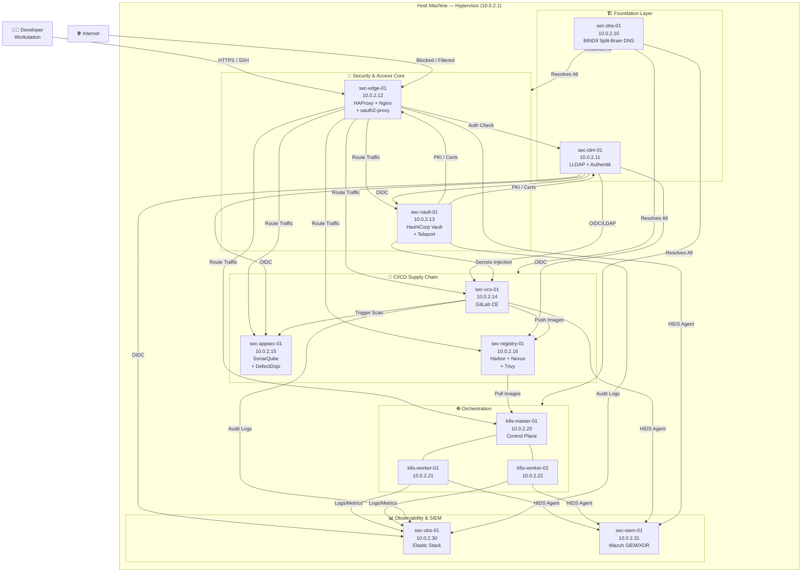
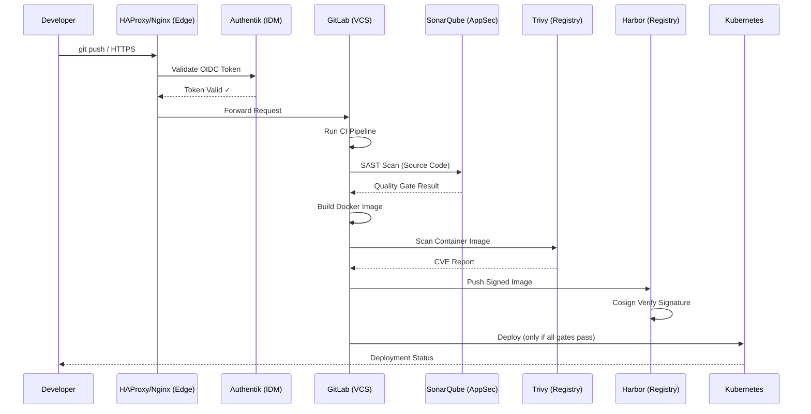
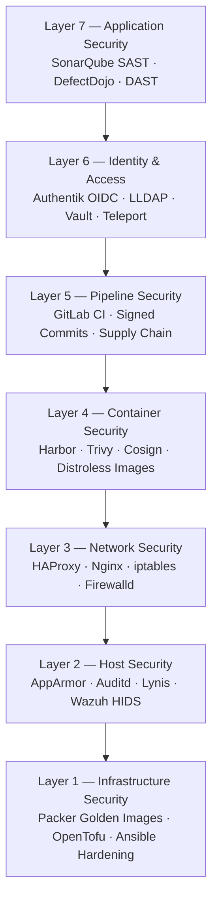

# DevSecOps Lab Book — Zero to Hero

## Master Plan & Full Architecture Reference

### Edition 2026 | Advanced Engineering Track

---

> **Who This Book Is For**
> 
> You don't need to be a security expert to start this book. You need to be curious, patient, and willing to understand _why_ before _how_. By the last chapter, you will have built a production-grade DevSecOps platform from scratch — every service, every certificate, every firewall rule — with your own hands and your own understanding.
> 
> Every command in this book is explained. Not just _what_ to run, but _why_ it exists, _what problem it solves_, and _what breaks if you skip it_.

---

## Table of Contents — Complete Course

```
00  Master Plan (this file)
│
├── PHASE 1 — Foundation
│   ├── 01  Host Preparation & Hypervisor Setup
│   ├── 02  VM Provisioning Strategy
│   ├── 03  Network Architecture & IP Planning
│   ├── 04  BIND9 — DNS Deep Dive
│   │   └── 04-SEC  BIND9 Security Series (7 Parts)
│   └── 05  LLDAP + Authentik — Identity Deep Dive
│       └── 05-SEC  Identity Security Series (7 Parts)
│
├── PHASE 2 — Immutable Infrastructure
│   ├── 06  Packer — Golden Image Creation
│   │   └── 06-SEC  Packer Security Series (7 Parts)
│   ├── 07  OpenTofu — Infrastructure as Code
│   │   └── 07-SEC  OpenTofu Security Series (7 Parts)
│   └── 08  Ansible — Configuration Management
│       └── 08-SEC  Ansible Security Series (7 Parts)
│
├── PHASE 3 — Security & Access Core
│   ├── 09  HAProxy — Load Balancing & SSL Termination
│   ├── 10  Nginx — Reverse Proxy & Web Gateway
│   ├── 11  oauth2-proxy — AuthN/AuthZ Middleware
│   ├── 12  HashiCorp Vault — Secrets Management
│   └── 13  Teleport — Zero Trust Access
│
├── PHASE 4 — CI/CD Supply Chain Security
│   ├── 14  GitLab CE — Source Control & Pipelines
│   ├── 15  SonarQube — Static Analysis (SAST)
│   ├── 16  DefectDojo — Vulnerability Management
│   ├── 17  Harbor — Container Registry
│   ├── 18  Nexus Repository Manager — Artifact Store
│   └── 19  Trivy — Container & IaC Scanning
│
├── PHASE 5 — Orchestration
│   ├── 20  Kubernetes — Cluster Setup
│   ├── 21  Kubernetes — Security Hardening
│   └── 22  Kubernetes — GitOps with Flux/ArgoCD
│
├── PHASE 6 — Observability & SIEM
│   ├── 23  Elastic Stack (ELK) — Centralized Logging
│   └── 24  Wazuh — HIDS/XDR/SIEM
│
└── PHASE 7 — Cross-Cutting Security Controls
    ├── 25  iptables & Firewalld
    ├── 26  AppArmor — Mandatory Access Control
    ├── 27  Chrony — Time Synchronization
    └── 28  Auditd + Lynis — System Auditing
```

---

## The Complete VM Inventory

> **Reading this table:** Every VM in this lab has a purpose. The "Role" column tells you what security domain the machine serves. The "Resources" column is the _minimum_ for the lab to function — real production deployments would use more.

|#|Hostname|IP Address|Role|vCPU|RAM|Disk|OS|
|---|---|---|---|---|---|---|---|
|1|sec-dns-01|10.0.2.10|DNS Authority (BIND9, Split-Brain)|2|2 GB|20 GB|Ubuntu 22.04 LTS|
|2|sec-idm-01|10.0.2.11|Identity Provider (LLDAP + Authentik)|4|6 GB|40 GB|Ubuntu 22.04 LTS|
|3|sec-edge-01|10.0.2.12|Edge Proxy (HAProxy + Nginx + oauth2-proxy)|4|4 GB|30 GB|Ubuntu 22.04 LTS|
|4|sec-vault-01|10.0.2.13|Secrets + Zero Trust (Vault + Teleport)|4|4 GB|40 GB|Ubuntu 22.04 LTS|
|5|sec-vcs-01|10.0.2.14|Version Control (GitLab CE)|8|8 GB|80 GB|Ubuntu 22.04 LTS|
|6|sec-appsec-01|10.0.2.15|AppSec (SonarQube + DefectDojo)|4|8 GB|60 GB|Ubuntu 22.04 LTS|
|7|sec-registry-01|10.0.2.16|Artifact Store (Harbor + Nexus + Trivy)|4|8 GB|100 GB|Ubuntu 22.04 LTS|
|8|k8s-cp-01|10.0.2.20|Kubernetes Control Plane 1 (etcd, API, scheduler)|4|6 GB|60 GB|Ubuntu 22.04 LTS|
|9|k8s-cp-02|10.0.2.21|Kubernetes Control Plane 2 (etcd, API, scheduler)|4|6 GB|60 GB|Ubuntu 22.04 LTS|
|10|k8s-cp-03|10.0.2.22|Kubernetes Control Plane 3 (etcd, API, scheduler)|4|6 GB|60 GB|Ubuntu 22.04 LTS|
|11|k8s-worker-01|10.0.2.23|Kubernetes Worker Node 1|4|8 GB|80 GB|Ubuntu 22.04 LTS|
|12|k8s-worker-02|10.0.2.24|Kubernetes Worker Node 2|4|8 GB|80 GB|Ubuntu 22.04 LTS|
|13|sec-obs-01|10.0.2.30|Observability (Elastic Stack / ELK)|6|12 GB|120 GB|Ubuntu 22.04 LTS|
|14|sec-siem-01|10.0.2.31|SIEM/XDR (Wazuh)|4|8 GB|80 GB|Ubuntu 22.04 LTS|
|—|(Host Machine)|10.0.2.1|Hypervisor / Gateway|—|—|—|Any Linux or macOS|

**Total Minimum Resources:**

- vCPU: 56 cores (added 2 more for 2 additional control plane nodes)
- RAM: 94 GB (added 12 GB for 2 additional control plane nodes)
- Disk: ~890 GB

> **Lab Tip — Resource Constrained?** Run phases sequentially. Snapshot VMs when done, shut them down, spin up the next phase. A 32 GB / 8-core host can complete every phase this way. This is itself a real DevOps practice: treating lab environments as cattle, not pets.

---

## Network Architecture

### IP & Subnet Planning

```
Network:    10.0.2.0/24
Gateway:    10.0.2.1   (Host / Hypervisor)
Broadcast:  10.0.2.255

Range Allocation:
  .1        → Host / Router / Default Gateway
  .10–.19   → Foundation Layer (DNS, IDM)
  .12–.13   → Security Core (Edge, Vault)   ← overlaps intentionally: core security
  .14–.16   → CI/CD Supply Chain
  .20–.24   → Kubernetes Cluster (3x Control Plane + 2x Workers)
  .30–.39   → Observability & SIEM
```

### Domain Naming Convention

```
Internal domain:  devsecops.com
Internal zone:    internal.devsecops.com

Full hostnames:
  sec-dns-01.devsecops.com       → 10.0.2.10
  sec-idm-01.devsecops.com       → 10.0.2.11
  sec-edge-01.devsecops.com      → 10.0.2.12
  sec-vault-01.devsecops.com     → 10.0.2.13
  sec-vcs-01.devsecops.com       → 10.0.2.14
  sec-appsec-01.devsecops.com    → 10.0.2.15
  sec-registry-01.devsecops.com  → 10.0.2.16
  k8s-master-01.devsecops.com    → 10.0.2.20
  k8s-worker-01.devsecops.com    → 10.0.2.21
  k8s-worker-02.devsecops.com    → 10.0.2.22
  sec-obs-01.devsecops.com       → 10.0.2.30
  sec-siem-01.devsecops.com      → 10.0.2.31

Service CNAMEs (resolved by BIND9):
  gitlab.devsecops.com           → sec-vcs-01
  vault.devsecops.com            → sec-vault-01
  harbor.devsecops.com           → sec-registry-01
  sonar.devsecops.com            → sec-appsec-01
  auth.devsecops.com             → sec-idm-01
  kibana.devsecops.com           → sec-obs-01
  wazuh.devsecops.com            → sec-siem-01
```

---

## Full Architecture Diagram



---

## Traffic Flow: A Developer Pushes Code

> Understanding this flow is worth 10 hours of reading documentation. This is what you are building. Every chapter adds one more layer.



---

## The Seven Security Layers (Defense-in-Depth Model)

> Every tool in this lab maps to one or more of these layers. A mature DevSecOps platform has controls at _every_ layer.



---

## How to Use This Book

### Chapter Structure — Every Chapter Follows This Format

```
1. Why This Tool Exists         ← The problem it solves
2. Core Concepts                ← Mental models, analogies
3. Architecture in Our Lab      ← How it fits our specific design
4. Installation                 ← Step-by-step with explanations
5. Configuration                ← Every important setting explained
6. Integration                  ← How it talks to other tools
7. Validation & Testing         ← Prove it works
8. Troubleshooting              ← Real errors with real fixes
9. Exercises                    ← Hands-on labs with solutions
10. Security Series (7 parts)   ← Deep security hardening
```

### Security Series Structure — Every Tool Gets These 7 Parts

```
Part 1 — Threat Model: What can go wrong with this tool?
Part 2 — Authentication Hardening
Part 3 — Authorization & Least Privilege
Part 4 — Encryption in Transit & at Rest
Part 5 — Audit Logging & Alerting
Part 6 — Backup, Recovery & Business Continuity
Part 7 — Compliance Mapping (CIS / NIST / SOC2)
```

---

## Phase Overview Cards

### Phase 1 — Foundation (Chapters 01–05)

**Goal:** A working network, DNS, and identity platform. **Output:** Every VM can resolve names. Every service has a user directory. **Why first?** Nothing else works without DNS and identity. These are the bedrock.

### Phase 2 — Immutable Infrastructure (Chapters 06–08)

**Goal:** Reproducible, auditable VM creation and configuration. **Output:** Golden images, Infrastructure-as-Code, idempotent configuration. **Why second?** You need to be able to rebuild the entire lab from code.

### Phase 3 — Security & Access Core (Chapters 09–13)

**Goal:** All traffic flows through authenticated, encrypted proxies. Secrets are managed. **Output:** TLS everywhere, zero-trust access, no plaintext credentials. **Why third?** Before connecting services together, secure the connections.

### Phase 4 — CI/CD Supply Chain (Chapters 14–19)

**Goal:** A pipeline that enforces security gates before anything reaches production. **Output:** Code is scanned, images are signed, artifacts are tracked. **Why fourth?** The CI/CD pipeline is the highest-value attack surface.

### Phase 5 — Orchestration (Chapters 20–22)

**Goal:** Workloads run in a secure, policy-enforced Kubernetes cluster. **Output:** RBAC, NetworkPolicy, PodSecurityStandards, GitOps. **Why fifth?** Kubernetes security builds on everything before it.

### Phase 6 — Observability & SIEM (Chapters 23–24)

**Goal:** See everything that happens. Alert on anything suspicious. **Output:** Centralized logs, dashboards, HIDS alerts, incident playbooks. **Why sixth?** Detection requires full visibility across all systems.

### Phase 7 — Cross-Cutting Controls (Chapters 25–28)

**Goal:** Host-level hardening applied consistently across all VMs. **Output:** Firewall rules, mandatory access control, time sync, audit trails. **Why seventh (but applied throughout)?** These are applied to every machine as it's provisioned. Chapter 7 documents them as a standalone reference.

---

## Conventions Used in This Book

```
# Shell commands you run on the HOST (your laptop/desktop)
$ command

# Shell commands you run INSIDE a VM
vm# command

# Commands run as root inside a VM
vm-root# command

# File contents — the filename appears above the block
# /etc/example/config.yaml
key: value

# Expected output from a command
→ output line 1
→ output line 2

# A warning
⚠️  This will break X if you skip Y.

# A security note
🔐 This setting prevents credential exposure.

# A real-world analogy
🏗️  Think of this like...

# A key takeaway
💡 Key Takeaway: ...
```

---

_Next: Chapter 01 — Host Preparation & Hypervisor Setup_