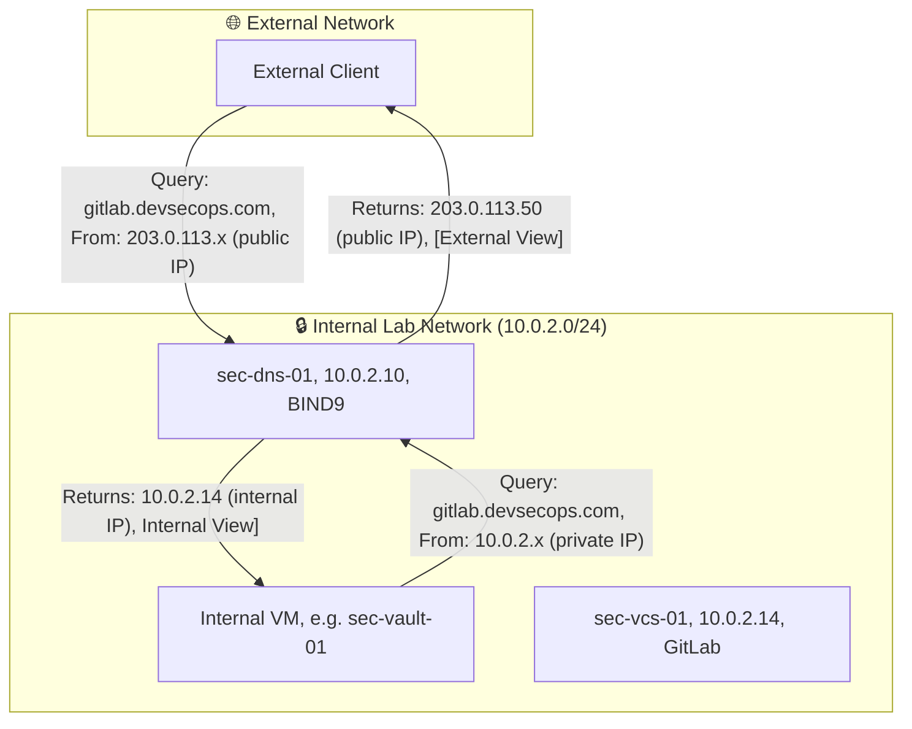
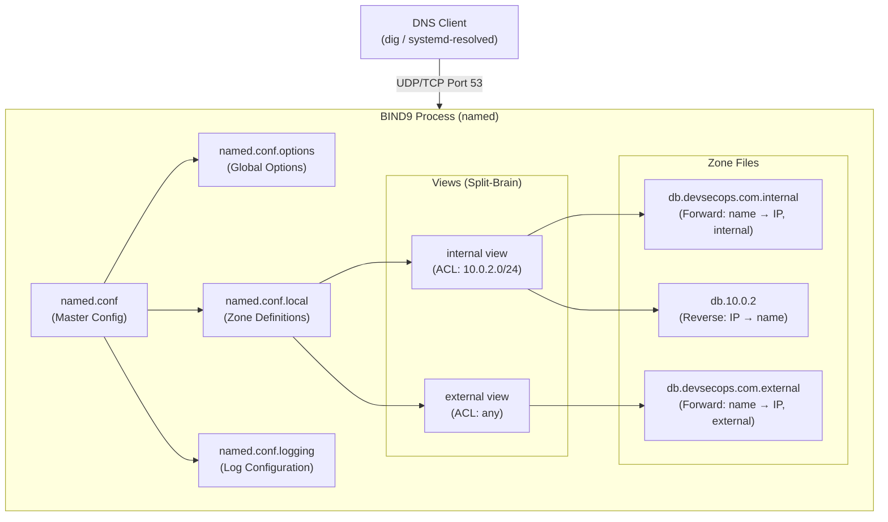

# Chapter 02 — BIND9: Split-Brain DNS Deep Dive

## 2.1 Why DNS Exists — The Problem It Solves

Imagine you have a friend named Sarah. You don't memorize her phone number (+1-415-555-0142) — you just search "Sarah" in your contacts. The address book translates _names_ to _numbers_ so humans don't have to.

🏗️ **Analogy:** DNS is the internet's address book. When a browser visits `gitlab.devsecops.com`, it has no idea what that means at the network layer. The network only understands IP addresses like `10.0.2.14`. DNS translates the human-readable name into the machine-readable number.

### What Breaks Without DNS

In our lab, without DNS:

- You cannot use `PasswordAuthentication` with hostname-based SSH configs
- TLS certificates (HTTPS) cannot be issued — they require valid DNS names
- Authentik's OIDC redirects require a domain name, not an IP
- Kubernetes service discovery depends on DNS
- LDAP cannot use FQDN-based binds
- Log correlation becomes impossible (logs show IPs, not hostnames)

> 💡 **Key Takeaway:** DNS is not a convenience feature. It is the prerequisite for virtually every other service in this lab. This is why it is Chapter 02 (right after the host setup) — nothing meaningful works until DNS works.

---

## 2.2 What is Split-Brain DNS?

Split-brain DNS (also called split-horizon DNS) is a configuration where the **same domain name resolves to different IP addresses depending on who is asking**.

### The Problem Split-Brain Solves

Consider `gitlab.devsecops.com`:

- **Inside the lab network:** It should resolve to `10.0.2.14` (the internal IP). Traffic stays local, no hairpinning through the internet.
- **From the outside world** (if exposed): It should resolve to a public IP. The internal `10.0.2.14` is a private address — useless to the public internet.



> 🔐 **Security Benefit:** Split-brain DNS also prevents information leakage. External clients never see your internal IP scheme. They only see what you deliberately expose.

---

## 2.3 BIND9 Architecture Overview

BIND9 (Berkeley Internet Name Domain, version 9) is the most widely deployed DNS server in the world. Understanding its architecture helps you configure it correctly and troubleshoot problems faster.



### Key BIND9 Concepts

|Concept|Definition|Lab Usage|
|---|---|---|
|**Zone**|A portion of the DNS namespace managed by this server|`devsecops.com` zone|
|**Forward Zone**|Maps names → IP addresses (`A` records)|`gitlab.devsecops.com → 10.0.2.14`|
|**Reverse Zone**|Maps IP addresses → names (`PTR` records)|`10.0.2.14 → sec-vcs-01.devsecops.com`|
|**View**|A named set of zones served to a specific set of clients (ACL)|`internal` vs `external`|
|**ACL**|Access Control List — defines who can use which view|`10.0.2.0/24` = internal clients|
|**SOA Record**|Start of Authority — metadata about the zone (serial, refresh)|Required in every zone|
|**NS Record**|Name Server — declares who is authoritative for this zone|Points to sec-dns-01|
|**A Record**|Address — maps a name to an IPv4 address|Core record type|
|**CNAME**|Canonical Name — alias from one name to another|`gitlab → sec-vcs-01`|
|**PTR**|Pointer — maps an IP to a name (reverse lookup)|Used by SSH, logging, SIEM|

---

## 2.4 Installation

Log into `sec-dns-01` and run these commands:

```bash
$ ssh sec-dns-01
```

### Step 1 — Install BIND9

```bash
# Install BIND9 and its utilities
sudo apt update
sudo apt install -y bind9 bind9utils bind9-doc dnsutils

```

**What each package does:**

|Package|Purpose|
|---|---|
|`bind9`|The BIND9 daemon (`named`) — the actual DNS server|
|`bind9utils`|Utilities: `named-checkconf`, `named-checkzone` — validate config before applying|
|`bind9-doc`|Documentation (useful for referencing record types offline)|
|`dnsutils`|`dig`, `nslookup`, `host` — DNS query tools for testing|

```bash
# Verify BIND9 is installed
named -v
```

```
# Expected output:
→ BIND 9.18.x-Ubuntu (Extended Support Version) <...>
```

### Step 2 — Verify Service Status

```bash
# BIND9 starts automatically after install
sudo systemctl status bind9
```

```
# Expected output:
→ ● named.service - BIND Domain Name Server
→      Active: active (running) since ...
→      ...
→ Nov 01 12:00:00 sec-dns-01 named[1234]: command channel listening on 127.0.0.1#953
→ Nov 01 12:00:00 sec-dns-01 named[1234]: managed-keys-zone: Key 20326 ...
```

> ⚠️ BIND9 binds to port 53 (both UDP and TCP). Verify:

```bash
sudo ss -tulnp | grep named
```

```
→ udp   UNCONN 0  0  0.0.0.0:53  0.0.0.0:*  users:(("named",pid=...,fd=...))
→ tcp   LISTEN 0  10 0.0.0.0:53  0.0.0.0:*  users:(("named",pid=...,fd=...))
```

---

## 2.5 Configuration — The Full Build

BIND9's configuration is split across multiple files. We write each one in order.

### File Structure

```
/etc/bind/
├── named.conf                    ← Master config (includes others)
├── named.conf.options            ← Global server options
├── named.conf.local              ← Our zone + view definitions
├── named.conf.logging            ← Logging configuration
└── zones/
    ├── db.devsecops.com.internal ← Internal forward zone
    ├── db.devsecops.com.external ← External forward zone
    └── db.10.0.2                 ← Reverse zone (PTR records)
```

### Step 1 — Create the Zones Directory

```bash
sudo mkdir -p /etc/bind/zones
sudo chown -R bind:bind /etc/bind/zones
```

### Step 2 — named.conf.options

This file configures BIND9's global behaviour — how it handles recursion, forwarders, rate limiting, and security settings.

```bash
# /etc/bind/named.conf.options
sudo tee /etc/bind/named.conf.options > /dev/null << 'EOF'
options {
    /*
     * The working directory for BIND9.
     * Zone files are stored here if not using absolute paths.
     */
    directory "/var/cache/bind";

    /*
     * Forwarders: When BIND9 cannot answer a query from its own zones,
     * it forwards the query to these servers.
     * We use Cloudflare (1.1.1.1) and Google (8.8.8.8) as fallbacks.
     * In a real high-security environment, you would use your own recursive
     * resolver or your ISP's DNS — not public resolvers.
     */
    forwarders {
        1.1.1.1;
        8.8.8.8;
    };

    /*
     * forward only: Never try to resolve from root hints.
     * Always forward external queries to the forwarders above.
     * This limits information exposure and is faster in a lab.
     */
    forward only;

    /*
     * dnssec-validation: Validate DNSSEC signatures on external DNS responses.
     * "auto" uses the built-in root trust anchor.
     * This protects against DNS spoofing/poisoning attacks.
     */
    dnssec-validation no;

    /*
     * listen-on: Which interfaces BIND9 listens on.
     * We listen on localhost AND the lab interface.
     * Never listen on all interfaces in production without ACLs.
     */
    listen-on {
        127.0.0.1;
        10.0.2.10;
    };

    /*
     * listen-on-v6: Disable IPv6 for this lab.
     * Reduces attack surface. Enable if your environment uses IPv6.
     */
    listen-on-v6 { none; };

    /*
     * allow-query: Who can query this server for non-authoritative data.
     * We override this per-view, but set a safe default here.
     * 'localnets' = the local network (10.0.2.0/24 and localhost).
     */
    allow-query { localnets; localhost; };

    /*
     * allow-recursion: Who can use this server as a recursive resolver.
     * CRITICAL: Never allow recursion from the public internet.
     * Open recursors are abused for DNS amplification DDoS attacks.
     */
    # allow-recursion { localnets; localhost; };

    /*
     * allow-transfer: Who can receive a full copy of zone data (AXFR).
     * Zone transfers expose your entire DNS to the requester.
     * Default: nobody. Override per-zone for secondary DNS servers.
     */
    allow-transfer { none; };

    /*
     * recursion: Enable recursive queries for internal clients.
     * Required so internal VMs can resolve external names (e.g., ubuntu.com).
     */
    # recursion yes;

    /*
     * Rate limiting: Prevent DNS amplification attacks.
     * Limits how many responses per second BIND9 sends to any single IP.
     */
    rate-limit {
        responses-per-second 10;
        window 5;
    };

    /*
     * Max cache size: Prevent memory exhaustion from cache poisoning.
     */
    max-cache-size 64m;

    /*
     * Version: Hide the BIND9 version from version queries.
     * Running 'dig chaos txt version.bind @10.0.2.10' should return this string,
     * not the actual version (which attackers use to find CVEs).
     */
    version "DNS Server";
};
EOF
```

### Step 3 — named.conf.logging

Good logging is the difference between debugging in 10 minutes and 10 hours.

```bash
# /etc/bind/named.conf.logging
sudo tee /etc/bind/named.conf.logging > /dev/null << 'EOF'
logging {
    /*
     * BIND9 uses "channels" (output destinations) and "categories" (event types).
     * We define channels first, then assign categories to them.
     */

    /* Channel 1: Write to a dedicated log file */
    channel bind_log {
        file "/var/log/named/named.log" versions 5 size 20m;
        severity dynamic;
        print-time yes;
        print-severity yes;
        print-category yes;
    };

    /* Channel 2: Write security events to a separate file */
    channel security_log {
        file "/var/log/named/security.log" versions 5 size 10m;
        severity info;
        print-time yes;
        print-severity yes;
        print-category yes;
    };

    /* Channel 3: Send to syslog (picked up by rsyslog → Elastic Stack) */
    channel syslog_channel {
        syslog daemon;
        severity info;
    };

    /* Assign categories to channels */
    category default         { bind_log; syslog_channel; };
    category queries         { bind_log; };          /* Every DNS query */
    category security        { security_log; bind_log; }; /* ACL violations, TSIG */
    category config          { bind_log; };          /* Config loading events */
    category dnssec          { bind_log; };          /* DNSSEC validation events */
    category xfer-in         { bind_log; };          /* Zone transfer inbound */
    category xfer-out        { bind_log; };          /* Zone transfer outbound */
    category update          { bind_log; };          /* Dynamic DNS updates */
    category notify          { bind_log; };          /* Zone change notifications */
    category resolver        { bind_log; };          /* Recursive resolution */
    category lame-servers    { null; };              /* Suppress noisy lame-server msgs */
};
EOF
```

```bash
# Create the log directory and set ownership
sudo mkdir -p /var/log/named
sudo chown bind:bind /var/log/named
sudo chmod 750 /var/log/named
```

### Step 4 — Internal Forward Zone

This zone file defines what internal clients see when they query `devsecops.com`.

```bash
# /etc/bind/zones/db.devsecops.com.internal
sudo tee /etc/bind/zones/db.devsecops.com.internal > /dev/null << 'EOF'
;
; BIND9 Zone File — Internal View
; Domain: devsecops.com
; Served to: 10.0.2.0/24 (internal lab network)
;
; IMPORTANT: The serial number (2026010101) MUST be incremented every time
; this file changes. Secondary DNS servers use the serial to decide whether
; to update their copy. Format: YYYYMMDDnn (date + 2-digit sequence number).
;

$TTL 300    ; Default TTL: 300 seconds (5 minutes)
            ; Short TTL is fine in a lab — faster propagation of changes.
            ; Production zones typically use 3600 (1 hour) or 86400 (1 day).

; SOA (Start of Authority) — Required in every zone file. First record.
; Format: <zone> IN SOA <primary-ns> <admin-email> (serial refresh retry expire min-ttl)
@   IN  SOA sec-dns-01.devsecops.com. admin.devsecops.com. (
            2026010101  ; Serial   — increment on every change
            3600        ; Refresh  — secondary polls primary every 1 hour
            900         ; Retry    — retry after failure every 15 minutes
            604800      ; Expire   — give up after 7 days without contact
            300         ; Minimum  — negative caching TTL (NXDOMAIN)
        )

; NS (Name Server) — Declares who is authoritative for this zone
@   IN  NS  sec-dns-01.devsecops.com.

;
; ─────────────────────────────────────────────
; INFRASTRUCTURE SERVERS (A Records)
; ─────────────────────────────────────────────
;
; A record format: <name> <ttl> IN A <IPv4-address>
; The '@' symbol means "the zone apex" (devsecops.com itself)
;

; Foundation Layer
sec-dns-01      IN  A   10.0.2.10
sec-idm-01      IN  A   10.0.2.11

; Security Core
sec-edge-01     IN  A   10.0.2.12
sec-vault-01    IN  A   10.0.2.13

; CI/CD Supply Chain
sec-vcs-01      IN  A   10.0.2.14
sec-appsec-01   IN  A   10.0.2.15
sec-registry-01 IN  A   10.0.2.16

; Kubernetes Cluster
k8s-master-01   IN  A   10.0.2.20
k8s-worker-01   IN  A   10.0.2.21
k8s-worker-02   IN  A   10.0.2.22

; Observability
sec-obs-01      IN  A   10.0.2.30
sec-siem-01     IN  A   10.0.2.31

;
; ─────────────────────────────────────────────
; SERVICE CNAMEs (Human-Friendly Names)
; ─────────────────────────────────────────────
;
; CNAME records create aliases. Instead of remembering that GitLab is on
; sec-vcs-01, you can just use gitlab.devsecops.com.
;
; CNAME format: <alias> IN CNAME <canonical-hostname>.
; Note the trailing dot (.) — required. Without it, BIND appends the zone name.
;

; Identity & Auth
auth            IN  CNAME   sec-idm-01.devsecops.com.
ldap            IN  CNAME   sec-idm-01.devsecops.com.
sso             IN  CNAME   sec-idm-01.devsecops.com.

; Edge & Access
edge            IN  CNAME   sec-edge-01.devsecops.com.
proxy           IN  CNAME   sec-edge-01.devsecops.com.

; Secrets & Zero Trust
vault           IN  CNAME   sec-vault-01.devsecops.com.
teleport        IN  CNAME   sec-vault-01.devsecops.com.

; CI/CD
gitlab          IN  CNAME   sec-vcs-01.devsecops.com.
git             IN  CNAME   sec-vcs-01.devsecops.com.

; AppSec
sonar           IN  CNAME   sec-appsec-01.devsecops.com.
sonarqube       IN  CNAME   sec-appsec-01.devsecops.com.
defectdojo      IN  CNAME   sec-appsec-01.devsecops.com.
dojo            IN  CNAME   sec-appsec-01.devsecops.com.

; Registry
harbor          IN  CNAME   sec-registry-01.devsecops.com.
nexus           IN  CNAME   sec-registry-01.devsecops.com.
registry        IN  CNAME   sec-registry-01.devsecops.com.

; Kubernetes API
k8s             IN  CNAME   k8s-master-01.devsecops.com.
kubernetes      IN  CNAME   k8s-master-01.devsecops.com.

; Observability
kibana          IN  CNAME   sec-obs-01.devsecops.com.
elasticsearch   IN  CNAME   sec-obs-01.devsecops.com.
elk             IN  CNAME   sec-obs-01.devsecops.com.
wazuh           IN  CNAME   sec-siem-01.devsecops.com.
siem            IN  CNAME   sec-siem-01.devsecops.com.

;
; ─────────────────────────────────────────────
; WILDCARD RECORD (Optional but useful)
; ─────────────────────────────────────────────
;
; Any subdomain not explicitly defined above will resolve to the edge proxy.
; This supports dynamic application URLs without adding DNS records per app.
; *.devsecops.com → sec-edge-01 → routes to correct backend
;
*               IN  CNAME   sec-edge-01.devsecops.com.

EOF
```

### Step 5 — External Forward Zone

This is what the outside world would see (in a real deployment). For the lab, it's mostly a placeholder — but it teaches the split-brain pattern correctly.

```bash
# /etc/bind/zones/db.devsecops.com.external
sudo tee /etc/bind/zones/db.devsecops.com.external > /dev/null << 'EOF'
;
; BIND9 Zone File — External View
; Domain: devsecops.com
; Served to: any (external clients)
;
; In a real deployment, these would be public IPs.
; In the lab, external queries are answered with minimal records.
; External clients should only see what we deliberately expose.
;

$TTL 3600

@   IN  SOA sec-dns-01.devsecops.com. admin.devsecops.com. (
            2026010101
            3600
            900
            604800
            300
        )

@   IN  NS  sec-dns-01.devsecops.com.

sec-dns-01 IN A 10.0.2.10

; In a real deployment, this would be your public IP.
; In the lab, we point to the edge (sec-edge-01) which handles all public traffic.
@           IN  A   10.0.2.12

; Only expose what's meant to be publicly accessible.
; Notice: NO internal hostnames, NO infrastructure IPs.
gitlab      IN  A   10.0.2.12
harbor      IN  A   10.0.2.12
vault       IN  A   10.0.2.12

EOF
```

### Step 6 — Reverse Zone (PTR Records)

Reverse DNS maps IP addresses back to hostnames. Required for:

- SSH connection logging
- SIEM log enrichment (IPs appear as hostnames)
- Many authentication systems
- Email anti-spam (SPF/DKIM rely on reverse DNS)

```bash
# /etc/bind/zones/db.10.0.2
sudo tee /etc/bind/zones/db.10.0.2 > /dev/null << 'EOF'
;
; BIND9 Reverse Zone File
; Zone: 2.0.10.in-addr.arpa
; Maps 10.0.2.x → hostnames
;
; The reverse zone name looks backwards because DNS reads right-to-left.
; The zone '2.0.10.in-addr.arpa' covers all IPs in 10.0.2.0/24.
;
; PTR record format:
; <last-octet>   IN  PTR  <fully-qualified-hostname>.
; Example: 10   IN  PTR  sec-dns-01.devsecops.com.
; This means: 10.0.2.10 → sec-dns-01.devsecops.com
;

$TTL 300

@   IN  SOA sec-dns-01.devsecops.com. admin.devsecops.com. (
            2026010101
            3600
            900
            604800
            300
        )

@   IN  NS  sec-dns-01.devsecops.com.

; PTR Records — last octet only (zone provides the rest)
1   IN  PTR gateway.devsecops.com.        ; 10.0.2.1 → Host machine
10  IN  PTR sec-dns-01.devsecops.com.     ; 10.0.2.10
11  IN  PTR sec-idm-01.devsecops.com.     ; 10.0.2.11
12  IN  PTR sec-edge-01.devsecops.com.    ; 10.0.2.12
13  IN  PTR sec-vault-01.devsecops.com.   ; 10.0.2.13
14  IN  PTR sec-vcs-01.devsecops.com.     ; 10.0.2.14
15  IN  PTR sec-appsec-01.devsecops.com.  ; 10.0.2.15
16  IN  PTR sec-registry-01.devsecops.com.; 10.0.2.16
20  IN  PTR k8s-master-01.devsecops.com.  ; 10.0.2.20
21  IN  PTR k8s-worker-01.devsecops.com.  ; 10.0.2.21
22  IN  PTR k8s-worker-02.devsecops.com.  ; 10.0.2.22
30  IN  PTR sec-obs-01.devsecops.com.     ; 10.0.2.30
31  IN  PTR sec-siem-01.devsecops.com.    ; 10.0.2.31

EOF
```

### Step 7 — named.conf.local (Views Definition)

This is the heart of split-brain DNS. We define two views: `internal` and `external`.

```bash
# /etc/bind/named.conf.local
sudo tee /etc/bind/named.conf.local > /dev/null << 'EOF'
//
// named.conf.local
// Defines ACLs and Views for split-brain DNS
//

//
// ─────────────────────────────────────────────
// ACCESS CONTROL LISTS (ACLs)
// ─────────────────────────────────────────────
// ACLs define groups of IP addresses.
// We reference these ACL names in the view match-clients statements.
//

acl "internal_clients" {
    10.0.2.0/24;    // Our lab network
    127.0.0.1;      // Localhost
    ::1;            // IPv6 localhost
};

//
// ─────────────────────────────────────────────
// INTERNAL VIEW
// Served to: internal_clients ACL
// Shows real internal IPs
// ─────────────────────────────────────────────
//
view "internal" {

    // Only respond with this view to internal clients
    match-clients { internal_clients; };

    // Allow internal clients to perform recursive lookups
    // (so they can resolve external names like ubuntu.com)
    recursion yes;
    allow-recursion { internal_clients; };

    // Allow internal clients to query our zones
    allow-query { internal_clients; };

    //
    // Internal Forward Zone
    // Authoritative for devsecops.com — returns real internal IPs
    //
    zone "devsecops.com" {
        type master;        // We are the authoritative (primary) server
        file "/etc/bind/zones/db.devsecops.com.internal";
        allow-update { none; };   // No dynamic DNS updates (we manage manually)
        allow-transfer { none; }; // No zone transfers (no secondary DNS in lab)
        notify no;
    };

    //
    // Reverse Zone
    // 2.0.10.in-addr.arpa covers the 10.0.2.0/24 subnet
    //
    zone "2.0.10.in-addr.arpa" {
        type master;
        file "/etc/bind/zones/db.10.0.2";
        allow-update { none; };
        allow-transfer { none; };
        notify no;
    };

    //
    // Root hints — needed for recursive resolution of external names
    //
    zone "." {
        type hint;
        file "/usr/share/dns/root.hints";
    };

    //
    // Localhost zones — standard, required for correct loopback behavior
    //
    zone "localhost" {
        type master;
        file "/etc/bind/db.local";
    };

    zone "127.in-addr.arpa" {
        type master;
        file "/etc/bind/db.127";
    };

    zone "0.in-addr.arpa" {
        type master;
        file "/etc/bind/db.0";
    };

    zone "255.in-addr.arpa" {
        type master;
        file "/etc/bind/db.255";
    };
};

//
// ─────────────────────────────────────────────
// EXTERNAL VIEW
// Served to: anyone not matching internal ACL
// Shows only publicly-safe information
// ─────────────────────────────────────────────
//
view "external" {

    // Match anyone not already matched by the internal view
    match-clients { any; };

    // No recursion for external clients — prevents open resolver abuse
    recursion no;

    // Allow external queries to our authoritative zones only
    allow-query { any; };

    //
    // External Forward Zone — limited, public-safe records only
    //
    zone "devsecops.com" {
        type master;
        file "/etc/bind/zones/db.devsecops.com.external";
        allow-update { none; };
        allow-transfer { none; };
        notify no;
    };
};

EOF
```

### Step 8 — Master named.conf (Assembles Everything)

```bash
# /etc/bind/named.conf
sudo tee /etc/bind/named.conf > /dev/null << 'EOF'
/*
 * named.conf — Master BIND9 Configuration
 * This file only includes the other files.
 * Keeping it minimal makes it easy to see the overall structure.
 */

include "/etc/bind/named.conf.options";
include "/etc/bind/named.conf.logging";
include "/etc/bind/named.conf.local";

EOF
```

### Step 9 — Set Correct File Ownership

```bash
# BIND9 runs as the 'bind' user.
# All config and zone files must be readable by bind.
sudo chown -R root:bind /etc/bind
sudo chmod -R 640 /etc/bind/*.conf
sudo chmod -R 640 /etc/bind/zones/*
sudo chmod 750 /etc/bind/zones
```

---

## 2.6 Validation Before Starting BIND9

Always validate configuration _before_ reloading. BIND9 provides two tools for this:

### Validate the Main Config

```bash
# named-checkconf parses all included files.
# A clean config produces no output.
sudo named-checkconf
```

```
# Expected output (success = silence):
→ (no output)

# If there's an error, it shows the file and line number:
→ /etc/bind/named.conf.local:45: unknown option 'recusion'
```

> 💡 **Key Takeaway:** `named-checkconf` returning nothing is success. Unlike most Unix tools, silence means "everything is correct."

### Validate Each Zone File

```bash
# named-checkzone validates a zone file's syntax and record consistency
# Format: named-checkzone <zone-name> <zone-file>

sudo named-checkzone devsecops.com /etc/bind/zones/db.devsecops.com.internal

sudo named-checkzone devsecops.com /etc/bind/zones/db.devsecops.com.external

sudo named-checkzone 2.0.10.in-addr.arpa /etc/bind/zones/db.10.0.2
```

```
# Expected output for each (all three must show OK):
→ zone devsecops.com/IN: loaded serial 2026010101
→ OK
```

---

## 2.7 Starting and Enabling BIND9

```bash
# Restart (not reload) after major config changes like adding views
sudo systemctl restart bind9

# Enable on boot
sudo systemctl enable bind9

# Check status — look for 'active (running)'
sudo systemctl status bind9
```

```
# Expected output:
→ ● named.service - BIND Domain Name Server
→      Loaded: loaded (/lib/systemd/system/named.service; enabled)
→      Active: active (running) since ...
→   Main PID: 2345 (named)
→      Tasks: 6 (limit: 2327)
→     Memory: 28.3M
→         ...
→ Nov 01 named[2345]: all zones loaded
→ Nov 01 named[2345]: running
```

> ⚠️ If you see `Failed` instead of `active (running)`, check the logs:

  ```bash
  sudo journalctl -xeu named --no-pager | tail -30
  ```
> 

---

## 2.8 Opening the Firewall

```bash
# Allow DNS traffic (port 53) from the lab network
sudo ufw allow from 10.0.2.0/24 to any port 53 proto tcp
sudo ufw allow from 10.0.2.0/24 to any port 53 proto udp

# Also allow from localhost (for the VM itself)
sudo ufw allow from 127.0.0.1 to any port 53

# Verify
sudo ufw status
```

```
# Expected output:
→ Status: active
→
→ To                         Action      From
→ --                         ------      ----
→ 22/tcp                     ALLOW IN    Anywhere
→ 53/tcp                     ALLOW IN    10.0.2.0/24
→ 53/udp                     ALLOW IN    10.0.2.0/24
→ 53/tcp                     ALLOW IN    127.0.0.1
→ 53/udp                     ALLOW IN    127.0.0.1
```

---

## 2.9 Testing DNS Resolution

Run these tests _from sec-dns-01 itself first_, then from another VM.

### Test 1 — Forward Lookup (Internal View)

```bash
# Query from sec-dns-01 itself (should hit the internal view)
dig @10.0.2.10 sec-vcs-01.devsecops.com A
```

```
# Expected output (key sections):
→ ;; QUESTION SECTION:
→ ;sec-vcs-01.devsecops.com.   IN  A
→
→ ;; ANSWER SECTION:
→ sec-vcs-01.devsecops.com. 300 IN  A  10.0.2.14
→
→ ;; Query time: 1 msec
→ ;; SERVER: 10.0.2.10#53(10.0.2.10)
→ ;; MSG SIZE  rcvd: 62
```

### Test 2 — CNAME Resolution

```bash
dig @10.0.2.10 gitlab.devsecops.com
```

```
# Expected output:
→ ;; ANSWER SECTION:
→ gitlab.devsecops.com.    300 IN  CNAME  sec-vcs-01.devsecops.com.
→ sec-vcs-01.devsecops.com. 300 IN A     10.0.2.14
```

> The resolver follows the CNAME chain automatically. One query, two records returned.

### Test 3 — Reverse Lookup (PTR)

```bash
dig @10.0.2.10 -x 10.0.2.14
```

```
# Expected output:
→ ;; ANSWER SECTION:
→ 14.2.0.10.in-addr.arpa. 300 IN PTR sec-vcs-01.devsecops.com.
```

### Test 4 — All Service CNAMEs

```bash
# Quick-check all CNAMEs in one sweep
for NAME in auth ldap vault gitlab sonar harbor nexus kibana wazuh; do
    RESULT=$(dig @10.0.2.10 +short ${NAME}.devsecops.com)
    printf "%-15s → %s\n" "${NAME}.devsecops.com" "${RESULT}"
done
```

```
# Expected output:
→ auth.devsecops.com  → sec-idm-01.devsecops.com. 10.0.2.11
→ ldap.devsecops.com  → sec-idm-01.devsecops.com. 10.0.2.11
→ vault.devsecops.com → sec-vault-01.devsecops.com. 10.0.2.13
→ gitlab.devsecops.com → sec-vcs-01.devsecops.com. 10.0.2.14
→ sonar.devsecops.com → sec-appsec-01.devsecops.com. 10.0.2.15
→ harbor.devsecops.com → sec-registry-01.devsecops.com. 10.0.2.16
→ nexus.devsecops.com → sec-registry-01.devsecops.com. 10.0.2.16
→ kibana.devsecops.com → sec-obs-01.devsecops.com. 10.0.2.30
→ wazuh.devsecops.com → sec-siem-01.devsecops.com. 10.0.2.31
```

### Test 5 — External View Test

```bash
# Simulate an external query by using a source IP not in the internal ACL.
# We can test this with a specific query option:
dig @10.0.2.10 gitlab.devsecops.com \
    +subnet=203.0.113.1/32   # Fake an external client IP (RFC 5737 test range)
```

```
# Expected output — should return external zone's A record (10.0.2.12, the edge):
→ ;; ANSWER SECTION:
→ gitlab.devsecops.com.  3600  IN  A  10.0.2.12
```

### Test 6 — External Resolution (Recursion)

```bash
# Verify internal clients can resolve external names (forwarding works)
dig @10.0.2.10 ubuntu.com A
```

```
# Expected output — should return Ubuntu's real public IPs:
→ ;; ANSWER SECTION:
→ ubuntu.com.  3600  IN  A  185.125.190.20
→ ubuntu.com.  3600  IN  A  185.125.190.21
```

### Test 7 — Security Check (No External Recursion)

```bash
# From the HOST machine (10.0.2.1), simulate an "external" client
# trying to use our DNS as an open resolver.
# This should fail — recursion must be denied.
dig @10.0.2.10 ubuntu.com A +norecurse
```

```
# Expected — REFUSED or no answer (not NOERROR with a result):
→ ;; ->>HEADER<<- opcode: QUERY, status: REFUSED, id: ...
→ ;; flags: qr rd; QUERY: 1, ANSWER: 0
```

> 🔐 **Security Note:** If this returns actual results, your BIND9 is an **open recursive resolver**. This means anyone on the internet can use your DNS server to perform DNS amplification attacks. Fix by tightening `allow-recursion` in `named.conf.options`.

---

## 2.10 Configuring Other VMs to Use sec-dns-01

Now that BIND9 is running and tested, configure every other VM to use it.

### On Each Non-DNS VM

```bash
# Update Netplan to use sec-dns-01 as the primary DNS
# Remove 8.8.8.8 fallback once you've confirmed BIND9 handles external queries

# Edit /etc/netplan/00-lab-network.yaml
# Change the nameservers block to:

nameservers:
  addresses:
    - 10.0.2.10   # sec-dns-01 — now handles ALL resolution
  search:
    - devsecops.com  # Default search domain

# Apply the change
sudo netplan apply
```

```bash
# Verify DNS is working from another VM (e.g., sec-idm-01)
resolvectl status
```

```
# Expected output:
→ Global
→        DNS Servers: 10.0.2.10
	→ Search Domains: devsecops.comw
```

```bash
# Test resolution from sec-idm-01
dig vault.devsecops.com
```

```
# Expected:
→ vault.devsecops.com.  300 IN CNAME sec-vault-01.devsecops.com.
→ sec-vault-01.devsecops.com. 300 IN A 10.0.2.13
```

---

## 2.11 Making Zone Updates (Operational Process)

Every time you change a zone file, follow this process:

```bash
# Step 1: Edit the zone file
sudo vim /etc/bind/zones/db.devsecops.com.internal

# Step 2: Increment the serial number!
# Change: 2026010101
# To:     2026010102  (or today's date + sequence)

# Step 3: Validate before reloading
sudo named-checkzone devsecops.com /etc/bind/zones/db.devsecops.com.internal

# Step 4: Reload (not restart) — live reload with no downtime
sudo rndc reload

# Step 5: Verify the change
dig @10.0.2.10 <new-record>.devsecops.com
```

> ⚠️ **The serial number is critical.** If you change zone data but forget to increment the serial, secondary DNS servers (if you add them later) will not update their copies. Even in a single-server setup, it's good practice — it creates a change history you can track.

### Serial Number Convention

Use the format `YYYYMMDDnn`:

- `2026010101` = January 1, 2026, first change of the day
- `2026010102` = January 1, 2026, second change of the day
- `2026010201` = January 2, 2026, first change of the day

---

## 2.12 Validation Script — Chapter 02

```bash
#!/bin/bash
# ~/lab/scripts/validate-chapter-02.sh
# Run from: HOST machine

set -euo pipefail

DNS_SERVER="10.0.2.10"
PASS=0
FAIL=0

check_dns() {
    local description="$1"
    local query="$2"
    local type="$3"
    local expected="$4"

    result=$(dig @${DNS_SERVER} +short "${query}" "${type}" 2>/dev/null | head -1)
    if echo "$result" | grep -q "$expected"; then
        echo "  ✅ PASS: $description → $result"
        ((PASS++))
    else
        echo "  ❌ FAIL: $description"
        echo "         Expected to contain: '$expected'"
        echo "         Got: '$result'"
        ((FAIL++))
    fi
}

check_reverse() {
    local description="$1"
    local ip="$2"
    local expected="$3"

    result=$(dig @${DNS_SERVER} +short -x "${ip}" 2>/dev/null | head -1)
    if echo "$result" | grep -q "$expected"; then
        echo "  ✅ PASS: $description → $result"
        ((PASS++))
    else
        echo "  ❌ FAIL: $description (got: '$result')"
        ((FAIL++))
    fi
}

echo "============================================="
echo " Chapter 02 Validation — BIND9 DNS           "
echo "============================================="

echo ""
echo "--- Service Health ---"
result=$(ssh sec-dns-01 'systemctl is-active bind9')
if [ "$result" = "active" ]; then
    echo "  ✅ PASS: BIND9 service is active"
    ((PASS++))
else
    echo "  ❌ FAIL: BIND9 service is not active (got: $result)"
    ((FAIL++))
fi

echo ""
echo "--- Infrastructure A Records ---"
check_dns "sec-dns-01"      "sec-dns-01.devsecops.com"      "A"  "10.0.2.10"
check_dns "sec-idm-01"      "sec-idm-01.devsecops.com"      "A"  "10.0.2.11"
check_dns "sec-edge-01"     "sec-edge-01.devsecops.com"     "A"  "10.0.2.12"
check_dns "sec-vault-01"    "sec-vault-01.devsecops.com"    "A"  "10.0.2.13"
check_dns "sec-vcs-01"      "sec-vcs-01.devsecops.com"      "A"  "10.0.2.14"
check_dns "sec-appsec-01"   "sec-appsec-01.devsecops.com"   "A"  "10.0.2.15"
check_dns "sec-registry-01" "sec-registry-01.devsecops.com" "A"  "10.0.2.16"
check_dns "k8s-master-01"   "k8s-master-01.devsecops.com"   "A"  "10.0.2.20"
check_dns "sec-obs-01"      "sec-obs-01.devsecops.com"      "A"  "10.0.2.30"
check_dns "sec-siem-01"     "sec-siem-01.devsecops.com"     "A"  "10.0.2.31"

echo ""
echo "--- Service CNAMEs ---"
check_dns "gitlab → sec-vcs-01"   "gitlab.devsecops.com"   "A"  "10.0.2.14"
check_dns "vault → sec-vault-01"  "vault.devsecops.com"    "A"  "10.0.2.13"
check_dns "auth → sec-idm-01"     "auth.devsecops.com"     "A"  "10.0.2.11"
check_dns "harbor → sec-registry" "harbor.devsecops.com"   "A"  "10.0.2.16"
check_dns "kibana → sec-obs-01"   "kibana.devsecops.com"   "A"  "10.0.2.30"
check_dns "wazuh → sec-siem-01"   "wazuh.devsecops.com"    "A"  "10.0.2.31"

echo ""
echo "--- Reverse Lookups (PTR) ---"
check_reverse "10.0.2.10 → sec-dns-01"      "10.0.2.10" "sec-dns-01"
check_reverse "10.0.2.14 → sec-vcs-01"      "10.0.2.14" "sec-vcs-01"
check_reverse "10.0.2.30 → sec-obs-01"      "10.0.2.30" "sec-obs-01"

echo ""
echo "--- External Forwarding ---"
result=$(dig @${DNS_SERVER} +short ubuntu.com A 2>/dev/null | head -1)
if [ -n "$result" ]; then
    echo "  ✅ PASS: External resolution (ubuntu.com → $result)"
    ((PASS++))
else
    echo "  ❌ FAIL: External forwarding not working"
    ((FAIL++))
fi

echo ""
echo "--- Results ---"
echo "  Passed: ${PASS}"
echo "  Failed: ${FAIL}"

[ "$FAIL" -eq 0 ] && echo "" && echo "🎉 All DNS checks passed! Ready for Chapter 03."
[ "$FAIL" -gt 0 ] && echo "" && echo "⚠️  Fix failures before proceeding." && exit 1
```

---

## 2.13 Troubleshooting

### Problem: `named-checkconf` reports "unknown option"

Typo in config. The error message includes the file name and line number. Read it carefully. Common mistakes: `recusion` instead of `recursion`, missing semicolons at end of statements.

### Problem: BIND9 starts but queries time out

```bash
# Check if it's listening on the right interface
sudo ss -tulnp | grep named
# Should show 10.0.2.10:53 and 127.0.0.1:53

# Check the firewall
sudo ufw status
# Port 53 should be open from 10.0.2.0/24
```

### Problem: Internal queries get external zone results

The `match-clients` ACL in your `internal` view isn't matching your client IP. Check that `10.0.2.0/24` is in the `internal_clients` ACL, and that the client's source IP is actually on that subnet.

```bash
# From the querying VM, check its source IP
ip addr show | grep "10.0.2"
```

### Problem: Zone file changes not taking effect after `rndc reload`

Did you increment the serial number? Without a serial increment, BIND9 considers the zone unchanged and doesn't reload it.

```bash
# Force a reload of a specific zone
sudo rndc reload devsecops.com
sudo rndc reload 2.0.10.in-addr.arpa
```

### Problem: `dig` returns SERVFAIL

```bash
# Check BIND9 logs for the cause
sudo tail -50 /var/log/named/named.log | grep -i "error\|fail\|servfail"
```

Common causes: syntax error in zone file caught at runtime, missing hint file, DNSSEC validation failure for forwarded queries.

---

## 2.14 Chapter Summary & Key Takeaways

|What We Built|Why It Matters|
|---|---|
|Split-brain DNS with two views|Internal/external name resolution without leaking internal IPs|
|All 12 VMs registered by hostname|Every service reachable by name, not fragile IP|
|15+ service CNAMEs|Abstraction layer — move a service, update one CNAME|
|Reverse DNS (PTR records)|SSH logs, SIEM enrichment, authentication systems all need it|
|Query logging enabled|Security-critical: every DNS query is an observable event|
|Recursion locked to internal|Cannot be abused as an open resolver|

💡 **Key Takeaway — DNS Is Your First Security Control:** Every DNS query is a window into what your systems are doing. A VM querying `malware-c2.attacker.com` at 3 AM shows up in your DNS logs _before_ the connection completes. DNS logging is one of the highest-value, lowest-cost security controls you can implement — and you already have it.

---

_DevSecOps Lab Book — Zero to Hero | Chapter 02 | Phase 1: Foundation_