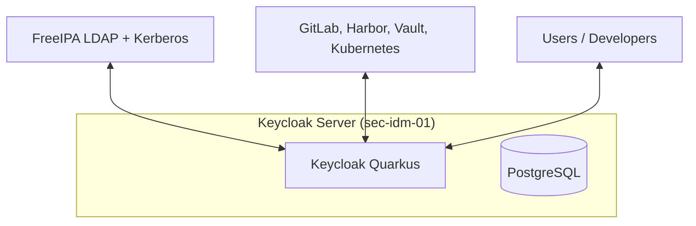
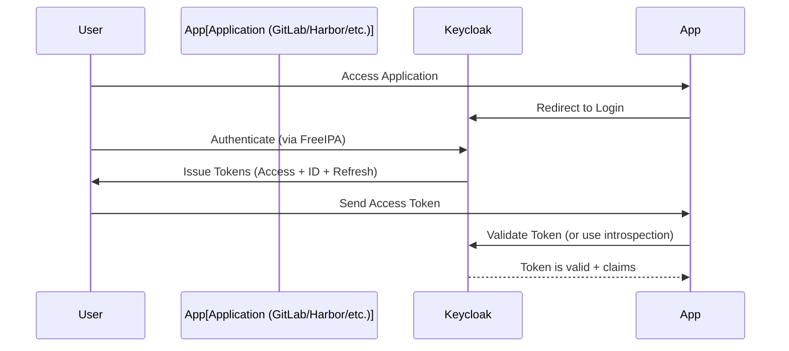

# Keycloak Deep Dive – Zero to Hero

## 1. Introduction – What is Keycloak?

**Keycloak** is an open-source **Identity and Access Management (IAM)** solution that makes it easy to secure modern applications and services using industry-standard protocols.

It acts as a central **authentication and authorization server** that supports:
- OpenID Connect (OIDC)
- OAuth 2.0
- SAML 2.0
- Social login (Google, GitHub, etc.)
- LDAP / Active Directory integration

In our DevSecOps lab, Keycloak is the **modern identity broker** that sits on top of FreeIPA. While FreeIPA handles traditional Linux authentication (Kerberos + LDAP), Keycloak provides modern API-friendly authentication (JWT tokens) for applications like GitLab, Harbor, Vault, Kubernetes, etc.

---

## 2. Why Keycloak?

Modern applications (especially cloud-native ones) need:
- Single Sign-On (SSO)
- JSON Web Tokens (JWT)
- Fine-grained authorization
- Easy integration with microservices and Kubernetes

Keycloak excels at this while allowing us to reuse our existing FreeIPA users and groups.

**Key Benefits in Our Lab:**
- Federated with FreeIPA (no duplicate user management)
- Issues JWT tokens with group claims
- Easy client registration for GitLab, Harbor, Vault, Kubernetes API, etc.
- Built-in user federation, identity brokering, and strong security features

---

## 3. History and Evolution

- Originally developed by **Red Hat** (as JBoss Keycloak)
- Now a mature open-source project under the **Keycloak Community**
- Major shift to **Quarkus** (from WildFly) made it much lighter and faster
- Current version (as of 2026): 26.x series

---

## 4. Core Concepts (Explained from Scratch)

### 4.1 Realms
A **Realm** is like a tenant or a security domain. In our lab we use `DevSecOps-Lab`.

### 4.2 Clients
A **Client** represents an application that wants to use Keycloak for authentication (e.g., GitLab, Harbor, Kubernetes).

### 4.3 Users & Groups
Users can come from:
- Local Keycloak database
- **LDAP Federation** (FreeIPA in our case)
- Social providers

### 4.4 Tokens (The Heart of Modern Auth)

- **ID Token**: Contains user identity information
- **Access Token**: Used to access APIs (JWT)
- **Refresh Token**: Used to get new access tokens

---

## 5. Keycloak Architecture



---

## 6. Installation on Ubuntu 24.04 (Our Lab)

### Prerequisites
```bash
sudo apt install -y openjdk-21-jdk postgresql postgresql-contrib
```

### Database Setup
```bash
sudo -u postgres psql << EOF
CREATE USER keycloak WITH PASSWORD 'StrongKeycloakPass123!';
CREATE DATABASE keycloak OWNER keycloak;
GRANT ALL PRIVILEGES ON DATABASE keycloak TO keycloak;
EOF
```

### Download & Install Keycloak
```bash
KEYCLOAK_VERSION=26.0.0
wget https://github.com/keycloak/keycloak/releases/download/${KEYCLOAK_VERSION}/keycloak-${KEYCLOAK_VERSION}.tar.gz
sudo tar -xzf keycloak-${KEYCLOAK_VERSION}.tar.gz -C /opt/
sudo ln -s /opt/keycloak-${KEYCLOAK_VERSION} /opt/keycloak
```

---

## 7. Systemd Service Configuration

Create the service file: `/etc/systemd/system/keycloak.service`

```ini
[Unit]
Description=Keycloak Identity and Access Management
After=network.target postgresql.service

[Service]
Type=simple
User=keycloak
Group=keycloak
WorkingDirectory=/opt/keycloak
ExecStart=/opt/keycloak/bin/kc.sh start --optimized
Restart=always

Environment="JAVA_HOME=/usr/lib/jvm/java-21-openjdk-amd64"
Environment="KC_DB=postgres"
Environment="KC_DB_URL=jdbc:postgresql://localhost:5432/keycloak"
Environment="KC_DB_USERNAME=keycloak"
Environment="KC_DB_PASSWORD=StrongKeycloakPass123!"
Environment="KC_HOSTNAME=sec-idm-01.devsecops.com"
Environment="KC_HOSTNAME_STRICT=true"
Environment="KC_HTTP_PORT=8080"
Environment="KC_HTTPS_PORT=8443"
Environment="KC_PROXY=edge"
Environment="KC_LOG_LEVEL=INFO"

[Install]
WantedBy=multi-user.target
```

Enable and start:

```bash
sudo useradd -r -s /bin/false keycloak
sudo chown -R keycloak:keycloak /opt/keycloak
sudo systemctl daemon-reload
sudo systemctl enable --now keycloak
```

---

## 8. Initial Setup & Realm Configuration

1. Access the Admin Console: `http://sec-idm-01.devsecops.com:8080`
2. Create the first admin user on first login.
3. Create a new Realm: **`DevSecOps-Lab`**

---

## 9. LDAP Federation with FreeIPA (Critical Integration)

This is the most important part for our lab.

### Configuration Steps:

1. Go to your Realm (`DevSecOps-Lab`) → **User Federation** → **Add provider** → **LDAP**
2. Fill in the following:

   - **Vendor**: Red Hat Directory Server (389-DS)
   - **Connection URL**: `ldap://sec-idm-01.devsecops.com`
   - **Bind Type**: `simple`
   - **Bind DN**: `uid=admin,ou=people,dc=devsecops,dc=com`
   - **Bind Credential**: `SuperSecureLDAPAdminPass123!`
   - **Search Base**: `dc=devsecops,dc=com`
   - **Edit Mode**: `READ_ONLY` (recommended for lab)
   - **Sync Registrations**: `ON`

3. Save and test the connection.

---

## 10. Client Scopes & Protocol Mappers (Advanced)

**Client Scopes** are reusable configurations for claims.

**Create a scope called `devsecops-groups`**:

- Add **Group Membership** mapper:
  - Token Claim Name: `groups`
  - Full group path: `OFF`
  - Claim JSON Type: `String`

Assign this scope as **Default** to all clients.

---

## 11. Registering Clients (GitLab, Harbor, Vault, Kubernetes)

For each application, create a client with:

- **Client Protocol**: `openid-connect`
- **Access Type**: `Confidential`
- **Standard Flow Enabled**: ON
- **Direct Access Grants**: ON (for testing)
- **Valid Redirect URIs**: e.g., `https://gitlab.lab.devsecops.local/*`

**Important Mappers** (especially for Kubernetes):
- Audience Mapper
- Group Mapper
- Hardcoded claims if needed

---
## 12. Security Hardening Best Practices

- **Always use HTTPS** in production (configure TLS with FreeIPA CA certificates)
- Enable **Hostname Strict** mode
- Set short **Access Token Lifespan** (5–15 minutes)
- Enable **Refresh Token Rotation**
- Use strong client secrets or client authentication with JWT
- Enable **Brute Force Detection**
- Configure **Password Policies** (inherit from FreeIPA where possible)
- Use **Realm Roles** + **Client Roles** wisely
- Regularly review **Event Logs** in the admin console

---

## 13. Token Flow Explanation (Critical for Understanding)



**Key Claims** we care about:
- `preferred_username`
- `groups` (from FreeIPA)
- `realm_access.roles`

---

## 14. Troubleshooting Guide

**Common Issues & Fixes:**

| Issue                         | Solution |
|-------------------------------|----------|
| Can't reach admin console     | Check port 8080, firewall, service status |
| LDAP federation fails         | Check bind DN, password, network, FreeIPA status |
| No groups in JWT              | Check Group Mapper + Client Scope assignment |
| Token invalid / audience      | Add proper Audience Mapper |
| Slow performance              | Check PostgreSQL resources, enable --optimized |

**Useful Commands:**

```bash
journalctl -u keycloak -f
sudo -u keycloak /opt/keycloak/bin/kc.sh show-config
curl -v http://localhost:8080/realms/DevSecOps-Lab/.well-known/openid-configuration
```

---

## 15. Exercises with Complete Solutions

### **Beginner Exercises**

**Exercise 1**: Install Keycloak with PostgreSQL backend and create the `DevSecOps-Lab` realm.  
**Solution**: Follow sections 6 and 8.

**Exercise 2**: Create your first OIDC client for testing.  
**Solution**: Create client with `openid-connect`, enable Direct Access Grants.

### **Intermediate Exercises**

**Exercise 3**: Configure LDAP Federation with FreeIPA.  
**Solution**: Use the exact settings from Part 2, section 9.

**Exercise 4**: Create a Client Scope that includes group membership.  
**Solution**: Create scope `devsecops-groups` + Group Membership mapper.

### **Advanced Exercises**

**Exercise 5**: Get a JWT token using password grant and decode it to see groups.  
**Solution**:
```bash
curl -X POST http://sec-idm-01:8080/realms/DevSecOps-Lab/protocol/openid-connect/token \
  -d "client_id=gitlab" \
  -d "client_secret=..." \
  -d "grant_type=password" \
  -d "username=admin" \
  -d "password=StrongAdminPass123!" | jq -R 'split(".") | .[1] | @base64d | fromjson'
```

**Exercise 6**: Configure a test application (nginx + oauth2-proxy) to use Keycloak SSO.

---

## 16. Alternatives Comparison

| Tool          | Strengths                        | Weaknesses                    | Our Choice |
|---------------|----------------------------------|-------------------------------|------------|
| **Keycloak**  | Feature-rich, Quarkus, free      | Can be heavy                  | Best overall |
| Zitadel       | Modern, very lightweight         | Younger project               | Alternative |
| Authelia      | Lightweight proxy                | Less features                 | Simpler use |
| Ory Stack     | Very modular                     | Complex to operate            | Advanced |

---

## 17. Summary & Key Takeaways

- Keycloak is the **modern identity broker** in our architecture.
- It complements FreeIPA perfectly: FreeIPA = backend identity, Keycloak = frontend protocols (OIDC).
- Mastering **Client Scopes**, **Protocol Mappers**, and **LDAP Federation** is essential.
- Proper token configuration and group mapping are the foundation for secure access to GitLab, Harbor, Vault, and Kubernetes.

**Next Step in the Course**: Use Keycloak to secure all other components (Phase 3 and beyond).

---
