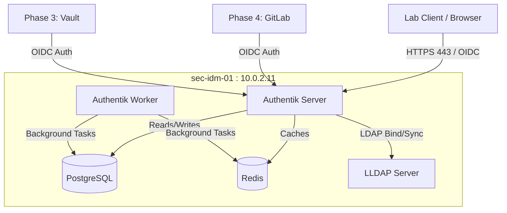
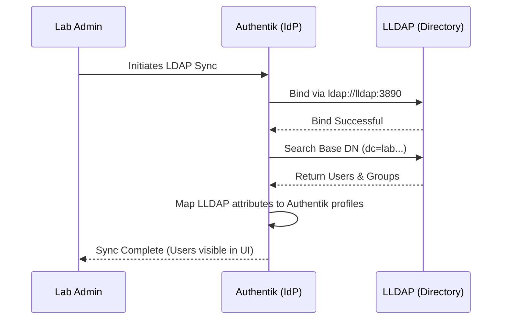

Before we dive into the setup, I need to address a critical architectural shift based on your previous note about replacing Docker-based attempts with native installations. While Samba AD and FreeIPA are monolithic services designed to run natively on bare-metal or VMs, **Authentik and LLDAP are fundamentally cloud-native applications.** Authentik relies on a complex stack (Go backend, Python workers, PostgreSQL, and Redis). Installing it natively on Ubuntu is highly discouraged, undocumented, and a maintenance nightmare. Therefore, for this specific IdM stack on `sec-idm-01`, we **must** use Docker/Docker Compose. 

# Phase 1: Modern Identity Services (LLDAP + Authentik)

## 1.1 Architecture & Strategy

In a modern DevSecOps environment, legacy Active Directory is often replaced by a decoupled identity stack. We use **LLDAP** (Lightweight LDAP) as the high-performance backend database for users/groups, and **Authentik** as the Identity Provider (IdP) to bridge LLDAP to modern protocols like OIDC and SAML for downstream services (Vault, GitLab, Kubernetes).

### The Cloud-Native IdP Flow

_Real-world analogy: LLDAP is the secure vault holding the employee badges (credentials). Authentik is the security guard at the front desk who checks the badge, confirms it with the vault, and hands the employee a temporary VIP pass (OIDC token) to enter specific rooms (applications)._



# 🧩 Part 1 — LLDAP Server (10.0.2.11)


## 0. Install Container Engine and Prepare Directories

We will use Docker Compose to manage the identity stack. All configurations will reside in `/opt/identity-stack`.
```bash
sudo apt update && sudo apt install -y docker.io docker-compose-v2 apparmor-utils acl
```

Create the required directory structure with strict access controls:
```bash
sudo mkdir -p /opt/identity-stack/{lldap_data,authentik-certs,custom-templates}
sudo chown -R root:root /opt/identity-stack
sudo chmod 700 /opt/identity-stack
cd /opt/identity-stack
```

We’ll use LLDAP with Docker Compose.
## 1. Install Docker + Compose
```bash
sudo apt update
sudo apt install -y docker.io docker-compose
sudo systemctl enable --now docker
```

## 2. Create LLDAP directory
```bash
mkdir -p /opt/identity-stack
cd /opt/identity-stack
```

## 3. Create `docker-compose.yml`
```yaml
services:
  # --- LLDAP (Lightweight LDAP Directory) ---
  lldap:
    image: ghcr.io/lldap/lldap:stable
    container_name: lldap
    ports:
      - "3890:3890"    # Maps standard LDAP port 389 to LLDAP internal port
      - "17170:17170"  # LLDAP Web UI
#     - "6360:6360"    # LDAPS Port 
    volumes:
      - ./lldap_data:/data
      - ./certs:/certs
    environment:
      - LLDAP_LDAP_BASE_DN=dc=devsecops,dc=com
      - LLDAP_LDAP_USER_PASS=SuperSecureLDAPAdminPass123!
      - LLDAP_JWT_SECRET=${LLDAP_JWT_SECRET}
      - LLDAP_KEY_SEED=some-random-seed-phrase
#     - LLDAP_LDAPS_OPTIONS__ENABLED=true
#     - LLDAP_LDAPS_OPTIONS__PORT=6360
#     - LLDAP_LDAPS_OPTIONS__CERT_FILE=/certs/lldap.crt
#     - LLDAP_LDAPS_OPTIONS__KEY_FILE=/certs/lldap.key
    restart: unless-stopped
```

## 4. Start LLDAP
```bash
docker-compose up -d
```

## 5. Access Web UI
```web
http://10.0.2.11:17170
```

Login:
- Username: `admin`
- Password: `SuperSecureLDAPAdminPass123!`

## 6. Create Users
Inside UI:
- Create **groups** (e.g., `devops`)
- Create **users** (e.g., `alex`)
- Assign them to group

## 7. Important LDAP Details

| Setting  | Value                                   |
| -------- | --------------------------------------- |
| LDAP URI | `ldap://10.0.2.11:3890`                 |
| Base DN  | `dc=example,dc=com`                     |
| Bind DN  | `uid=admin,ou=people,dc=example,dc=com` |
| Password | `SuperSecureLDAPAdminPass123!`          |

---

## 2.1 Cryptographic Keys & Secrets

Security first. Authentik requires a secure PostgreSQL password and a cryptographic secret key for signing session cookies and tokens. We will append these to our environment file.

### Exercise 2: Generate and Store Secrets

Run the following commands on `sec-idm-01` to generate strong cryptographic keys and append them to a new `.env` file. We merge the LLDAP configuration with the Authentik configuration.
```bash
cd /opt/identity-stack

# Generate a 50-character random string for Authentik Secret Key
AUTH_SECRET=$(openssl rand -base64 48 | tr -dc 'A-Za-z0-0' | head -c 50)
# Generate a strong database password
PG_PASS=$(openssl rand -base64 32 | tr -dc 'A-Za-z0-9' | head -c 32)

# Create the unified .env file
cat <<EOF > .env

# --- Authentik Configuration ---
AUTHENTIK_SECRET_KEY=${AUTH_SECRET}
AUTHENTIK_ERROR_REPORTING__ENABLED=false
AUTHENTIK_POSTGRESQL__USER=authentik
AUTHENTIK_POSTGRESQL__NAME=authentik
AUTHENTIK_POSTGRESQL__PASSWORD=${PG_PASS}
AUTHENTIK_REDIS__HOST=redis
AUTHENTIK_POSTGRESQL__HOST=postgresql

# Port configuration for the host
COMPOSE_PORT_HTTP=9000
COMPOSE_PORT_HTTPS=9443
EOF
```

## 2.2 Extending the Identity Stack

We will now expand our `docker-compose.yaml` to include the complete Authentik stack. We use the official `ghcr.io` images.

### Exercise 3: The Complete Compose File

Overwrite your existing `docker-compose.yaml` with this complete, production-ready topology.

_Real-world analogy: If LLDAP is the secure badge vault, PostgreSQL is the filing cabinet where Authentik stores its security policies, and Redis is the high-speed radio the security guards (workers) use to communicate in real-time._

```yaml
services:
  # --- LLDAP (Lightweight LDAP Directory) ---
  lldap:
    image: ghcr.io/lldap/lldap:stable
    container_name: lldap
    ports:
      - "3890:3890"    # Maps standard LDAP port 389 to LLDAP internal port
      - "17170:17170"  # LLDAP Web UI
#     - "6360:6360"    # LDAPS Port 
    volumes:
      - ./lldap_data:/data
      - ./certs:/certs
    environment:
      - LLDAP_LDAP_BASE_DN=dc=devsecops,dc=com
      - LLDAP_LDAP_USER_PASS=SuperSecureLDAPAdminPass123!
      - LLDAP_JWT_SECRET=${LLDAP_JWT_SECRET}
      - LLDAP_KEY_SEED=some-random-seed-phrase
#     - LLDAP_LDAPS_OPTIONS__ENABLED=true
#     - LLDAP_LDAPS_OPTIONS__PORT=6360
#     - LLDAP_LDAPS_OPTIONS__CERT_FILE=/certs/lldap.crt
#     - LLDAP_LDAPS_OPTIONS__KEY_FILE=/certs/lldap.key
    restart: unless-stopped
    networks:
      - identity_net

  # --- Authentik Database & Cache ---
  postgresql:
    image: docker.io/library/postgres:16-alpine
    container_name: authentik-db
    restart: unless-stopped
    healthcheck:
      test: ["CMD-SHELL", "pg_isready -d $${POSTGRES_DB} -U $${POSTGRES_USER}"]
      start_period: 20s
      interval: 30s
      retries: 5
      timeout: 5s
    volumes:
      - ./pg-data:/var/lib/postgresql/data
    environment:
      POSTGRES_PASSWORD: ${AUTHENTIK_POSTGRESQL__PASSWORD:?database password required}
      POSTGRES_USER: ${AUTHENTIK_POSTGRESQL__USER:-authentik}
      POSTGRES_DB: ${AUTHENTIK_POSTGRESQL__NAME:-authentik}
    env_file:
      - .env
    networks:
      - identity_net

  redis:
    image: docker.io/library/redis:alpine
    container_name: authentik-redis
    command: --save 60 1 --loglevel warning
    restart: unless-stopped
    healthcheck:
      test: ["CMD-SHELL", "redis-cli ping | grep PONG"]
      start_period: 20s
      interval: 30s
      retries: 5
      timeout: 3s
    volumes:
      - ./redis-data:/data
    networks:
      - identity_net

  # --- Authentik Application ---
  server:
    image: ghcr.io/goauthentik/server:2024.4.2
    container_name: authentik-server
    restart: unless-stopped
    command: server
    environment:
      AUTHENTIK_REDIS__HOST: redis
      AUTHENTIK_POSTGRESQL__HOST: postgresql
      AUTHENTIK_POSTGRESQL__USER: ${AUTHENTIK_POSTGRESQL__USER:-authentik}
      AUTHENTIK_POSTGRESQL__NAME: ${AUTHENTIK_POSTGRESQL__NAME:-authentik}
      AUTHENTIK_POSTGRESQL__PASSWORD: ${AUTHENTIK_POSTGRESQL__PASSWORD}
    volumes:
      - ./media:/media
      - ./custom-templates:/templates
    env_file:
      - .env
    ports:
      - "${COMPOSE_PORT_HTTP:-9000}:9000"
      - "${COMPOSE_PORT_HTTPS:-9443}:9443"
    depends_on:
      postgresql:
        condition: service_healthy
      redis:
        condition: service_healthy
    networks:
      - identity_net

  worker:
    image: ghcr.io/goauthentik/server:2024.4.2
    container_name: authentik-worker
    restart: unless-stopped
    command: worker
    environment:
      AUTHENTIK_REDIS__HOST: redis
      AUTHENTIK_POSTGRESQL__HOST: postgresql
      AUTHENTIK_POSTGRESQL__USER: ${AUTHENTIK_POSTGRESQL__USER:-authentik}
      AUTHENTIK_POSTGRESQL__NAME: ${AUTHENTIK_POSTGRESQL__NAME:-authentik}
      AUTHENTIK_POSTGRESQL__PASSWORD: ${AUTHENTIK_POSTGRESQL__PASSWORD}
    # This user override is required for docker socket access if handling Outpost deployments natively
    user: root
    volumes:
      - /var/run/docker.sock:/var/run/docker.sock
      - ./media:/media
      - ./custom-templates:/templates
    env_file:
      - .env
    depends_on:
      postgresql:
        condition: service_healthy
      redis:
        condition: service_healthy
    networks:
      - identity_net

networks:
  identity_net:
    driver: bridge
```

## 2.3 Deployment and Verification

Before starting, ensure the target directories for the database and cache exist with restricted permissions:
```bash
sudo mkdir -p ./pg-data ./redis-data ./media
sudo chown -R root:root .
sudo chmod -R 700 ./pg-data ./redis-data
```

Start the complete stack in detached mode:
```bash
sudo docker compose up -d
```

### Exercise 4: Health and Log Validation

Authentik performs heavy database migrations on its first boot. It is critical to monitor the logs before attempting to access the UI.

1. **Monitor the Server Logs:**
    ```bash
    sudo docker logs -f authentik-server
    ```
    
    _Wait until you see a log entry indicating the server is listening on `0.0.0.0:9000`. Press `Ctrl+C` to exit the logs._
    
1. **Verify Service Health:**
    ```bash
    sudo docker compose ps
    ```
    
    _Ensure `postgresql` and `redis` show as `(healthy)` and `server` and `worker` are `Up`._

## 2.4 Initial Setup Flow

With the services running, navigate to the Initial Setup interface from your lab client browser.

1. **Access URL:** `https://10.0.2.11:9443/if/flow/initial-setup/`
    
    _(Note: Your browser will display a certificate warning because Authentik generates a self-signed certificate by default. Accept the risk to proceed)._
    
2. **Create `akadmin` User:** You will be prompted to set the password for the default `akadmin` account. Create a strong password (e.g., `SuperAdmin2026!`) and store it securely.
    
3. **Log In:** You will be redirected to the Authentik Admin Interface.

---

Now that you are inside the Authentik dashboard, we need to connect the "security guard" (Authentik) to the "credential vault" (LLDAP).

## 3.1 Directory Federation Architecture

Authentik does not natively store users; it manages _access_. We must configure Authentik to synchronize with LLDAP. Because we deployed both services on the same Docker bridge network (`identity_net`), Authentik can communicate directly with LLDAP using the container name as the hostname, bypassing the host's firewall entirely.



## 3.2 Configuring the LDAP Source

In the Authentik Admin Interface, navigate through the left-hand menu to establish the federation link.

### Exercise 5: Bind Authentik to LLDAP

1. Go to **Directory** -> **Federation and Social login**.
    
2. Click the **Create** button and select **LDAP Source**.
    
3. Fill in the **General Settings**:
    
    - **Name:** `LLDAP-Backend`
        
    - **Slug:** `lldap-backend` (Auto-fills)
        
4. Fill in the **Connection Settings**:
    
    - **Server URI:** `ldap://lldap:3890` _(Note: We use the Docker container name `lldap`, not the IP)_.
        
    - **Bind CN:** `uid=admin,ou=people,dc=devsecops,dc=com`
        
    - **Bind Password:** `SuperSecureLDAPAdminPass123!`
        
    - **Base DN:** `dc=devsecops,dc=com`
        
5. Configure **Sync Settings**:
    
    - **User object filter:** `(objectClass=person)`
        
    - **Group object filter:** `(objectClass=groupOfUniqueNames)`
        
    - Expand the Property Mappings section. Authentik usually selects default LDAP mappings automatically. Ensure **authentik default LDAP Mapping** is selected for both users and groups.
    
    - **Object uniqueness field:** `uid`
        
6. Click **Finish**.
    

## 3.3 Validating the Synchronization

To prove the integration is functional, we will create a test user in the LLDAP backend and verify that Authentik automatically imports it.

### Exercise 6: End-to-End User Sync

1. Open a new browser tab and navigate to the LLDAP interface: `http://10.0.2.11:17170`
    
2. Log in with `admin` and `SuperSecureLDAPAdminPass123!`.
    
3. Navigate to **Users** and click **Create a User**.
    
4. Create a test engineering account:
    
    - **Username:** `arash`
        
    - **First Name:** `Arash`
        
    - **Last Name:** `Foroughi`
        
    - **Email:** `arash@devsecops.com`
        
5. Click **Create**, then select the newly created user and assign a password (e.g., `DevSecOps2026!`).
    
6. Return to the **Authentik Admin Interface** tab.
    
7. Go to **Directory** -> **Federation and Social login**.
    
8. Click on your `LLDAP-Backend` source.
    
9. Click the **Sync** tab and click **Run Sync** (or wait for the background worker to do it automatically).
    
10. Navigate to **Directory** -> **Users**.
    

**Expected Outcome:** You should see `arash` listed in the Authentik user directory alongside your `akadmin` account. If you look at the "Path" or "Source" column for `arash`, it will indicate that the user originated from the `LLDAP-Backend`.

This completes the core identity infrastructure setup. Your IdP is fully functional and backed by a highly efficient directory.

---

#### **3.4 SSH Login Integration with LLDAP + Authentik**

Authentik itself is **not** a direct SSH authentication provider. We use **LLDAP** as the backend and configure Linux clients to authenticate against it via **PAM + NSS**.

**Exercise 7: Enable SSH Login via LLDAP on Client VMs**

On a client machine (e.g. `sec-vcs-01` or `k8s-master-01`):

```bash
sudo apt update
sudo apt install -y libnss-ldapd libpam-ldapd nslcd

# During installation, set:
# LDAP server URI: ldap://10.0.2.11:3890
# Search base: dc=devsecops,dc=com
# Bind DN: uid=admin,ou=people,dc=devsecops,dc=com
# Bind password: AdminP@ssw0rd2026!
```

Then edit `/etc/nsswitch.conf`:

```bash
sudo nano /etc/nsswitch.conf
```

Change these lines:
```bash
passwd: files ldap
group: files ldap
shadow: files ldap
```

Edit `/etc/pam.d/common-session`:

```bash
session optional pam_mkhomedir.so skel=/etc/skel/ umask=0022
```

Restart services:

```bash
sudo systemctl restart nslcd
sudo systemctl restart ssh
```

**Test SSH Login:**

```bash
ssh arash@10.0.2.14   # Use the user you created in LLDAP
```

---

#### **3.5 GitLab Integration with Authentik (OIDC Provider)**

Authentik will act as the main OIDC provider for the lab.

**In Authentik Admin UI:**

1. Go to **Applications** → **Create**
2. Name: `GitLab`
3. Slug: `gitlab`
4. Backchannel Providers: Create new OIDC Provider
5. Client Type: `Confidential`
6. Redirect URIs: `https://gitlab.devsecops.com/oauth2/callback`

Copy the **Client ID** and **Client Secret** for later use in GitLab, Vault, etc.

---

#### **3.6 Validation & Testing**

Create a test user in LLDAP and verify:
- SSH login works
- Authentik can sync the user
- Keycloak (later) can federate with Authentik

---

