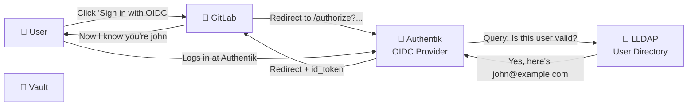

# Chapter 03 — LLDAP + Authentik: Modern Identity Provider

## 3.1 The Evolution of Authentication — Why Authentik Exists

Authentication is answering the question: **"Who are you?"** Authorization answers: **"What are you allowed to do?"**

This chapter builds both.

### The Problem: The "Browser Full of Passwords" Era

Imagine 2005. You have accounts at:

- Your email provider
- Your bank
- LinkedIn
- Your project management tool
- Your file sharing service
- Your development team's GitLab
- Your company's Slack
- Your VPN provider

That's 8 different passwords to remember. Different login pages. Different password policies (one requires uppercase, one forbids special characters, one expires every 30 days).

🏗️ **Analogy:** Before hotels had key cards, you carried a ring of 50 keys — one for each room, locked at different times, needing replacement quarterly. Key cards (SSO/OIDC) mean you carry _one card_ that opens everything you're allowed to access.

### LDAP (1993) — The First Directory Service

LDAP (Lightweight Directory Access Protocol) was the first widely-adopted solution:

- Centralized user directory
- Services query the LDAP server to check passwords
- One username/password works everywhere

LDAP is still around (Active Directory is LDAP-based). It works. It's boring. It's also 30+ years old and predates the web.

**LDAP's weakness:** It's designed for _authentication_ (verifying identity), not _authorization_ (granting permissions) or _consent flows_ (asking users if they're OK with a third-party app accessing their data).

### OAuth2 (2012) — Authorization Without Sharing Passwords

OAuth2 addressed a specific problem: "I want to let this third-party app access my Google Photos without giving it my Google password."

OAuth2 lets you delegate access:

- You click "Sign in with Google"
- You're redirected to Google
- You log in
- Google asks "Is it OK if this app accesses your photos?"
- You say yes
- The app gets a _token_, not a password
- The app can only do what the token allows
- You can revoke it any time

**Weakness:** OAuth2 doesn't standardize _how_ to ask "who is this person?" Different implementations do it differently.

### OIDC (OpenID Connect, 2014) — OAuth2 + Identity

OIDC = OAuth2 + a standard way to get user information.

It adds an `id_token` (JWT with user info) to OAuth2's `access_token`.

OIDC introduced the concept of **scopes** (permissions you're asking for):

- `openid` — I'm asking for your identity
- `profile` — I want your name, picture, etc.
- `email` — I want your email address
- `groups` — I want to know what groups you're in (for authorization)

**This is what modern identity platforms use.**

### Authentik — An OIDC Provider

Authentik is an open-source identity provider. Think of it as:

- A friendly face over LDAP (it talks to LLDAP for user data)
- An OIDC server (services redirect users to Authentik to log in)
- A policy engine (you can say "only allow GitHub-authenticated users from this organization")
- A consent manager (ask users for permission before giving apps their data)



---

## 3.2 LLDAP — The Lightweight LDAP Server

LLDAP is a modern reimplementation of LDAP in Rust. It's lightweight, fast, and perfect for a lab. It stores users, groups, and basic attributes.

### Why Not Full OpenLDAP?

OpenLDAP is the traditional choice. It's powerful. It's also complex — the config files look like line noise. LLDAP:

- Has a web UI for user management (no need to edit LDIF files)
- Is easier to back up and restore
- Uses less memory
- Still speaks LDAP — compatible with everything that expects LDAP

---

# 🧩 Part 1 — LLDAP Server (10.0.2.11)

We’ll use LLDAP with Docker Compose.
## 1. Install Docker + Compose
```bash
sudo apt update
sudo apt install -y docker.io docker-compose
sudo systemctl enable --now docker
```

## 2. Create LLDAP directory
```bash
mkdir -p /opt/lldap
cd /opt/lldap
```

## 3. Create `docker-compose.yml`
```yaml
services:
  # --- LLDAP (Lightweight LDAP Directory) ---
  lldap:
    image: ghcr.io/lldap/lldap:stable
    container_name: lldap
    ports:
      - "3890:3890"    # Maps standard LDAP port 389 to LLDAP internal port
      - "17170:17170"  # LLDAP Web UI
#     - "6360:6360"    # LDAPS Port 
    volumes:
      - ./lldap_data:/data
      - ./certs:/certs
    environment:
      - LLDAP_LDAP_BASE_DN=dc=devsecops,dc=com
      - LLDAP_LDAP_USER_PASS=SuperSecureLDAPAdminPass123!
      - LLDAP_JWT_SECRET=${LLDAP_JWT_SECRET}
      - LLDAP_KEY_SEED=some-random-seed-phrase
#     - LLDAP_LDAPS_OPTIONS__ENABLED=true
#     - LLDAP_LDAPS_OPTIONS__PORT=6360
#     - LLDAP_LDAPS_OPTIONS__CERT_FILE=/certs/lldap.crt
#     - LLDAP_LDAPS_OPTIONS__KEY_FILE=/certs/lldap.key
    restart: unless-stopped
```

## 4. Start LLDAP
```bash
docker-compose up -d
```

## 5. Access Web UI
```web
http://10.0.2.11:17170
```

Login:
- Username: `admin`
- Password: `SuperSecureLDAPAdminPass123!`

## 6. Create Users
Inside UI:
- Create **groups** (e.g., `devops`)
- Create **users** (e.g., `alex`)
- Assign them to group

## 7. Important LDAP Details

| Setting  | Value                                   |
| -------- | --------------------------------------- |
| LDAP URI | `ldap://10.0.2.11:3890`                 |
| Base DN  | `dc=example,dc=com`                     |
| Bind DN  | `uid=admin,ou=people,dc=example,dc=com` |
| Password | `SuperSecureLDAPAdminPass123!`          |

---
# 🧩 Part 2 — LDAP Client (10.0.2.14)

We’ll configure Ubuntu to authenticate via LDAP using:
- SSSD
- OpenLDAP client utilities

## 1. Install packages
```bash
sudo apt update
sudo apt install -y sssd sssd-tools libnss-sss libpam-sss ldap-utils
```

## 2. Configure SSSD
Create config:
```bash
sudo vim /etc/sssd/sssd.conf
```

Paste:
```ini
[sssd]
services = nss, pam
config_file_version = 2
domains = default

[domain/default]
# ldap_schema = rfc2307
ldap_schema = rfc2307bis

id_provider = ldap
auth_provider = ldap
chpass_provider = ldap

ldap_uri = ldap://10.0.2.11:3890
# ldap_uri = ldaps://10.0.2.11:6360
# ldap_tls_reqcert = never
# ldap_tls_cacert = /etc/ssl/certs/lldap.crt
ldap_id_use_start_tls = false
ldap_tls_reqcert = never
ldap_auth_disable_tls_never_use_in_production = true

ldap_search_base = dc=devsecops,dc=com
ldap_default_bind_dn = uid=admin,ou=people,dc=devsecops,dc=com
ldap_default_authtok = SuperSecureLDAPAdminPass123!
ldap_user_search_base = ou=people,dc=devsecops,dc=com
ldap_group_search_base = ou=groups,dc=devsecops,dc=com

cache_credentials = true
enumerate = true

ldap_user_name = uid
ldap_user_uid_number = uidNumber
ldap_user_gid_number = gidNumber
ldap_user_home_directory = homeDirectory
ldap_user_shell = loginShell
ldap_user_gecos = cn

ldap_group_object_class = groupOfNames
ldap_group_name = cn
ldap_group_member = member
ldap_group_gid_number = gidNumber

ldap_access_order = filter
ldap_access_filter = (objectClass=posixAccount)

ldap_user_ssh_public_key = sshPublicKey
```

## 3. Secure config
```bash
sudo chmod 600 /etc/sssd/sssd.conf
```

## 4. Enable SSSD
```bash
sudo systemctl enable --now sssd
```

## 5. Configure NSS
```bash
sudo vim /etc/nsswitch.conf
```

Update lines:
```text
passwd:     files systemd sss
group:      files systemd sss
shadow:     files sss
```

## 6. Configure PAM (auto-creates home dirs)
```bash
sudo pam-auth-update
```

Enable:
- ✅ SSS authentication
- ✅ Create home directory on login

---
# 🧩 Part 3 — Enable SSH Login via LDAP

## 1. Edit SSH config:
```bash
sudo vim /etc/ssh/sshd_config
```

Ensure:
```text
UsePAM yes
PasswordAuthentication yes
```

Restart SSH:
```bash
sudo systemctl enable ssh
sudo systemctl restart ssh
sudo systemctl restart sshd
```

## 2. Check PAM for SSH
Open:
```bash
sudo vim /etc/pam.d/sshd
```

Make sure this line exists:
```text
auth    sufficient    pam_sss.so
account sufficient    pam_sss.so
```

## 3. Check SSH config
Open:
```bash
sudo vim /etc/ssh/sshd_config
```

Ensure:
```text
UsePAM yes
PasswordAuthentication yes
ChallengeResponseAuthentication no
```

Then restart:
```bash
sudo systemctl enable ssh
sudo systemctl restart ssh
sudo systemctl restart sshd
```

## 4. Restrict SSH to LDAP Group

Edit:
```bash
sudo vim /etc/ssh/sshd_config
```

Add:
```text
AllowGroups ssh-users
```

(Ensure group exists in LLDAP)

---
# 🧩 Part 4 — Enable POSIX Attributes in LLDAP

## 1. Go to “User schema”
In LLDAP Web UI:
- Click **User schema**
- Add the following fields:

| Attribute       | Type    |
| --------------- | ------- |
| `uidNumber`     | Integer |
| `gidNumber`     | Integer |
| `homeDirectory` | String  |
| `loginShell`    | String  |
## 2. Go to “Group schema”
In LLDAP Web UI:
- Click **Group schema**
- Add the following fields:

| Attribute   | Type    |
| ----------- | ------- |
| `gidNumber` | Integer |

## 3. Edit your user (`alex`)
Set values like:
```text
uidNumber: 10001
gidNumber: 10001
homeDirectory: /home/alex
loginShell: /bin/bash
```

## 4. Create matching group
Go to **Groups → devops** (or new group):
Set:
```text
gidNumber: 10001
```

👉 Important:  
`gidNumber` in group must match user's `gidNumber`

## 5. Restart SSSD on client
```bash
sudo systemctl restart sssd
sudo rm -rf /var/lib/sss/db/*
sudo systemctl restart sssd
```

## 6. Test again
Verify LDAP actually returns fields
```bash
ldapsearch -H ldap://sec-idm-01.devsecops.com:3890 \
   -D "uid=admin,ou=people,dc=devsecops,dc=com" -x \
   -w "SuperSecureLDAPAdminPass123!" \
   -b "ou=people,dc=devsecops,dc=com" \
   "(uid=alex)"

sssctl config-check

sssctl user-checks alex
```

Make sure output includes:
- uidNumber
- gidNumber
- homeDirectory
- loginShell

```bash
getent passwd alex
```

You should now see something like:
```text
alex:x:10001:10001::/home/alex:/bin/bash
```

Then:
```bash
su - alex
```

---
# 🧩 Part 5 — Enable SSH PubKey Authentication
This is a big upgrade:
- No passwords over SSH
- Centralized key management
- Instant revoke access

## 1. Enable home directory auto-creation
Make sure this is active:
```bash
sudo pam-auth-update
```
Enable:
- ✅ _Create home directory on login_

Or manually:
```bash
sudo vim /etc/pam.d/common-session
```

Add:
```text
session required pam_mkhomedir.so skel=/etc/skel umask=077
```

## 2. Extend LLDAP schema
Go to **User schema → Add attribute**

Add:

|Field|Value|
|---|---|
|Name|`sshPublicKey`|
|Type|String|
|Multi-value|✅ YES|

## 3. Add SSH key to user
Edit user `alex`:

Paste public key:
```bash
cat ~/.ssh/id_ed25519.pub
```

Example:
```text
ssh-ed25519 AAAAC3NzaC1lZDI1NTE5AAAAI... alex@client
```

## 4. SSH key authentication via LDAP
In addition to passwords, store SSH keys in LDAP.

Edit:
```bash
sudo vim /etc/sssd/sssd.conf
```

Add:
```ini
ldap_user_ssh_public_key = sshPublicKey
```

Then SSH just works with centralized keys.

## 5. Configure SSH daemon
Edit:
```bash
sudo vim /etc/ssh/sshd_config
```

Add:
```text
PubkeyAuthentication yes
AuthorizedKeysCommand /usr/bin/sss_ssh_authorizedkeys
AuthorizedKeysCommandUser nobody
```

## 6. Restart everything
```bash
sudo systemctl restart sssd
sudo systemctl restart ssh
sudo systemctl restart sshd
```

## 7. Test
From another machine:
```bash
ssh alex@10.0.2.14
```

👉 Should log in **without password**

---
# 🧩 Part 6 — Sudo via LDAP Groups (LLDAP)

Here’s the reality:

👉 LLDAP does **NOT support sudo schema**

So we do it the Linux way.

## 1. Use LDAP group directly
You already have:
- `devops` group ✅

## 2. Map group to sudo
Create file:
```bash
sudo nano /etc/sudoers.d/devops
```

Add:
```text
%devops ALL=(ALL:ALL) ALL
```

## 3. Test
```bash
su - alex
sudo whoami
```

👉 Should return:
```text
root
```

## 4. Restrict sudo more
Restrict Sudoers to run less commands using sudo.
Example:
```text
%devops ALL=(ALL) NOPASSWD: /usr/bin/apt, /usr/bin/systemctl
```

---
# 🧩 Part 7 — Enable LDAPS (TLS) for LLDAP

Right now you're using:
```text
ldap://10.0.2.11:3890
```

👉 This sends passwords **in plaintext** (even if hashed later). Not acceptable in real setups.

## 1. Generate certificates
Option A (lab / quick)
```bash
mkdir -p /opt/lldap/certs
cd /opt/lldap/certs

openssl req -x509 -nodes -days 365 \
  -newkey rsa:2048 \
  -keyout lldap.key \
  -out lldap.crt \
  -subj "/CN=idm.devsecops.com"
```

## 2. Update Docker Compose
Edit your LLDAP container:
```yaml
environment:
  - LLDAP_LDAPS_OPTIONS__ENABLED=true
  - LLDAP_LDAPS_OPTIONS__PORT=6360
  - LLDAP_LDAPS_OPTIONS__CERT_FILE=/certs/lldap.crt
  - LLDAP_LDAPS_OPTIONS__KEY_FILE=/certs/lldap.key

ports:
  - "6360:6360"

volumes:
  - ./certs:/certs
```

 Restart service:
```bash
docker-compose down
docker-compose up -d
```

## 3. Test LDAPS
```bash
LDAPTLS_REQCERT=never ldapsearch \
  -x -H ldaps://10.0.2.11:6360 \
  -D "uid=admin,ou=people,dc=devsecops,dc=com" \
  -w "SuperSecureLDAPAdminPass123!" \
  -b "dc=devsecops,dc=com"
```

## 4. Update client (SSSD)

Edit `/etc/sssd/sssd.conf`:
```ini
ldap_uri = ldaps://10.0.2.11:6360
ldap_tls_reqcert = never   # (lab only)
```

Restart:
```bash
sudo systemctl restart sssd
```

## 5. Production note
Later:
- Replace self-signed with real CA
- Use:
```ini
ldap_tls_reqcert = demand
ldap_tls_cacert = /etc/ssl/certs/your-ca.pem
```

---