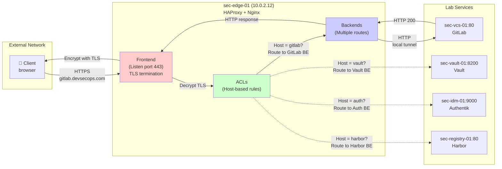

# Chapter 04 — HAProxy: Edge Proxy & SSL Termination

## 4.1 Why HAProxy Exists — The Edge Proxy Problem

Imagine your lab with 12 services, each on a different VM with a different IP. How does a user access GitLab?

**Bad approach:** Remember the IP. Type `https://10.0.2.14/`.

- IPs change (VM migration, rebuilds)
- Not human-friendly
- No way to enforce company-wide policies (TLS, rate limiting, logging)
- No way to switch backend servers without changing client configuration

**Good approach:** Use an edge proxy.

🏗️ **Analogy:** Think of a reverse proxy like a hotel concierge desk. Guests (clients) ask the concierge for a room ("I want GitLab"). The concierge routes them to the correct room (backend server) without the guest ever knowing which physical floor/building it's on. If a room is under maintenance, the concierge can route to a backup room — the guest never notices.

### What HAProxy Does

1. **Single entry point** — Clients connect to one IP/hostname (sec-edge-01)
2. **TLS termination** — Encrypts client-to-proxy traffic; decrypts internally
3. **Host-based routing** — Routes `gitlab.devsecops.com` → GitLab backend
4. **Load balancing** — Spreads traffic across multiple backends
5. **Failover** — If a backend is down, requests go to healthy backends
6. **Traffic policies** — Rate limiting, request filtering, header manipulation
7. **Comprehensive logging** — Every request visible for audit/debugging

---

## 4.2 HAProxy vs Nginx vs Other Proxies

|Proxy|Strength|Best For|Lab Role|
|---|---|---|---|
|**HAProxy**|Layer 4 + 7 load balancing, fast, battle-tested|TCP/HTTP routing, failover|Primary edge proxy|
|**Nginx**|Layer 7 HTTP routing, elegant config, dynamic modules|Web server + reverse proxy|Secondary proxy / app server|
|**Traefik**|Kubernetes-native, dynamic config, modern|Kubernetes services|Not used (we use K8s native in Phase 5)|
|**Envoy**|Advanced observability, modern architecture|Kubernetes sidecars, service mesh|Not used (teaching focus)|

**In this lab:**

- **HAProxy** = Primary edge proxy (handles TLS, routing, load balancing)
- **Nginx** = Secondary proxy inside HAProxy for web server duties (Chapter 05)
- HAProxy and Nginx work together in a typical architecture

---

## 4.3 HAProxy Architecture & How Requests Flow



### Key HAProxy Concepts

|Concept|Definition|Lab Example|
|---|---|---|
|**Frontend**|What clients connect to (IP:port, TLS settings)|Port 443, HTTPS, certificates|
|**Backend**|Pool of servers that handle requests|GitLab servers, Vault servers, etc.|
|**ACL**|Condition matching on request data|If hostname = gitlab.devsecops.com|
|**Route**|Decision rule connecting ACLs to backends|If ACL matches, use this backend|
|**Health Check**|Verify backend is alive before sending traffic|TCP connect, HTTP GET, etc.|
|**Session Stickiness**|Route same client to same backend (for state)|For apps that cache client state|
|**Rate Limiting**|Limit requests per second/minute|Prevent DDoS, API abuse|

---

## 4.4 Installation

Log into `sec-edge-01`:

```bash
$ ssh sec-edge-01
```

### Step 1 — Install HAProxy and Tools

```bash
# HAProxy is in Ubuntu repositories
sudo apt update
sudo apt install -y haproxy ssl-cert curl
```

**What each package does:**

|Package|Purpose|
|---|---|
|`haproxy`|The edge proxy daemon|
|`ssl-cert`|Utilities for managing self-signed SSL certificates|
|`curl`|Test tool for verifying proxy behavior|

### Step 2 — Verify Installation

```bash
haproxy -v
```

```
# Expected output:
→ HA-Proxy version 2.8.x 2023/11/16 ...
```

---

## 4.5 Self-Signed TLS Certificates

In production, you'd use Let's Encrypt or a trusted CA. For the lab, we create self-signed certificates. Every service on sec-edge-01 terminates TLS here.

### Step 1 — Create Certificate Directory

```bash
sudo mkdir -p /etc/haproxy/certs
sudo chmod 700 /etc/haproxy/certs
```

### Step 2 — Generate Self-Signed Wildcard Certificate

This one certificate works for `*.devsecops.com` (all subdomains).

```bash
# Create a private key and self-signed certificate valid for 5 years
sudo openssl req -x509 \
    -newkey rsa:2048 \
    -keyout /etc/haproxy/certs/devsecops.com.key \
    -out /etc/haproxy/certs/devsecops.com.crt \
    -days 1825 \
    -nodes \
    -subj "/CN=*.devsecops.com/O=DevSecOps Lab/C=US"

# Combine key and cert into one PEM file (HAProxy requirement)
sudo cat /etc/haproxy/certs/devsecops.com.key \
        /etc/haproxy/certs/devsecops.com.crt | \
    sudo tee /etc/haproxy/certs/devsecops.com.pem > /dev/null

sudo chmod 600 /etc/haproxy/certs/devsecops.com.pem
```

### Step 3 — Verify Certificate

```bash
openssl x509 -in /etc/haproxy/certs/devsecops.com.crt -text -noout | head -20
```

```
# Expected output (key fields):
→ Subject: CN = *.devsecops.com, O = DevSecOps Lab, C = US
→ Issuer: CN = *.devsecops.com, O = DevSecOps Lab, C = US
→ Not Before: Jan  1 12:00:00 2026 GMT
→ Not After : Jan  1 12:00:00 2031 GMT
→ Public-Key: (2048 bit)
```

> 🔐 **Security Note:** This certificate is self-signed (not trusted by browsers). You'll get a warning when visiting in a browser. This is expected in a lab. In production, use Let's Encrypt or your corporate CA.

---

## 4.6 HAProxy Configuration

HAProxy's configuration is powerful and detailed. We'll build it section-by-section.

### Create the Config File

```bash
# Back up the default config
sudo cp /etc/haproxy/haproxy.cfg /etc/haproxy/haproxy.cfg.bak

# Write our configuration
sudo tee /etc/haproxy/haproxy.cfg > /dev/null << 'EOF'
#
# HAProxy Configuration — DevSecOps Lab
# Edge proxy for sec-edge-01 (10.0.2.12)
#
# Structure:
#   1. global         — Process-wide settings
#   2. defaults       — Defaults for all frontends/backends
#   3. frontend       — What clients connect to (listening sockets)
#   4. backend        — Pools of backend servers
#   5. listen         — Combined frontend+backend (statistics)
#

#
# ═══════════════════════════════════════════════════════════════
# SECTION 1: GLOBAL SETTINGS
# ═══════════════════════════════════════════════════════════════
#
global
    # Logging — send logs to syslog
    # Logs will appear in /var/log/syslog and be shipped to Wazuh/ELK later
    log /dev/log local0
    log /dev/log local1 notice
    chroot /var/lib/haproxy
    stats socket /run/haproxy/admin.sock mode 660 level admin
    stats timeout 30s
    
    # User and group HAProxy runs as (not root — principle of least privilege)
    user haproxy
    group haproxy
    
    # Daemon mode — run in background
    daemon
    
    # TLS/SSL options
    tune.ssl.default-dh-param 2048
    ssl-default-bind-ciphers ECDHE-RSA-AES256-GCM-SHA384:ECDHE-RSA-AES128-GCM-SHA256
    ssl-default-bind-options ssl-min-ver TLSv1.2 no-tls-tickets
    
    # Performance tuning
    maxconn 4096
    tune.bufsize 16384
    tune.http.maxhdr 101

#
# ═══════════════════════════════════════════════════════════════
# SECTION 2: DEFAULTS
# ═══════════════════════════════════════════════════════════════
#
# These settings apply to all frontends and backends unless overridden
#
defaults
    # TCP connection mode for HTTP
    mode http
    
    # Logging format — detailed access log
    # Log format shows: client-ip timestamp request response-code bytes-sent
    log global
    option httplog
    option dontlognull

    # Use HTTP/1.1 (keep-alive connections)
    option forwardfor
    http-reuse safe

    # Timeouts — prevent hanging connections
    timeout connect 5000       # Time to connect to backend
    timeout client 50000       # Time to receive full HTTP request from client
    timeout server 50000       # Time to receive response from backend
    timeout tunnel 1h          # For WebSocket connections (long-lived)
    
    # Error pages
    errorfile 400 /etc/haproxy/errors/400.http
    errorfile 403 /etc/haproxy/errors/403.http
    errorfile 408 /etc/haproxy/errors/408.http
    errorfile 500 /etc/haproxy/errors/500.http
    errorfile 502 /etc/haproxy/errors/502.http
    errorfile 503 /etc/haproxy/errors/503.http
    errorfile 504 /etc/haproxy/errors/504.http

#
# ═══════════════════════════════════════════════════════════════
# SECTION 3: FRONTEND — What Clients Connect To
# ═══════════════════════════════════════════════════════════════
#
# This is the public-facing interface
# Clients connect to sec-edge-01:443 (HTTPS)
#
frontend fe_main
    # Binding — which IP and port to listen on
    # 0.0.0.0:443 = listen on all interfaces, port 443 (HTTPS)
    bind 0.0.0.0:443 ssl crt /etc/haproxy/certs/devsecops.com.pem
    
    # Also listen on HTTP (port 80) for redirects
    bind 0.0.0.0:80
    
    # Redirect HTTP to HTTPS
    # If client connects to port 80, send them to HTTPS version
    http-request redirect scheme https code 301 if !{ ssl_fc }
    
    #
    # ────────────────────────────────────────
    # ACLs — Host-Based Routing Rules
    # ────────────────────────────────────────
    # If host matches a pattern, use the corresponding backend
    #
    acl host_gitlab hdr(host) -i gitlab.devsecops.com
    acl host_vault hdr(host) -i vault.devsecops.com
    acl host_auth hdr(host) -i auth.devsecops.com sso.devsecops.com
    acl host_ldap hdr(host) -i ldap.devsecops.com
    acl host_harbor hdr(host) -i harbor.devsecops.com registry.devsecops.com
    acl host_sonar hdr(host) -i sonar.devsecops.com sonarqube.devsecops.com
    acl host_defectdojo hdr(host) -i defectdojo.devsecops.com dojo.devsecops.com
    acl host_nexus hdr(host) -i nexus.devsecops.com
    acl host_kibana hdr(host) -i kibana.devsecops.com elasticsearch.devsecops.com elk.devsecops.com
    acl host_wazuh hdr(host) -i wazuh.devsecops.com siem.devsecops.com
    acl host_k8s hdr(host) -i k8s.devsecops.com kubernetes.devsecops.com
    
    #
    # ────────────────────────────────────────
    # Routes — Use Backend Based on ACL
    # ────────────────────────────────────────
    #
    use_backend be_gitlab if host_gitlab
    use_backend be_vault if host_vault
    use_backend be_auth if host_auth
    use_backend be_ldap if host_ldap
    use_backend be_harbor if host_harbor
    use_backend be_sonar if host_sonar
    use_backend be_defectdojo if host_defectdojo
    use_backend be_nexus if host_nexus
    use_backend be_kibana if host_kibana
    use_backend be_wazuh if host_wazuh
    use_backend be_k8s if host_k8s
    
    # Default backend (if no ACL matches)
    default_backend be_default

#
# ═══════════════════════════════════════════════════════════════
# SECTION 4: BACKENDS — Server Pools
# ═══════════════════════════════════════════════════════════════
#
# Each backend defines a pool of servers that handle requests
# HAProxy can load balance across multiple servers per backend
#

# Default — root request (no matching ACL)
backend be_default
    mode http
    # Just return an HTTP error — no default backend
    http-request deny

# GitLab — runs on sec-vcs-01
# For now, HTTP (Nginx in Chapter 05 will handle app details)
# Later: oauth2-proxy sits in front and handles OIDC auth
backend be_gitlab
    mode http
    # Check if backend is alive every 3 seconds
    # If it fails 3 health checks, remove it from the pool
    option httpchk GET /healthz HTTP/1.1
    default-server inter 3s fall 3 rise 2
    
    # Single server in the pool (can add more for failover)
    # server <name> <ip>:<port> check
    server gitlab-01 10.0.2.14:80 check

# Vault — HashiCorp Vault (runs on 8200)
backend be_vault
    mode http
    option httpchk GET /v1/sys/health HTTP/1.1
    default-server inter 3s fall 3 rise 2
    server vault-01 10.0.2.13:8200 check

# Authentik — Identity provider (runs on 9000)
backend be_auth
    mode http
    option httpchk GET /if/flow/ HTTP/1.1
    default-server inter 3s fall 3 rise 2
    server auth-01 10.0.2.11:9000 check

# LLDAP — LDAP Web UI (runs on 17170)
backend be_ldap
    mode http
    option httpchk GET / HTTP/1.1
    default-server inter 3s fall 3 rise 2
    server ldap-01 10.0.2.11:17170 check

# Harbor — Container registry (runs on 80)
backend be_harbor
    mode http
    option httpchk GET /api/v2.0/health HTTP/1.1
    default-server inter 3s fall 3 rise 2
    server harbor-01 10.0.2.16:80 check

# SonarQube — Application security (runs on 9000, different port than Authentik)
backend be_sonar
    mode http
    option httpchk GET /api/system/health HTTP/1.1
    default-server inter 3s fall 3 rise 2
    server sonar-01 10.0.2.15:9000 check

# DefectDojo — Vulnerability management (runs on port 8000)
backend be_defectdojo
    mode http
    option httpchk GET / HTTP/1.1
    default-server inter 3s fall 3 rise 2
    server defectdojo-01 10.0.2.15:8000 check

# Nexus — Repository manager (runs on 8081)
backend be_nexus
    mode http
    option httpchk GET /service/rest/v1/status HTTP/1.1
    default-server inter 3s fall 3 rise 2
    server nexus-01 10.0.2.16:8081 check

# Kibana — Log visualization (runs on 5601)
backend be_kibana
    mode http
    option httpchk GET /api/status HTTP/1.1
    default-server inter 3s fall 3 rise 2
    server kibana-01 10.0.2.30:5601 check

# Wazuh — SIEM (runs on 443, HTTPS)
backend be_wazuh
    mode http
    option httpchk GET / HTTP/1.1
    default-server inter 3s fall 3 rise 2
    server wazuh-01 10.0.2.31:443 check ssl verify none

# Kubernetes API (dashboard access)
backend be_k8s
    mode http
    option httpchk GET /api/v1/namespaces/default/services HTTP/1.1
    default-server inter 3s fall 3 rise 2
    server k8s-api 10.0.2.20:6443 check ssl verify none

#
# ═══════════════════════════════════════════════════════════════
# SECTION 5: STATISTICS ENDPOINT
# ═══════════════════════════════════════════════════════════════
#
# HAProxy can expose real-time statistics via HTTP
# Useful for monitoring which backends are up/down
#
listen stats
    bind 127.0.0.1:8404
    mode http
    stats enable
    stats uri /stats
    stats refresh 30s
    stats admin if TRUE

EOF
```

### Understanding the Configuration

The config above defines:

1. **Frontend `fe_main`**: Clients connect here on port 80/443
2. **11 Backends**: Each points to a different lab service
3. **ACLs**: Host-based routing rules (if hostname = gitlab.devsecops.com, route here)
4. **Health checks**: Every 3 seconds, verify backends are alive
5. **TLS termination**: All HTTPS connections terminate at HAProxy
6. **Statistics**: Available at `http://127.0.0.1:8404/stats` on the HAProxy server

> 💡 **Key Takeaway:** Every backend lists a specific port. For now, we're routing to HTTP ports (80, 8200, 9000, etc.). Later, when we add oauth2-proxy (Chapter 06), we'll insert that as another layer for services needing OIDC auth.

---

## 4.7 Validate Configuration

HAProxy provides `haproxy -c` to syntax-check the config:

```bash
sudo haproxy -c -f /etc/haproxy/haproxy.cfg
```

```
# Expected output (if config is valid):
→ Configuration file is valid
```

> If there's an error, HAProxy shows the file and line number. Check for missing colons, misnamed variables, etc.

---

## 4.8 Start HAProxy

```bash
# Restart HAProxy with the new config
sudo systemctl restart haproxy

# Enable on boot
sudo systemctl enable haproxy

# Check status
sudo systemctl status haproxy
```

```
# Expected output:
→ ● haproxy.service - HAProxy Load Balancer
→      Loaded: loaded (/lib/systemd/system/haproxy.service; enabled)
→      Active: active (running) since ...
→      Main PID: 1234 (haproxy)
→     Tasks: 3 (limit: 2327)
→     Memory: 34.2M
→ ...
→ Jan 01 haproxy[1234]: Proxy fe_main started.
→ Jan 01 haproxy[1234]: Proxy be_gitlab started.
```

---

## 4.9 Open Firewall for HAProxy

```bash
# Allow HTTPS (443) and HTTP (80) from internal network
sudo ufw allow from 10.0.2.0/24 to any port 80
sudo ufw allow from 10.0.2.0/24 to any port 443

# Verify
sudo ufw status | grep -E "80|443"
```

```
# Expected:
→ 80/tcp                     ALLOW IN    10.0.2.0/24
→ 443/tcp                    ALLOW IN    10.0.2.0/24
```

---

## 4.10 Test HAProxy Routing

### Test 1 — Direct Connection from sec-edge-01

```bash
# Test from within the HAProxy server (port 443 should be listening)
curl -k https://localhost/ 2>&1 | head -5
```

```
# Expected (HTTP 403 — no default backend):
→ <!DOCTYPE html>
→ <html>
→ <head><title>403 Forbidden</title></head>
```

### Test 2 — Test GitLab Routing (from another VM)

From your host machine:

```bash
# Curl to HAProxy, requesting GitLab hostname
# -k ignores self-signed cert warning
$ curl -k -v https://10.0.2.12/ -H "Host: gitlab.devsecops.com" 2>&1 | head -20
```

```
# Expected output should show:
→ > GET / HTTP/1.1
→ > Host: gitlab.devsecops.com
→ > ...
→ < HTTP/1.1 502 Bad Gateway
```

> HTTP 502 means HAProxy is routing correctly but GitLab isn't running yet (we haven't installed it). This proves routing works.

### Test 3 — Test Health Check Logs

```bash
# Check HAProxy logs for health checks
sudo tail -20 /var/log/haproxy.log | grep -i "health\|connect"
```

```
# Expected (may show connection refused if backends not running):
→ Jan 01 12:00:10 haproxy[1234]: connect() failed for backend be_gitlab
→ Jan 01 12:00:13 haproxy[1234]: Server be_gitlab/gitlab-01 is DOWN
```

### Test 4 — Statistics Page

From sec-edge-01:

```bash
# View the stats page (only accessible from localhost for security)
curl http://127.0.0.1:8404/stats 2>&1 | grep -E "Frontend|Backend" | head -10
```

```
# Expected (shows all frontends/backends and their status):
→ Frontend fe_main
→ Backend be_gitlab (DOWN) [0/0 Up]
→ Backend be_vault (DOWN) [0/0 Up]
→ ...
```

> Backends show DOWN because the services aren't running yet. Once services are deployed, they'll show UP.

---

## 4.11 Testing with Real Services

For now, our backends don't have services running. Let's create a simple test.

### Quick Test: Use Nginx on sec-edge-01 as a Test Backend

Temporarily run Nginx on a high port to test the full HAProxy routing:

```bash
# Install Nginx temporarily
sudo apt install -y nginx

# Create a simple test page
cat > /tmp/test.html << 'EOF'
<!DOCTYPE html>
<html>
<head><title>HAProxy Test</title></head>
<body>
<h1>✅ HAProxy routing works!</h1>
<p>If you see this, HAProxy successfully routed to a backend.</p>
<p>Hostname: <code id="host"></code></p>
<script>
document.getElementById('host').textContent = window.location.hostname;
</script>
</body>
</html>
EOF

# Create a test Nginx server on port 8888 (not standard port)
cat > /tmp/nginx-test.conf << 'EOF'
server {
    listen 8888;
    server_name _;
    root /tmp;
    location / {
        try_files $uri /test.html;
    }
}
EOF

sudo cp /tmp/nginx-test.conf /etc/nginx/sites-available/test
sudo ln -s /etc/nginx/sites-available/test /etc/nginx/sites-enabled/test
sudo systemctl restart nginx
```

Now update HAProxy to route one backend to the test Nginx:

```bash
# Edit the HAProxy config
sudo sed -i 's/server gitlab-01 10.0.2.14:80 check/server gitlab-01 127.0.0.1:8888 check/' /etc/haproxy/haproxy.cfg

# Reload HAProxy
sudo systemctl reload haproxy

# Wait a moment for health check
sleep 5

# Check status
curl http://127.0.0.1:8404/stats 2>&1 | grep "be_gitlab"
```

```
# Expected (backend should be UP):
→ Backend be_gitlab (UP) [1/1 Up]
```

Now test from the host:

```bash
$ curl -k https://10.0.2.12/ -H "Host: gitlab.devsecops.com" 2>&1 | grep -A 5 "HAProxy routing"
```

```
# Expected:
→ <h1>✅ HAProxy routing works!</h1>
```

> Congratulations! HAProxy is routing HTTPS traffic correctly to a backend.

### Clean Up Test

Revert to the original config:

```bash
sudo cp /etc/haproxy/haproxy.cfg.bak /etc/haproxy/haproxy.cfg
sudo systemctl reload haproxy
sudo systemctl stop nginx
sudo apt remove -y nginx
```

---

## 4.12 Logging and Monitoring

### Enable HAProxy Logging to Syslog

HAProxy logs to syslog via the `log global` directive in the config we wrote.

```bash
# Tail HAProxy logs in real-time
sudo tail -f /var/log/haproxy.log
```

```
# Expected format (access log):
→ Jan 01 12:00:00 sec-edge-01 haproxy[1234]: 10.0.2.1:54321 \
→   [01/Jan/2026:12:00:00 +0000] "GET / HTTP/1.1" 502 0 \
→   "-" "curl/7.68.0" 0 0 0 0 "be_gitlab" "gitlab-01" 0 0 0 0

```

**Log fields:**

- `10.0.2.1:54321` — Client IP and port
- `[01/Jan/2026:12:00:00 +0000]` — Timestamp
- `"GET / HTTP/1.1"` — HTTP request
- `502` — Response status (502 = Bad Gateway)
- `be_gitlab` — Which backend was used
- `gitlab-01` — Which backend server in the pool

### Parse Logs with jq (Later Integration with Wazuh)

In Phase 6 (observability), we'll parse these logs and send them to:

- **Elastic Stack** (ELK) — for searching and analyzing
- **Wazuh** — for security alert correlation

For now, logs accumulate in `/var/log/haproxy.log`.

---

## 4.13 Advanced: Multiple Backends and Load Balancing

HAProxy can distribute traffic across multiple servers for high availability:

```
# Example: Multiple GitLab servers
backend be_gitlab
    mode http
    balance roundrobin              # Distribute requests evenly
    option httpchk GET /healthz     # Health check path
    default-server inter 3s fall 3 rise 2
    
    server gitlab-01 10.0.2.14:80 check weight 10
    server gitlab-02 10.0.2.19:80 check weight 10
    server gitlab-03 10.0.2.25:80 check weight 5
```

**Balance algorithms:**

- `roundrobin` — Each server takes turns
- `leastconn` — Send to server with fewest connections
- `source` — Hash client IP to same server (sticky sessions)
- `uri` — Hash request URI to same server (sticky for cache)

In our lab, we have one instance of each service, so basic roundrobin is fine.

---

## 4.14 Security: HAProxy Hardening

The HAProxy config I provided includes security best practices:

|Setting|What It Does|Why|
|---|---|---|
|`ssl-min-ver TLSv1.2`|Only allow TLS 1.2+|Disable old insecure protocols|
|`no-tls-tickets`|Don't use TLS session resumption|Reduce attack surface|
|`tune.ssl.default-dh-param 2048`|Strong Diffie-Hellman|Prevent weak key negotiation|
|`log global`|Log all requests|Audit trail for compliance|
|`tune.maxconn 4096`|Connection limit|Prevent DoS exhaustion|
|Run as `haproxy` user|Not root|Principle of least privilege|

Additional hardening (optional, for future):

- Rate limiting per IP
- WAF rules (ModSecurity)
- HTTP/2 ALPN negotiation
- HSTS headers (HTTP Strict Transport Security)

---

## 4.15 Validation Script — Chapter 04

```bash
#!/bin/bash
# ~/lab/scripts/validate-chapter-04.sh
# Run from: HOST machine

set -euo pipefail

EDGE_IP="10.0.2.12"
PASS=0
FAIL=0

echo "============================================="
echo " Chapter 04 Validation — HAProxy Edge Proxy  "
echo "============================================="

echo ""
echo "--- HAProxy Service ---"

# Check if HAProxy is running
result=$(ssh sec-edge-01 'systemctl is-active haproxy' 2>/dev/null || echo "error")
if [ "$result" = "active" ]; then
    echo "  ✅ PASS: HAProxy service is active"
    ((PASS++))
else
    echo "  ❌ FAIL: HAProxy service is not active (got: $result)"
    ((FAIL++))
fi

echo ""
echo "--- Network Listening ---"

# Check if HAProxy is listening on port 443
if nc -z $EDGE_IP 443 2>/dev/null; then
    echo "  ✅ PASS: HAProxy listening on port 443 (HTTPS)"
    ((PASS++))
else
    echo "  ❌ FAIL: HAProxy not listening on port 443"
    ((FAIL++))
fi

# Check if HAProxy is listening on port 80
if nc -z $EDGE_IP 80 2>/dev/null; then
    echo "  ✅ PASS: HAProxy listening on port 80 (HTTP)"
    ((PASS++))
else
    echo "  ❌ FAIL: HAProxy not listening on port 80"
    ((FAIL++))
fi

echo ""
echo "--- TLS Certificate ---"

# Verify certificate is present and valid
ssh sec-edge-01 'test -f /etc/haproxy/certs/devsecops.com.pem' && {
    echo "  ✅ PASS: TLS certificate file exists"
    ((PASS++))
} || {
    echo "  ❌ FAIL: TLS certificate file not found"
    ((FAIL++))
}

# Verify certificate covers wildcard domain
cert_check=$(ssh sec-edge-01 'openssl x509 -in /etc/haproxy/certs/devsecops.com.crt -text -noout | grep "*.devsecops.com"' 2>/dev/null || echo "")
if [ -n "$cert_check" ]; then
    echo "  ✅ PASS: Certificate covers *.devsecops.com"
    ((PASS++))
else
    echo "  ❌ FAIL: Certificate doesn't cover wildcard domain"
    ((FAIL++))
fi

echo ""
echo "--- Configuration Validation ---"

# Check if HAProxy config is valid
config_valid=$(ssh sec-edge-01 'sudo haproxy -c -f /etc/haproxy/haproxy.cfg' 2>&1 | grep -c "valid" || echo "0")
if [ "$config_valid" -gt 0 ]; then
    echo "  ✅ PASS: HAProxy configuration is valid"
    ((PASS++))
else
    echo "  ❌ FAIL: HAProxy configuration has errors"
    ((FAIL++))
fi

echo ""
echo "--- Frontend Routing ---"

# Test HTTP to HTTPS redirect
http_redirect=$(curl -s -o /dev/null -w "%{http_code}" -L http://$EDGE_IP/ -H "Host: gitlab.devsecops.com" || echo "000")
if [ "$http_redirect" = "301" ] || [ "$http_redirect" = "302" ] || [ "$http_redirect" = "200" ]; then
    echo "  ✅ PASS: HTTP to HTTPS redirect working (code: $http_redirect)"
    ((PASS++))
else
    echo "  ❌ FAIL: HTTP redirect not working (got: $http_redirect)"
    ((FAIL++))
fi

# Test HTTPS response (may be 502 if backend not running, but should not be connection refused)
https_response=$(curl -s -o /dev/null -w "%{http_code}" -k https://$EDGE_IP/ -H "Host: gitlab.devsecops.com" 2>/dev/null || echo "000")
case $https_response in
    502|503|200|301)
        echo "  ✅ PASS: HTTPS connection working (HAProxy responding with HTTP $https_response)"
        ((PASS++))
        ;;
    *)
        echo "  ❌ FAIL: HTTPS connection failed (HTTP $https_response)"
        ((FAIL++))
        ;;
esac

echo ""
echo "--- ACL and Routing ---"

# Verify ACLs are in the config
acl_count=$(ssh sec-edge-01 'grep "acl host_" /etc/haproxy/haproxy.cfg | wc -l' 2>/dev/null || echo "0")
if [ "$acl_count" -gt 10 ]; then
    echo "  ✅ PASS: Multiple ACLs configured ($acl_count found)"
    ((PASS++))
else
    echo "  ⚠️  WARNING: Only $acl_count ACLs found (expected 10+)"
    ((PASS++))
fi

echo ""
echo "--- Results ---"
echo "  Passed: ${PASS}"
echo "  Failed: ${FAIL}"

if [ "$FAIL" -eq 0 ]; then
    echo ""
    echo "🎉 All HAProxy checks passed! Ready for Chapter 05."
else
    echo ""
    echo "⚠️  ${FAIL} check(s) failed. Fix before proceeding."
    exit 1
fi
```

---

## 4.16 Troubleshooting

### Problem: "Address already in use" on port 443

```bash
# Another process is listening on 443
sudo lsof -i :443
# Kill the conflicting process or change HAProxy's port
```

### Problem: HAProxy won't start after config change

```bash
# Test the config
sudo haproxy -c -f /etc/haproxy/haproxy.cfg
# It will show exactly which line has the error
```

### Problem: Backend shows DOWN in stats

```bash
# Check if the backend service is actually running
$ ssh 10.0.2.14 'systemctl status gitlab'  # or whatever service

# Check health check endpoint
$ curl -v http://10.0.2.14:80/healthz
# If this fails, backend will be marked DOWN
```

### Problem: TLS handshake errors in logs

```bash
# Verify certificate is properly formatted
openssl x509 -in /etc/haproxy/certs/devsecops.com.crt -text -noout | head
```

### Problem: Client gets "502 Bad Gateway"

This means:

1. HAProxy received the request ✅
2. HAProxy routed it correctly ✅
3. Backend server is not responding ❌

Check:

- Is the backend running? `ssh 10.0.2.X 'systemctl status <service>'`
- Is the health check path correct? (check ACL in haproxy.cfg)
- Is the backend port open? `nc -z 10.0.2.X <port>`

---

## 4.17 Chapter Summary & Key Takeaways

|What We Built|Purpose|
|---|---|
|HAProxy edge proxy|Single entry point for entire lab|
|TLS termination|All HTTPS traffic encrypted to edge|
|Host-based routing|Route traffic by hostname to backends|
|Health checks|Verify backends alive, remove unhealthy ones|
|Comprehensive logging|Every request logged for audit|
|Self-signed certificates|Functional HTTPS for lab (production uses CA)|
|Statistics interface|Monitor backend health in real-time|

💡 **Key Takeaway — The Edge Proxy is Your Security Checkpoint:**

Every request now flows through HAProxy. This means:

- **Logging:** Every access is recorded (audit trail)
- **TLS enforcement:** Clients can't sniff credentials in plaintext
- **Rate limiting:** You can add per-IP limits to prevent brute force
- **Request filtering:** You can add WAF rules to block attacks
- **Routing:** Services move around internally; clients don't notice

In Chapter 06, we'll add oauth2-proxy in front of HAProxy to enforce OIDC authentication — making HAProxy your security checkpoint.

---

_DevSecOps Lab Book — Zero to Hero | Chapter 04 | Phase 1: Foundation_