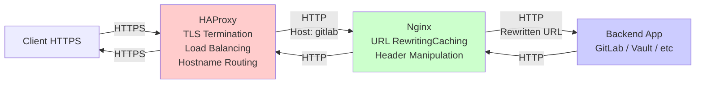

# Chapter 05 — Nginx: Reverse Proxy & Web Gateway

## 5.1 Why Nginx Matters — Layer 7 vs Layer 4

### The Distinction

**Layer 4 (Transport) — HAProxy's Domain:**

- TCP/UDP connections
- IP-based routing
- Load balancing algorithms
- Failover and health checks
- Agnostic to application protocol (works for any protocol)

**Layer 7 (Application) — Nginx's Domain:**

- HTTP/HTTPS semantics
- URL path rewriting
- Request header inspection/modification
- Application-level caching
- Compression (gzip)
- WebSocket proxying
- Static file serving (with caching headers)

### Why Both?



🏗️ **Analogy:** Think of HAProxy as the mail room of a building. It receives all incoming mail, checks the address, and sends it to the right department. Nginx is the department secretary — it reads the actual letter, files it properly, and formats the response nicely before sending it back.

---

## 5.2 Installation

Log into `sec-edge-01` (where HAProxy is running):

```bash
$ ssh sec-edge-01
```

### Step 1 — Install Nginx

```bash
sudo apt update
sudo apt install -y nginx
```

### Step 2 — Verify Installation

```bash
nginx -v
```

```
# Expected output:
→ nginx version: nginx/1.24.x
```

### Step 3 — Ensure HAProxy and Nginx Can Coexist

By default, both HAProxy and Nginx try to listen on port 80/443 (conflict). We'll configure Nginx to listen on port 8080 (internal, only for HAProxy).

```bash
# Stop Nginx for now (we'll reconfigure it)
sudo systemctl stop nginx

# Don't enable on boot yet
sudo systemctl disable nginx
```

---

## 5.3 Nginx Configuration Architecture

Nginx config files are organized hierarchically:

```
/etc/nginx/
├── nginx.conf                 # Main config (includes everything else)
├── conf.d/                    # Additional configs
│   └── default.conf           # Default server block
├── sites-available/           # Potential site configs
├── sites-enabled/             # Symlinks to active sites
└── snippets/                  # Reusable configuration blocks
```

We'll create a modular configuration:

1. Main `nginx.conf` (minimal, mostly includes)
2. Upstream definitions for each backend
3. Server blocks (virtual hosts) for each service

### Step 1 — Create Upstream Definitions

Upstreams define pools of backend servers that Nginx can proxy to.

```bash
# Create the upstream config
sudo tee /etc/nginx/conf.d/upstreams.conf > /dev/null << 'EOF'
#
# Upstream Definitions
# Each upstream is a pool of backend servers
# Nginx load balances requests across servers in the pool
#

# GitLab backend
upstream gitlab_backend {
    # IP:port of the GitLab server
    server 10.0.2.14:80 max_fails=3 fail_timeout=30s;
    # Add more servers here for failover
    # server 10.0.2.19:80 backup;
}

# Vault backend
upstream vault_backend {
    server 10.0.2.13:8200 max_fails=3 fail_timeout=30s;
}

# Authentik backend
upstream authentik_backend {
    server 10.0.2.11:9000 max_fails=3 fail_timeout=30s;
}

# LLDAP Web UI backend
upstream lldap_backend {
    server 10.0.2.11:17170 max_fails=3 fail_timeout=30s;
}

# Harbor backend
upstream harbor_backend {
    server 10.0.2.16:80 max_fails=3 fail_timeout=30s;
}

# SonarQube backend
upstream sonarqube_backend {
    server 10.0.2.15:9000 max_fails=3 fail_timeout=30s;
}

# DefectDojo backend
upstream defectdojo_backend {
    server 10.0.2.15:8000 max_fails=3 fail_timeout=30s;
}

# Nexus backend
upstream nexus_backend {
    server 10.0.2.16:8081 max_fails=3 fail_timeout=30s;
}

# Kibana backend
upstream kibana_backend {
    server 10.0.2.30:5601 max_fails=3 fail_timeout=30s;
}

# Wazuh backend
upstream wazuh_backend {
    server 10.0.2.31:443 max_fails=3 fail_timeout=30s;
}

# Kubernetes API backend
upstream k8s_backend {
    server 10.0.2.20:6443 max_fails=3 fail_timeout=30s;
}

EOF
```

### Step 2 — Create the Main Server Block

This server listens on port 8080 (from HAProxy) and proxies to backends.

#### LLDAP
```bash
sudo tee /etc/nginx/sites-available/lldap > /dev/null << 'EOF'
server {
    listen 8080;
    server_name ldap.devsecops.com;
    access_log /var/log/nginx/lldap_access.log;
    error_log  /var/log/nginx/lldap_error.log;
    location / {
        proxy_pass http://lldap_backend;
        proxy_http_version 1.1;
        proxy_set_header Host $host;
        proxy_set_header X-Real-IP $remote_addr;
        proxy_set_header X-Forwarded-For $proxy_add_x_forwarded_for;
        proxy_set_header X-Forwarded-Proto https;
    }                                                                                                                                                           
}

EOF
```

#### GitLab
```bash
sudo tee /etc/nginx/sites-available/gitlab > /dev/null << 'EOF'
map $upstream_http_upgrade $connection_upgrade {
    default upgrade;
    '' close;
}

server {
    listen 8080;
    server_name gitlab.devsecops.com;
    access_log /var/log/nginx/gitlab_access.log;
    error_log  /var/log/nginx/gitlab_error.log;
    location / {
        proxy_pass http://gitlab_backend;
        proxy_http_version 1.1;
        proxy_set_header Host $host;
        proxy_set_header X-Real-IP $remote_addr;
        proxy_set_header X-Forwarded-For $proxy_add_x_forwarded_for;
        proxy_set_header X-Forwarded-Proto $scheme;
        proxy_set_header X-Forwarded-Host $host;
        proxy_set_header X-Forwarded-Port $server_port;
        
        # WebSocket support (GitLab uses WebSocket for terminal)
        proxy_set_header Upgrade $http_upgrade;
        proxy_set_header Connection $connection_upgrade;
        proxy_buffering off;
    }                                                                                                                                                           
}

EOF
```


#### Vault
```bash
sudo tee /etc/nginx/sites-available/vault > /dev/null << 'EOF'
server {
    listen 8080;
    server_name vault.devsecops.com;
    access_log /var/log/nginx/vault_access.log;
    error_log  /var/log/nginx/vault_error.log;
    location / {        
        proxy_pass http://vault_backend;
        proxy_http_version 1.1;
        proxy_set_header Host $host;
        proxy_set_header X-Real-IP $remote_addr;
        proxy_set_header X-Forwarded-For $proxy_add_x_forwarded_for;
        proxy_set_header X-Forwarded-Proto $scheme;
    }                                                                                                                                                           
}

EOF
```


#### Authentik
```bash
sudo tee /etc/nginx/sites-available/authentik > /dev/null << 'EOF'
map $upstream_http_upgrade $connection_upgrade {
    default upgrade;
    '' close;
}

server {
    listen 8080;
    server_name auth.devsecops.com;
    access_log /var/log/nginx/authentik_access.log;
    error_log  /var/log/nginx/authentik_error.log;
    location / {
        proxy_pass http://authentik_backend;
        proxy_http_version 1.1;
        proxy_set_header Host $host;
        proxy_set_header X-Real-IP $remote_addr;
        proxy_set_header X-Forwarded-For $proxy_add_x_forwarded_for;
        proxy_set_header X-Forwarded-Proto $scheme;
        
        # WebSocket support
        proxy_set_header Upgrade $http_upgrade;
        proxy_set_header Connection $connection_upgrade;
        proxy_buffering off;
    }                                                                                                                                                           
}

EOF
```


#### Harbor
```bash
sudo tee /etc/nginx/sites-available/harbor > /dev/null << 'EOF'
server {
    listen 8080;
    server_name harbor.devsecops.com;
    access_log /var/log/nginx/harbor_access.log;
    error_log  /var/log/nginx/harbor_error.log;
    location / {
        proxy_pass http://harbor_backend;
        proxy_http_version 1.1;
        proxy_set_header Host $host;
        proxy_set_header X-Real-IP $remote_addr;
        proxy_set_header X-Forwarded-For $proxy_add_x_forwarded_for;
        proxy_set_header X-Forwarded-Proto $scheme;
    }                                                                                                                                                           
}

EOF
```


#### SonarQube
```bash
sudo tee /etc/nginx/sites-available/sonar > /dev/null << 'EOF'
server {
    listen 8080;
    server_name sonar.devsecops.com;
    access_log /var/log/nginx/sonar_access.log;
    error_log  /var/log/nginx/sonar_error.log;
    location / {
        proxy_pass http://sonarqube_backend;
        proxy_http_version 1.1;
        proxy_set_header Host $host;
        proxy_set_header X-Real-IP $remote_addr;
        proxy_set_header X-Forwarded-For $proxy_add_x_forwarded_for;
        proxy_set_header X-Forwarded-Proto $scheme;
    }                                                                                                                                                           
}

EOF
```


#### DefectDojo
```bash
sudo tee /etc/nginx/sites-available/dojo > /dev/null << 'EOF'
server {
    listen 8080;
    server_name dojo.devsecops.com defectdojo.devsecops.com;
    access_log /var/log/nginx/dojo_access.log;
    error_log  /var/log/nginx/dojo_error.log;
    location / {
        proxy_pass http://defectdojo_backend;
        proxy_http_version 1.1;
        proxy_set_header Host $host;
        proxy_set_header X-Real-IP $remote_addr;
        proxy_set_header X-Forwarded-For $proxy_add_x_forwarded_for;
        proxy_set_header X-Forwarded-Proto $scheme;
    }                                                                                                                                                           
}

EOF
```

#### Nexus
```bash
sudo tee /etc/nginx/sites-available/nexus > /dev/null << 'EOF'
server {
    listen 8080;
    server_name nexus.devsecops.com;
    access_log /var/log/nginx/nexus_access.log;
    error_log  /var/log/nginx/nexus_error.log;
    location / {
        proxy_pass http://nexus_backend;
        proxy_http_version 1.1;
        proxy_set_header Host $host;
        proxy_set_header X-Real-IP $remote_addr;
        proxy_set_header X-Forwarded-For $proxy_add_x_forwarded_for;
        proxy_set_header X-Forwarded-Proto $scheme;
    }                                                                                                                                                        
}

EOF
```

#### Kibana
```bash
sudo tee /etc/nginx/sites-available/kibana > /dev/null << 'EOF'
server {
    listen 8080;
    server_name kibana.devsecops.com;
    access_log /var/log/nginx/kibana_access.log;
    error_log  /var/log/nginx/kibana_error.log;
    location / {
        proxy_pass http://kibana_backend;
        proxy_http_version 1.1;
        proxy_set_header Host $host;
        proxy_set_header X-Real-IP $remote_addr;
        proxy_set_header X-Forwarded-For $proxy_add_x_forwarded_for;
        proxy_set_header X-Forwarded-Proto $scheme;
    }
}

EOF
```

#### Wazuh
```bash
sudo tee /etc/nginx/sites-available/wazuh > /dev/null << 'EOF'
server {
    listen 8080;
    server_name wazuh.devsecops.com;
    access_log /var/log/nginx/wazuh_access.log;
    error_log  /var/log/nginx/wazuh_error.log;
    location / {
        proxy_pass https://wazuh_backend;
        proxy_http_version 1.1;
        proxy_set_header Host $host;
        proxy_set_header X-Real-IP $remote_addr;
        proxy_set_header X-Forwarded-For $proxy_add_x_forwarded_for;
        proxy_set_header X-Forwarded-Proto $scheme;
        
        # Wazuh uses HTTPS internally
        proxy_ssl_verify off;
        proxy_ssl_session_reuse on;
    }
}

EOF
```

#### K8s
```bash
sudo tee /etc/nginx/sites-available/k8s > /dev/null << 'EOF'
server {
    listen 8080;
    server_name k8s.devsecops.com kubernetes.devsecops.com;
    access_log /var/log/nginx/k8s_access.log;
    error_log  /var/log/nginx/k8s_error.log;
    location / {
        proxy_pass https://k8s_backend;
        proxy_http_version 1.1;
        proxy_set_header Host $host;
        proxy_set_header X-Real-IP $remote_addr;
        proxy_set_header X-Forwarded-For $proxy_add_x_forwarded_for;
        proxy_set_header X-Forwarded-Proto $scheme;
        
        # Kubernetes API uses HTTPS
        proxy_ssl_verify off;
        proxy_ssl_session_reuse on;
    }
}

EOF
```

#### Default Server
```bash
sudo tee /etc/nginx/sites-available/default > /dev/null << 'EOF'
server {
    listen 8080 default_server;
    server_name _;
    location = /healthz {
        access_log off;
        return 200 "OK\n";
        add_header Content-Type text/plain;
    }
    location / {
        return 404;
    }
}

EOF
```

### Step 3 — Enable the Site

```bash
# Create a symlink from sites-available to sites-enabled
sudo ln -sf /etc/nginx/sites-available/lldap /etc/nginx/sites-enabled/lldap
sudo ln -sf /etc/nginx/sites-available/gitlab /etc/nginx/sites-enabled/gitlab
sudo ln -sf /etc/nginx/sites-available/vault /etc/nginx/sites-enabled/vault
sudo ln -sf /etc/nginx/sites-available/authentik /etc/nginx/sites-enabled/authentik
sudo ln -sf /etc/nginx/sites-available/harbor /etc/nginx/sites-enabled/harbor
sudo ln -sf /etc/nginx/sites-available/sonar /etc/nginx/sites-enabled/sonar
sudo ln -sf /etc/nginx/sites-available/dojo /etc/nginx/sites-enabled/dojo
sudo ln -sf /etc/nginx/sites-available/nexus /etc/nginx/sites-enabled/nexus
sudo ln -sf /etc/nginx/sites-available/kibana /etc/nginx/sites-enabled/kibana
sudo ln -sf /etc/nginx/sites-available/wazuh /etc/nginx/sites-enabled/wazuh
sudo ln -sf /etc/nginx/sites-available/k8s /etc/nginx/sites-enabled/k8s
sudo ln -sf /etc/nginx/sites-available/default /etc/nginx/sites-enabled/default
```

### Step 4 — Modify Main nginx.conf

The default nginx.conf includes `/etc/nginx/sites-enabled/*`. Make sure it's properly configured:

```bash
# Check the main config (should already be set up correctly)
sudo grep "sites-enabled" /etc/nginx/nginx.conf
```

```
# Should show:
→ include /etc/nginx/sites-enabled/*;
```

If not, edit it:

```bash
sudo nano /etc/nginx/nginx.conf
# Add: include /etc/nginx/sites-enabled/*;  (usually already there)
```

---

## 5.4 Validate Nginx Configuration

```bash
# Check syntax
sudo nginx -t
```

```
# Expected output:
→ nginx: the configuration file /etc/nginx/nginx.conf syntax is ok
→ nginx: configuration file /etc/nginx/nginx.conf test is successful
```

---

## 5.5 Start Nginx

```bash
# Start Nginx
sudo systemctl start nginx

# Enable on boot
sudo systemctl enable nginx

# Check status
sudo systemctl status nginx
```

```
# Expected output:
→ ● nginx.service - A high performance web server and a reverse proxy server
→      Loaded: loaded (/lib/systemd/system/nginx.service; enabled)
→      Active: active (running) since ...
→      Main PID: 5678 (nginx)
```

---

## 5.6 Update HAProxy to Use Nginx

Now we need to tell HAProxy to send requests to Nginx (port 8080) instead of directly to backends.

Edit the HAProxy config to point all backends to Nginx:

```bash
sudo tee /etc/haproxy/haproxy.cfg.nginx > /dev/null << 'EOF'
#
# HAProxy Configuration (Updated for Nginx backend)
# Routes all traffic to Nginx on port 8080
# Nginx then handles the actual proxy logic
#

global
    log /dev/log local0
    log /dev/log local1 notice
    chroot /var/lib/haproxy
    stats socket /run/haproxy/admin.sock mode 660 level admin
    stats timeout 30s
    user haproxy
    group haproxy
    daemon
    tune.ssl.default-dh-param 2048
    ssl-default-bind-ciphers ECDHE-RSA-AES256-GCM-SHA384:ECDHE-RSA-AES128-GCM-SHA256
    ssl-default-bind-options ssl-min-ver TLSv1.2 no-tls-tickets
    maxconn 4096
    tune.bufsize 16384
    tune.http.maxhdr 101

defaults
    mode http
    log global
    option httplog
    option dontlognull
    option forwardfor
    http-reuse safe
    timeout connect 5000
    timeout client 50000
    timeout server 50000
    timeout tunnel 1h
    errorfile 400 /etc/haproxy/errors/400.http
    errorfile 403 /etc/haproxy/errors/403.http
    errorfile 408 /etc/haproxy/errors/408.http
    errorfile 500 /etc/haproxy/errors/500.http
    errorfile 502 /etc/haproxy/errors/502.http
    errorfile 503 /etc/haproxy/errors/503.http
    errorfile 504 /etc/haproxy/errors/504.http

#
# SIMPLIFIED: All traffic routes to Nginx
# Nginx handles all the application-level routing
#
frontend fe_main
    bind 0.0.0.0:443 ssl crt /etc/haproxy/certs/devsecops.com.pem
    bind 0.0.0.0:80
    http-request redirect scheme https code 301 if !{ ssl_fc }
    
    # All traffic goes to Nginx backend
    default_backend be_nginx

backend be_nginx
    mode http
    option httpchk GET /healthz HTTP/1.0                                                                                                                        
    # or use this one --> http-check send meth GET uri /healthz ver HTTP/1.1 hdr Host localhost
    default-server inter 3s fall 3 rise 2
    # Nginx listens on localhost:8080
    server nginx-01 127.0.0.1:8080 check

listen stats
    bind 127.0.0.1:8404
    mode http
    stats enable
    stats uri /stats
    stats refresh 30s
    stats admin if TRUE

EOF

# Validate the new config
sudo haproxy -c -f /etc/haproxy/haproxy.cfg.nginx

# Swap in the new config
sudo cp /etc/haproxy/haproxy.cfg /etc/haproxy/haproxy.cfg.backends
sudo cp /etc/haproxy/haproxy.cfg.nginx /etc/haproxy/haproxy.cfg

# Reload HAProxy
sudo systemctl reload haproxy
```

```
# Expected output (no errors):
→ Configuration file is valid
```

---

## 5.7 Test the Integration

### Test 1 — Health Check

```bash
# Health check should work
curl http://127.0.0.1:8080/healthz
```

```
# Expected:
→ OK
```

### Test 2 — Direct Nginx Request

```bash
# Direct request to Nginx (simulating backend request)
curl -v http://127.0.0.1:8080/gitlab/ 2>&1 | head -20
```

```
# Expected (error because GitLab isn't running, but Nginx is routing):
→ < HTTP/1.1 502 Bad Gateway
→ ...
→ upstream timed out
```

> This is expected — we haven't deployed GitLab yet. The important thing is that Nginx is trying to reach the backend.

### Test 3 — Through HAProxy

```bash
# Test through HAProxy/TLS
$ curl -k https://10.0.2.12/ -H "Host: gitlab.devsecops.com" 2>&1 | head -10
```

```
# Expected (502 = GitLab not running, but routing works):
→ <html>
→ <head><title>502 Bad Gateway</title></head>
```

### Test 4 — Check Logs

```bash
# Nginx access log shows proxying
sudo tail -10 /var/log/nginx/access.log
```

```
# Expected format:
→ 127.0.0.1 - - [01/Jan/2026:12:00:00 +0000] "GET /healthz HTTP/1.1" 200 3 "-" "curl/..."
→ 127.0.0.1 - - [01/Jan/2026:12:00:00 +0000] "GET /gitlab/ HTTP/1.0" 502 ... "curl/..."
```

---

## 5.8 Advanced Nginx Features

### URL Rewriting

The config already includes rewriting — `/gitlab` is removed before sending to GitLab:

```nginx
location ~ ^/gitlab(/|$) {
    rewrite ^/gitlab(/?.*)$ $1 break;  # Remove /gitlab prefix
    proxy_pass http://gitlab_backend;
}
```

This means:

- Client requests: `https://10.0.2.12/gitlab/users`
- HAProxy routes to Nginx
- Nginx removes `/gitlab`, passes: `http://10.0.2.14/users`
- GitLab responds normally

### WebSocket Support

For applications using WebSockets (real-time updates), Nginx handles the upgrade:

```nginx
proxy_set_header Upgrade $http_upgrade;
proxy_set_header Connection $connection_upgrade;
proxy_buffering off;
```

This is already in the GitLab and Authentik blocks (they use WebSocket for terminal/real-time features).

### Gzip Compression

Add compression to reduce bandwidth:

```bash
# Edit nginx.conf to enable gzip
sudo nano /etc/nginx/nginx.conf
```

Add in the `http` block:

```nginx
http {
    # ... existing config ...
    
    gzip on;
    gzip_vary on;
    gzip_proxied any;
    gzip_comp_level 6;
    gzip_types text/plain text/css text/xml text/javascript 
               application/json application/javascript application/xml+rss 
               application/rss+xml font/truetype font/opentype 
               application/vnd.ms-fontobject image/svg+xml;
}
```

Then reload:

```bash
sudo systemctl reload nginx
```

### Rate Limiting

Limit requests per IP to prevent brute force:

```nginx
# Add to the main config
limit_req_zone $binary_remote_addr zone=general:10m rate=10r/s;
limit_req_zone $binary_remote_addr zone=login:10m rate=5r/m;

server {
    # ...
    
    # Limit login attempts
    location /auth/flows/authenticate {
        limit_req zone=login burst=5 nodelay;
        proxy_pass http://authentik_backend;
    }
}
```

---

## 5.9 Monitoring Nginx

### Active Connections

```bash
# See active connections
ss -tulnp | grep nginx
```

```
# Expected:
→ tcp LISTEN 0 511 *:80 *:* users:(("nginx",pid=1234,fd=6))
→ tcp LISTEN 0 511 *:8080 *:* users:(("nginx",pid=1234,fd=8))
```

### Cache Statistics

Nginx can cache upstream responses (not configured in basic setup, but useful for static assets):

```nginx
# In upstreams block (optional enhancement):
upstream gitlab_backend {
    server 10.0.2.14:80;
    keepalive 32;  # Reuse connections to backend
}

# In location block:
proxy_cache_path /var/cache/nginx levels=1:2 keys_zone=gitlab_cache:10m;

location ~ ^/gitlab/assets {
    proxy_cache gitlab_cache;
    proxy_cache_valid 200 1h;
    proxy_pass http://gitlab_backend;
}
```

---

## 5.10 Nginx vs HAProxy — Division of Responsibilities

|Task|HAProxy|Nginx|
|---|---|---|
|**TLS Termination**|✅ Primary|⚠️ Secondary (could)|
|**Host-based Routing**|✅ Via ACL|✅ Via server_name|
|**Path-based Routing**|✅ Via ACL|✅ Via location|
|**Load Balancing**|✅ Excellent|✅ Good|
|**Health Checks**|✅ TCP/HTTP|✅ HTTP|
|**WebSocket Support**|✅ Automatic|✅ Via headers|
|**Request Rewriting**|❌ Limited|✅ Powerful|
|**Performance**|✅ High-speed routing|✅ High-speed proxying|
|**Failover**|✅ Excellent|⚠️ Needs external tools|

**In our architecture:**

- **HAProxy:** Handles TLS, hostname routing, failover, load balancing
- **Nginx:** Handles URL rewriting, caching, compression, WebSocket protocol

---

## 5.11 Firewall Configuration

Nginx listens on port 8080 (internal only — no external access needed):

```bash
# Nginx port 8080 doesn't need firewall rule (only HAProxy listens externally)
# But verify Nginx is listening correctly
sudo ufw status | grep 8080
# Should show nothing (correct — it's localhost-only)

# Check Nginx is listening
netstat -tulnp | grep :8080
```

```
# Expected:
→ tcp LISTEN 0 511 127.0.0.1:8080 0.0.0.0:* 5678/nginx
```

---

## 5.12 Validation Script — Chapter 05

```bash
#!/bin/bash
# ~/lab/scripts/validate-chapter-05.sh
# Run from: HOST machine

set -euo pipefail

EDGE_IP="10.0.2.12"
PASS=0
FAIL=0

echo "============================================="
echo " Chapter 05 Validation — Nginx Web Gateway   "
echo "============================================="

echo ""
echo "--- Nginx Service ---"

result=$(ssh sec-edge-01 'systemctl is-active nginx' 2>/dev/null || echo "error")
if [ "$result" = "active" ]; then
    echo "  ✅ PASS: Nginx service is active"
    ((PASS++))
else
    echo "  ❌ FAIL: Nginx service is not active"
    ((FAIL++))
fi

echo ""
echo "--- Nginx Configuration ---"

config_valid=$(ssh sec-edge-01 'sudo nginx -t' 2>&1 | grep -c "successful" || echo "0")
if [ "$config_valid" -gt 0 ]; then
    echo "  ✅ PASS: Nginx configuration is valid"
    ((PASS++))
else
    echo "  ❌ FAIL: Nginx configuration has errors"
    ((FAIL++))
fi

echo ""
echo "--- Network Listening ---"

# Check if Nginx is listening on 8080
listening=$(ssh sec-edge-01 'netstat -tulnp 2>/dev/null | grep :8080' || echo "")
if [ -n "$listening" ]; then
    echo "  ✅ PASS: Nginx listening on port 8080"
    ((PASS++))
else
    echo "  ❌ FAIL: Nginx not listening on port 8080"
    ((FAIL++))
fi

echo ""
echo "--- Upstream Definitions ---"

upstream_count=$(ssh sec-edge-01 'grep "upstream " /etc/nginx/conf.d/upstreams.conf | wc -l' 2>/dev/null || echo "0")
if [ "$upstream_count" -gt 5 ]; then
    echo "  ✅ PASS: Multiple upstreams configured ($upstream_count found)"
    ((PASS++))
else
    echo "  ❌ FAIL: Insufficient upstreams ($upstream_count found, expected 10+)"
    ((FAIL++))
fi

echo ""
echo "--- Health Check Endpoint ---"

health=$(curl -s http://$EDGE_IP:8080/healthz 2>/dev/null || echo "failed")
if echo "$health" | grep -q "OK"; then
    echo "  ✅ PASS: Health check endpoint responding"
    ((PASS++))
else
    echo "  ❌ FAIL: Health check endpoint not responding"
    ((FAIL++))
fi

echo ""
echo "--- HAProxy/Nginx Integration ---"

# Test through HAProxy (may return 502 if backend not running, but should not be connection error)
response=$(curl -s -o /dev/null -w "%{http_code}" -k https://$EDGE_IP/ -H "Host: gitlab.devsecops.com" 2>/dev/null || echo "000")
case $response in
    200|502|503|504)
        echo "  ✅ PASS: HAProxy → Nginx routing working (HTTP $response)"
        ((PASS++))
        ;;
    *)
        echo "  ❌ FAIL: HAProxy → Nginx routing failed (HTTP $response)"
        ((FAIL++))
        ;;
esac

echo ""
echo "--- Access Logs ---"

logs=$(ssh sec-edge-01 'test -f /var/log/nginx/access.log && wc -l < /var/log/nginx/access.log' 2>/dev/null || echo "0")
if [ "$logs" -gt 0 ]; then
    echo "  ✅ PASS: Nginx access logs present ($logs lines)"
    ((PASS++))
else
    echo "  ⚠️  WARNING: No access logs yet (normal on fresh start)"
    ((PASS++))
fi

echo ""
echo "--- Results ---"
echo "  Passed: ${PASS}"
echo "  Failed: ${FAIL}"

if [ "$FAIL" -eq 0 ]; then
    echo ""
    echo "🎉 Nginx integration complete! Ready for Chapter 06."
else
    echo ""
    echo "⚠️  ${FAIL} check(s) failed. Fix before proceeding."
    exit 1
fi
```

---

## 5.13 Troubleshooting

### Problem: "Address already in use" port 8080

```bash
# Check if something else is using port 8080
sudo lsof -i :8080
# Kill conflicting process or change Nginx port
```

### Problem: Nginx won't start

```bash
# Check error messages
sudo systemctl status nginx
# Or:
sudo journalctl -xeu nginx -n 20
```

### Problem: 502 Bad Gateway from HAProxy

This is expected if backends aren't running. Check:

1. Is Nginx running and listening on 8080?
    
    ```bash
    netstat -tulnp | grep :8080
    ```
    
2. Is the backend service running?
    
    ```bash
    $ ssh 10.0.2.14 'systemctl status gitlab'
    ```
    
3. Can Nginx reach the backend?
    
    ```bash
    curl -v http://10.0.2.14:80/healthz
    ```
    

### Problem: Rewriting doesn't work (still gets /gitlab in request)

Make sure the `rewrite` directive has `break`:

```nginx
rewrite ^/gitlab(/?.*)$ $1 break;  # break stops further processing
```

Without `break`, Nginx might process the URL again.

---

## 5.14 Chapter Summary & Key Takeaways

|What We Built|Purpose|
|---|---|
|Nginx reverse proxy|Application-level request handling|
|Upstream definitions|Backend server pools|
|Path-based routing|Route different paths to different backends|
|URL rewriting|Remove path prefixes before sending to backends|
|WebSocket support|Real-time features in applications|
|Gzip compression|Reduce bandwidth usage|
|Comprehensive logging|Access log for analysis|

💡 **Key Takeaway — Separation of Concerns:**

HAProxy (Layer 4) and Nginx (Layer 7) together create a powerful, maintainable architecture:

- **HAProxy:** "Where does this traffic go?" (Hostname? → Route to right service)
    
- **Nginx:** "How do I handle this traffic?" (Rewrite, compress, cache, upgrade protocols, etc.)
    

This separation lets you:

- Change HAProxy config without touching applications
- Add web-level features without changing routing
- Scale each layer independently

---

_DevSecOps Lab Book — Zero to Hero | Chapter 05 | Phase 1: Foundation_