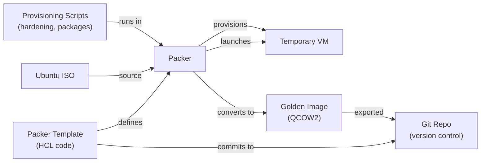

# Chapter 07 — Packer: Golden Image Creation

## DevSecOps Lab Book — Phase 2: Immutable Infrastructure

---

> **Chapter Goal**
> 
> Build automated, reproducible VM images using Packer. Instead of manually installing Ubuntu, hardening SSH, installing packages, and creating templates (like we did in Chapter 01), we define the entire image in code.
> 
> By the end of this chapter:
> 
> - You can build identical images consistently from code
> - Images are version-controlled and auditable
> - Base image is created once, cloned 12 times (vs creating from scratch)
> - All security hardening is in code (reproducible, testable)
> - Image building is fully automated (zero manual steps)
> 

---

## 7.1 Why Packer Exists — The Image Problem

In Chapter 01, we:

1. Downloaded Ubuntu ISO
2. Installed OS manually (clicked through wizard)
3. Ran 20+ commands to harden the system
4. Created a template VM
5. Cloned it 12 times

If we need to rebuild:

- Do we remember all the commands?
- Did we miss any hardening steps?
- Were all images identical or did we customize one?
- If a security patch is released, how do we update all images?

🏗️ **Analogy:** Imagine building a house:

- **Manual approach:** Hire a contractor, give verbal instructions, hope they remember everything
- **Packer approach:** Provide blueprints and a specification, contractor builds it identically every time

### What Packer Does



---

## 7.2 Packer Concepts

|Concept|Explanation|Lab Example|
|---|---|---|
|**Builder**|Tool that creates images (qemu, aws, azure)|QEMU for KVM VMs|
|**Provisioner**|Script/tool that runs inside the build VM|Shell scripts, Ansible|
|**Template**|HCL file defining the entire image|`ubuntu-22.04-base.pkr.hcl`|
|**Artifact**|Output image created by Packer|`ubuntu-22.04-base.qcow2`|
|**Variables**|Configurable values in templates|ISO URL, VM size, hostname|

---

## 7.3 Installation

Install Packer on your host machine (not in a VM):

```bash
# On your host (macOS, Linux, or WSL)
$ cd ~/lab

# Download Packer (check latest version)
$ wget https://releases.hashicorp.com/packer/1.9.4/packer_1.9.4_linux_amd64.zip
$ unzip packer_1.9.4_linux_amd64.zip
$ sudo mv packer /usr/local/bin/

# Verify installation
$ packer version
```

```
# Expected output:
→ Packer v1.9.4
```

---

## 7.4 Create Packer Template for Ubuntu 22.04

Packer templates are HCL files. We'll create one that:

- Downloads Ubuntu 22.04 ISO
- Boots the ISO
- Runs Ubuntu installer (unattended)
- Runs hardening scripts
- Outputs a QCOW2 image

### Step 1 — Create Project Directory

```bash
$ mkdir -p ~/lab/packer/ubuntu-22.04
$ cd ~/lab/packer/ubuntu-22.04
```

### Step 2 — Create Packer Variables File

```bash
$ cat > variables.pkr.hcl << 'EOF'
# Packer variables for Ubuntu 22.04 build

variable "iso_url" {
  description = "Ubuntu 22.04 LTS Server ISO URL"
  type        = string
  default     = "https://releases.ubuntu.com/22.04/ubuntu-22.04.4-live-server-amd64.iso"
}

variable "iso_checksum" {
  description = "SHA256 checksum of the ISO"
  type        = string
  default     = "sha256:45f873de5830e1c0ff67d4662ab12444351487b8292d1ad5f89022ad9f91f6a0"
  # Update this from Ubuntu's SHA256SUMS file
}

variable "vm_name" {
  description = "Name of the output image"
  type        = string
  default     = "ubuntu-22.04-base"
}

variable "output_directory" {
  description = "Where to save the image"
  type        = string
  default     = "output"
}

variable "ssh_username" {
  description = "SSH user for provisioning"
  type        = string
  default     = "ubuntu"
}

variable "ssh_password" {
  description = "SSH password (temporary)"
  type        = string
  default     = "ubuntu"
  sensitive   = true
}

variable "cpu_count" {
  description = "vCPUs for build VM"
  type        = number
  default     = 2
}

variable "memory_mb" {
  description = "RAM for build VM (MB)"
  type        = number
  default     = 2048
}

variable "disk_size_gb" {
  description = "Disk size for build VM (GB)"
  type        = number
  default     = 20
}

EOF
```

### Step 3 — Create Main Packer Template

```bash
$ cat > ubuntu-22.04.pkr.hcl << 'EOF'
#
# Packer Template: Ubuntu 22.04 Base Image
# Builds a hardened, minimal Ubuntu 22.04 image for the DevSecOps lab
#

# Required plugins
terraform {
  required_plugins {
    qemu = {
      source  = "github.com/hashicorp/qemu"
      version = "~> 1.0"
    }
  }
}

#
# BUILDER: QEMU (KVM)
# Launches a temporary VM, installs OS, applies hardening
#
source "qemu" "ubuntu-22.04" {
  # Image output settings
  vm_name              = var.vm_name
  output_directory     = var.output_directory
  accelerator          = "kvm"
  disk_image           = false
  format               = "qcow2"
  disk_size            = "${var.disk_size_gb}G"
  
  # ISO (boot image)
  iso_url      = var.iso_url
  iso_checksum = var.iso_checksum
  
  # VM resources
  cpus        = var.cpu_count
  memory      = var.memory_mb
  qemuargs    = [["-cpu", "host"]]
  
  # Network (use default bridge)
  net_device  = "virtio-net"
  
  # Keyboard layout
  qemu_binary = "qemu-system-x86_64"
  
  # Console output
  headless    = true
  
  # SSH access (for provisioning)
  communicator      = "ssh"
  ssh_username      = var.ssh_username
  ssh_password      = var.ssh_password
  ssh_timeout       = "20m"
  ssh_port          = 22
  
  # Shutdown command
  shutdown_command = "echo '${var.ssh_password}' | sudo -S shutdown -P now"
}

#
# BUILD BLOCK: Orchestrates the build process
#
build {
  name = "ubuntu-22.04"
  
  sources = [
    "source.qemu.ubuntu-22.04"
  ]

  #
  # PROVISIONER 1: Wait for Ubuntu to be ready
  #
  provisioner "shell" {
    inline = [
      "echo 'Waiting for system to stabilize...'",
      "sleep 30"
    ]
  }

  #
  # PROVISIONER 2: Update system
  #
  provisioner "shell" {
    inline = [
      "sudo apt-get update",
      "sudo apt-get upgrade -y",
      "sudo apt-get autoremove -y",
      "sudo apt-get autoclean -y"
    ]
  }

  #
  # PROVISIONER 3: Install base packages (same as Chapter 01)
  #
  provisioner "shell" {
    script = "${path.root}/scripts/install-packages.sh"
  }

  #
  # PROVISIONER 4: Hardening (SSH, firewall, etc.)
  #
  provisioner "shell" {
    script = "${path.root}/scripts/hardening.sh"
  }

  #
  # PROVISIONER 5: Cleanup (remove cloud-init, machine-id, etc.)
  #
  provisioner "shell" {
    script = "${path.root}/scripts/cleanup.sh"
  }

  #
  # PROVISIONER 6: Manifest (record build info)
  #
  provisioner "shell" {
    inline = [
      "echo 'Image built by Packer on '$(date)' > /etc/image-build-info",
      "echo 'Based on Ubuntu 22.04 LTS' >> /etc/image-build-info"
    ]
  }

  #
  # POST-PROCESSOR: Display build summary
  #
  post-processor "manifest" {
    output     = "manifest.json"
    strip_path = true
    custom_data = {
      "build_tool"    = "Packer"
      "build_version" = "1.9.4"
      "image_type"    = "Ubuntu 22.04 LTS"
    }
  }
}

EOF
```

### Step 4 — Create Provisioning Scripts

#### Install Packages Script

```bash
$ cat > scripts/install-packages.sh << 'EOF'
#!/bin/bash
# Install base packages (same as Chapter 01)

set -euo pipefail

echo "Installing base packages..."

sudo apt-get install -y \
    curl \
    wget \
    git \
    vim \
    htop \
    net-tools \
    dnsutils \
    tcpdump \
    nmap \
    ufw \
    fail2ban \
    auditd \
    chrony \
    rsyslog \
    ca-certificates \
    gnupg \
    lsb-release \
    unzip \
    jq \
    python3 \
    python3-pip

echo "Base packages installed."

EOF

chmod +x scripts/install-packages.sh
```

#### Hardening Script

```bash
$ cat > scripts/hardening.sh << 'EOF'
#!/bin/bash
# Security hardening (same as Chapter 01)

set -euo pipefail

echo "Applying security hardening..."

# ─────────────────────────────────────
# SSH Hardening
# ─────────────────────────────────────
echo "Hardening SSH..."
sudo mkdir -p /etc/ssh/sshd_config.d
sudo tee /etc/ssh/sshd_config.d/hardening.conf > /dev/null << 'SSHEOF'
PermitRootLogin no
PasswordAuthentication yes
PermitEmptyPasswords no
Protocol 2
ClientAliveInterval 300
ClientAliveCountMax 2
MaxAuthTries 3
AllowUsers ubuntu
X11Forwarding no
LogLevel VERBOSE
SSHEOF

sudo systemctl restart sshd

# ─────────────────────────────────────
# Firewall Configuration
# ─────────────────────────────────────
echo "Configuring firewall..."
sudo ufw default deny incoming
sudo ufw default allow outgoing
sudo ufw allow 22/tcp
sudo ufw --force enable

# ─────────────────────────────────────
# fail2ban Configuration
# ─────────────────────────────────────
echo "Configuring fail2ban..."
sudo tee /etc/fail2ban/jail.local > /dev/null << 'FAIL2BANEOF'
[DEFAULT]
bantime  = 3600
findtime = 600
maxretry = 5

[sshd]
enabled = true
FAIL2BANEOF

sudo systemctl enable fail2ban
sudo systemctl restart fail2ban

# ─────────────────────────────────────
# Timezone (UTC)
# ─────────────────────────────────────
echo "Setting timezone to UTC..."
sudo timedatectl set-timezone UTC

# ─────────────────────────────────────
# Auditd Configuration
# ─────────────────────────────────────
echo "Configuring auditd..."
sudo systemctl enable auditd

echo "Hardening complete."

EOF

chmod +x scripts/hardening.sh
```

#### Cleanup Script

```bash
$ cat > scripts/cleanup.sh << 'EOF'
#!/bin/bash
# Cleanup (prepare for cloning)

set -euo pipefail

echo "Cleaning up for image cloning..."

# Remove cloud-init
sudo apt-get remove -y cloud-init
sudo apt-get purge -y cloud-init

# Clear machine-id
sudo truncate -s 0 /etc/machine-id
sudo rm -f /var/lib/dbus/machine-id
sudo ln -s /etc/machine-id /var/lib/dbus/machine-id

# Remove SSH host keys (regenerated on first boot)
sudo rm -f /etc/ssh/ssh_host_*

# Clear history
history -c && history -w

# Clear cloud-init logs
sudo cloud-init clean --logs

# Clear temp files
sudo rm -rf /tmp/* /var/tmp/* /var/log/*.* 

echo "Cleanup complete."

EOF

chmod +x scripts/cleanup.sh
```

### Step 5 — Create Validation Script

```bash
$ cat > scripts/validate.sh << 'EOF'
#!/bin/bash
# Validate the built image

set -euo pipefail

IMAGE="$1"

if [ ! -f "$IMAGE" ]; then
    echo "Error: Image file not found: $IMAGE"
    exit 1
fi

echo "Validating image: $IMAGE"

# Check file size (should be reasonable)
SIZE=$(du -h "$IMAGE" | cut -f1)
echo "✓ Image size: $SIZE"

# Check if it's a valid QCOW2
if qemu-img info "$IMAGE" > /dev/null 2>&1; then
    echo "✓ Image is valid QCOW2 format"
else
    echo "✗ Image is not valid QCOW2"
    exit 1
fi

echo "✓ Validation passed!"

EOF

chmod +x scripts/validate.sh
```

---

## 7.5 Build the Image

### Step 1 — Validate Packer Template

```bash
$ cd ~/lab/packer/ubuntu-22.04
$ packer validate .
```

```
# Expected output:
→ The configuration is valid.
```

### Step 2 — Format the Template (Optional)

```bash
$ packer fmt .
# Fixes any formatting issues
```

### Step 3 — Build the Image

```bash
# Start the build
# This will take 5–10 minutes (downloads ISO, installs, hardens)
$ packer build -on-error=ask .
```

```
# Expected output (progress):
→ qemu.ubuntu-22.04: Downloading ISO...
→ qemu.ubuntu-22.04: Creating disk image...
→ qemu.ubuntu-22.04: Starting VM...
→ qemu.ubuntu-22.04: Running provisioner: shell (install-packages.sh)...
→ qemu.ubuntu-22.04: Running provisioner: shell (hardening.sh)...
→ qemu.ubuntu-22.04: Running provisioner: shell (cleanup.sh)...
→ qemu.ubuntu-22.04: Creating manifest...
→ qemu.ubuntu-22.04: Build complete!
```

> If the build fails at any step, Packer will pause and ask if you want to debug the VM or discard it. Choose debug to SSH in and troubleshoot.

### Step 4 — Validate the Image

```bash
$ ./scripts/validate.sh output/ubuntu-22.04
```

```
# Expected output:
→ ✓ Image size: 2.5G
→ ✓ Image is valid QCOW2 format
→ ✓ Validation passed!
```

### Step 5 — Move Image to KVM Default Location

```bash
# Copy the built image to where KVM expects it
$ sudo cp output/ubuntu-22.04 /var/lib/libvirt/images/ubuntu-22.04-packer.qcow2
$ sudo chown libvirt:libvirt /var/lib/libvirt/images/ubuntu-22.04-packer.qcow2
```

---

## 7.6 Test the Image (Boot a VM from It)

```bash
# Use the Packer-built image instead of the manual one from Chapter 01
$ virt-install \
    --name "ubuntu-22.04-test" \
    --ram 2048 \
    --vcpus 2 \
    --disk path=/var/lib/libvirt/images/ubuntu-22.04-packer.qcow2,format=qcow2 \
    --os-variant ubuntu22.04 \
    --network network=devsecops-lab,model=virtio \
    --graphics none \
    --console pty,target_type=serial \
    --import \
    --noautoconsole
```

### Verify the VM Boots

```bash
# Start and connect to the test VM
$ virsh start ubuntu-22.04-test
$ virsh console ubuntu-22.04-test

# Inside the VM:
vm# hostname
vm# ufw status
vm# systemctl status ssh
```

```
# Expected output:
→ ubuntu-22.04-test (hostname)
→ Status: active (ufw)
→ active (running) (ssh)
```

### Clean Up Test VM

```bash
$ virsh destroy ubuntu-22.04-test
$ virsh undefine ubuntu-22.04-test
$ rm /var/lib/libvirt/images/ubuntu-22.04-test.qcow2
```

---

## 7.7 Advanced Packer Techniques

### Build Variables with `-var` Flag

```bash
# Build with custom values without editing the template
$ packer build \
    -var "memory_mb=4096" \
    -var "cpu_count=4" \
    .
```

### Use Environment Variables

```bash
# Set via env, use in template
export PKR_VAR_iso_url="https://releases.ubuntu.com/22.04/ubuntu-22.04.4-live-server-amd64.iso"
packer build .
```

### Build Multiple Variants

Create different variants (minimal, server, hardened):

```
ubuntu-22.04-minimal.pkr.hcl
ubuntu-22.04-server.pkr.hcl
ubuntu-22.04-hardened.pkr.hcl
```

Then build all:

```bash
$ packer build -parallel=2 .
```

### Publish to Registry (Future)

After perfecting the image, push to a registry:

```bash
# For a team, publish to shared storage
$ aws s3 cp output/ubuntu-22.04 s3://my-images/ubuntu-22.04.qcow2
```

---

## 7.8 Version Control

Store your Packer templates in Git:

```bash
# Create a git repo for Packer templates
$ cd ~/lab/packer
$ git init
$ git add ubuntu-22.04/
$ git commit -m "Initial Ubuntu 22.04 Packer template"

# Tag the image version
$ git tag -a v1.0 -m "First stable build"
```

This lets you:

- Track changes to the image definition
- Revert to previous versions
- Review who changed what and when
- Collaborate with teammates

---

## 7.9 Validation Script — Chapter 07

```bash
#!/bin/bash
# ~/lab/scripts/validate-chapter-07.sh
# Validates Packer template and build

set -euo pipefail

PACKER_DIR="$HOME/lab/packer/ubuntu-22.04"
PASS=0
FAIL=0

echo "============================================="
echo " Chapter 07 Validation — Packer Images      "
echo "============================================="

echo ""
echo "--- Packer Installation ---"

if command -v packer &> /dev/null; then
    version=$(packer version | head -1)
    echo "  ✅ PASS: Packer installed ($version)"
    ((PASS++))
else
    echo "  ❌ FAIL: Packer not found"
    ((FAIL++))
fi

echo ""
echo "--- Template Files ---"

if [ -d "$PACKER_DIR" ]; then
    echo "  ✅ PASS: Packer project directory exists"
    ((PASS++))
else
    echo "  ❌ FAIL: Packer project directory not found"
    ((FAIL++))
fi

if [ -f "$PACKER_DIR/ubuntu-22.04.pkr.hcl" ]; then
    echo "  ✅ PASS: Main template file exists"
    ((PASS++))
else
    echo "  ❌ FAIL: Main template file not found"
    ((FAIL++))
fi

echo ""
echo "--- Template Validation ---"

if cd "$PACKER_DIR" && packer validate . > /dev/null 2>&1; then
    echo "  ✅ PASS: Template syntax is valid"
    ((PASS++))
else
    echo "  ❌ FAIL: Template syntax is invalid"
    ((FAIL++))
fi

echo ""
echo "--- Provisioning Scripts ---"

for script in install-packages.sh hardening.sh cleanup.sh; do
    if [ -f "$PACKER_DIR/scripts/$script" ]; then
        echo "  ✅ PASS: Script exists: $script"
        ((PASS++))
    else
        echo "  ❌ FAIL: Script missing: $script"
        ((FAIL++))
    fi
done

echo ""
echo "--- Built Image (if available) ---"

if [ -f "$PACKER_DIR/output/ubuntu-22.04" ]; then
    size=$(ls -lh "$PACKER_DIR/output/ubuntu-22.04" | awk '{print $5}')
    echo "  ✅ PASS: Built image exists (size: $size)"
    ((PASS++))
    
    # Validate QCOW2 format
    if qemu-img info "$PACKER_DIR/output/ubuntu-22.04" > /dev/null 2>&1; then
        echo "  ✅ PASS: Image is valid QCOW2"
        ((PASS++))
    else
        echo "  ❌ FAIL: Image is not valid QCOW2"
        ((FAIL++))
    fi
else
    echo "  ℹ️  INFO: No built image yet (run 'packer build')"
fi

echo ""
echo "--- Results ---"
echo "  Passed: ${PASS}"
echo "  Failed: ${FAIL}"

if [ "$FAIL" -eq 0 ]; then
    echo ""
    echo "🎉 Packer is ready! Run: cd $PACKER_DIR && packer build ."
else
    echo ""
    echo "⚠️  ${FAIL} check(s) failed."
    exit 1
fi

```

---

## 7.10 Troubleshooting

### Problem: "qemu-system-x86_64: No such file or directory"

QEMU is not installed.

```bash
$ sudo apt install -y qemu-system-x86 qemu-utils
```

### Problem: "Download failed: 404 Not Found"

ISO URL is wrong or moved.

```bash
# Check the correct URL at:
# https://releases.ubuntu.com/22.04/

# Update the variable:
$ packer build -var "iso_url=https://..." .
```

### Problem: Build hangs at "Starting VM"

QEMU can't start. Check:

```bash
$ kvm-ok  # Verify KVM acceleration available
$ sudo virt-host-validate qemu  # Full validation
```

### Problem: "Permission denied" when writing to /var/lib/libvirt

You need root for libvirt directory:

```bash
$ sudo cp output/ubuntu-22.04 /var/lib/libvirt/images/
$ sudo chown libvirt:libvirt /var/lib/libvirt/images/ubuntu-22.04
```

---

## 7.11 Chapter Summary

|What We Built|Purpose|
|---|---|
|Packer template (HCL)|Code-based image definition|
|Provisioning scripts|Shell scripts for hardening/packages|
|Automated build|No manual clicks; consistent output|
|QCOW2 image|KVM-compatible image artifact|
|Validation script|Verify image integrity|
|Git repository|Version control for image definitions|

💡 **Key Takeaway — Infrastructure as Code Starts with Images:**

Before you can truly have infrastructure-as-code, you need reproducible images. Packer handles this. Now:

- Images are version-controlled
- Changes are auditable
- Rebuilds are identical
- No manual steps = no human error

In Chapter 08 (OpenTofu), we'll use this image to provision all 12 VMs automatically.

---

## Next Chapter

**Chapter 08 → OpenTofu: Infrastructure as Code**

With a reproducible image from Packer, we can now define the entire lab infrastructure in code using OpenTofu (Terraform):

- All 12 VMs declared in HCL
- Network, firewall, DNS entries all defined
- Entire lab provisions with one command
- Destroy and rebuild in < 1 hour

---

_DevSecOps Lab Book — Zero to Hero | Chapter 07 | Phase 2: Immutable Infrastructure_