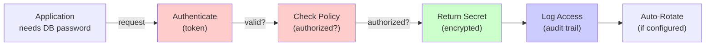

# Chapter 10 — HashiCorp Vault: Secrets Management Deep Dive

## DevSecOps Lab Book — Phase 3: Security & Access Core

---

> **Chapter Goal**
> 
> Deploy HashiCorp Vault on `sec-vault-01` (10.0.2.13) as the centralized secrets management system for the entire lab. Instead of secrets scattered in config files, environment variables, and code, everything goes through Vault.
> 
> By the end of this chapter:
> 
> - Vault is unsealed and operational
> - All lab services retrieve secrets from Vault
> - Database credentials, API keys, TLS certs are stored centrally
> - Secrets are encrypted at rest and in transit
> - All secret access is logged and auditable
> - Automatic secret rotation is configured
> 
> **Time estimate:** 4–5 hours.

---

## 10.1 The Secrets Problem — Why Vault Exists

Where are your secrets now?

### Common (Insecure) Patterns

**Pattern 1: Secrets in Code**

```python
# ❌ DANGEROUS: Secret in source code
DATABASE_PASSWORD = "mysql-password-123"
GITHUB_TOKEN = "ghp_xxxxxxxxxxxx"
API_KEY = "sk-xxxxxxxxxxxxxx"
```

Problems:

- ❌ Visible in Git history forever
- ❌ Accessible to everyone with code access
- ❌ Cannot rotate without code change + redeploy
- ❌ Compliance violation (SOC2, PCI, HIPAA)

**Pattern 2: Secrets in Environment Variables**

```bash
# ❌ WEAK: Secret in environment
export DATABASE_PASSWORD="mysql-password-123"
```

Problems:

- ❌ Visible in `ps aux` output
- ❌ No encryption
- ❌ No audit log
- ❌ Hard to rotate

**Pattern 3: Secrets in Config Files**

```yaml
# ❌ WEAK: Secret in config
database:
  password: mysql-password-123
```

Problems:

- ❌ Must protect file permissions manually
- ❌ Backup/copy accidentally spreads secrets
- ❌ No audit log
- ❌ No rotation mechanism

### The Vault Solution

🏗️ **Analogy:** Think of Vault like a bank safe deposit box:

- You put secrets in (lock them away)
- Applications request secrets (authenticate, verify authorization)
- Vault returns secrets (only if authorized)
- Vault logs every access (audit trail)
- Vault rotates secrets (automatically)
- Vault encrypts everything (at rest and in transit)



---

## 10.2 Vault Architecture & Concepts

|Concept|Explanation|Lab Example|
|---|---|---|
|**Seal/Unseal**|Vault is born "sealed" (encrypted at rest); must be unsealed to use|Initial startup|
|**Initialization**|Generate unseal keys + root token|Done once, securely|
|**Authentication**|Prove your identity (token, OIDC, LDAP, etc.)|App uses token to auth|
|**Authorization**|What secrets can this identity access?|Policy: "read database/* but not secrets/*"|
|**Secrets Engine**|Plugin that stores/generates secrets|KV (key-value), Database, PKI, SSH, etc.|
|**Engine Path**|Where a secrets engine is mounted|`secret/` for KV, `database/` for DB creds|
|**Lease**|How long a secret is valid before expiration|1 hour TTL, then must request again|
|**Audit Log**|Record of every secret access|Who, when, what, result|

---

## 10.3 Installation

Log into `sec-vault-01`:

```bash
$ ssh sec-vault-01
```

### Step 1 — Install Vault

```bash
# Download Vault binary
vm# cd /tmp
vm# wget https://releases.hashicorp.com/vault/1.15.0/vault_1.15.0_linux_amd64.zip
vm# unzip vault_1.15.0_linux_amd64.zip
vm# sudo mv vault /usr/local/bin/
vm# sudo chmod +x /usr/local/bin/vault

# Enable command autocompletion (optional)
vm# vault -autocomplete-install

# Verify installation
vm# vault version
```

```
# Expected output:
→ Vault v1.15.0 (...)
```

### Step 2 — Create Vault User and Directories

```bash
# Create vault system user
vm# sudo useradd --system --home /var/lib/vault --shell /usr/sbin/nologin vault

# Create directories
vm# sudo mkdir -p /var/lib/vault /var/log/vault /etc/vault
vm# sudo chown -R vault:vault /var/lib/vault /var/log/vault /etc/vault
vm# sudo chmod 700 /var/lib/vault /var/log/vault /etc/vault
```

### Step 3 — Create Vault Configuration

```bash
# Create the Vault config file
vm# sudo tee /etc/vault/vault.hcl > /dev/null << 'EOF'
#
# Vault Server Configuration
#

# Listener: How Vault accepts connections
listener "tcp" {
  address       = "0.0.0.0:8200"
  tls_cert_file = "/etc/vault/tls/vault.crt"
  tls_key_file  = "/etc/vault/tls/vault.key"
}

# Storage backend: Where secrets are stored (encrypted at rest)
# Using file backend for simplicity (production uses Consul, PostgreSQL, etc.)
storage "file" {
  path = "/var/lib/vault/data"
}

# UI: Enable web interface
ui = true

# Logging
log_level = "info"

# Maximum lease time (default 32 days)
max_lease_ttl = "768h"
default_lease_ttl = "168h"

EOF

vm# sudo chown vault:vault /etc/vault/vault.hcl
vm# sudo chmod 640 /etc/vault/vault.hcl
```

### Step 4 — Generate Self-Signed TLS Certificate

Vault requires TLS (encrypted connections):

```bash
# Create certificate directory
vm# sudo mkdir -p /etc/vault/tls
vm# sudo chown vault:vault /etc/vault/tls
vm# sudo chmod 700 /etc/vault/tls

# Generate certificate
vm# sudo openssl req -x509 \
    -newkey rsa:2048 \
    -keyout /etc/vault/tls/vault.key \
    -out /etc/vault/tls/vault.crt \
    -days 1825 \
    -nodes \
    -subj "/CN=vault.devsecops.com/O=DevSecOps Lab/C=US"

# Set permissions
vm# sudo chown vault:vault /etc/vault/tls/*
vm# sudo chmod 600 /etc/vault/tls/*
```

---

## 10.4 Create Systemd Service

```bash
# Create service file
vm# sudo tee /etc/systemd/system/vault.service > /dev/null << 'EOF'
[Unit]
Description=HashiCorp Vault
Documentation=https://www.vaultproject.io/docs/
Requires=network-online.target
After=network-online.target
ConditionFileNotEmpty=/etc/vault/vault.hcl

[Service]
Type=notify
User=vault
Group=vault
ProtectSystem=full
ProtectHome=yes
NoNewPrivileges=yes
PrivateDevices=yes
SecureBits=keep-caps
AmbientCapabilities=CAP_IPC_LOCK
CapabilityBoundingSet=CAP_SYSLOG CAP_IPC_LOCK
LimitNOFILE=65536
LimitNPROC=512
KillMode=process

ExecStart=/usr/local/bin/vault server -config=/etc/vault/vault.hcl
ExecReload=/bin/kill -HUP $MAINPID
Restart=on-failure
RestartSec=5

StandardOutput=journal
StandardError=journal
SyslogIdentifier=vault

[Install]
WantedBy=multi-user.target

EOF

vm# sudo systemctl daemon-reload
vm# sudo systemctl enable vault
```

---

## 10.5 Start Vault and Initialize

### Step 1 — Start the Service

```bash
vm# sudo systemctl start vault
vm# sudo systemctl status vault
```

```
# Expected output:
→ ● vault.service - HashiCorp Vault
→      Active: active (running)
```

### Step 2 — Initialize Vault

Initialization generates unseal keys and the root token. **This is a one-time, critical operation.**

```bash
# Initialize with 5 unseal keys, requiring 3 to unseal
# (5 keys = distribute to 5 people; 3 required = quorum)
vm# vault operator init \
    -key-shares=5 \
    -key-threshold=3
```

```
# OUTPUT - SAVE THIS SECURELY (it's the only copy):
→
→ Unseal Key 1: xxxxxxxx...
→ Unseal Key 2: xxxxxxxx...
→ Unseal Key 3: xxxxxxxx...
→ Unseal Key 4: xxxxxxxx...
→ Unseal Key 5: xxxxxxxx...
→
→ Initial Root Token: s.xxxxxxxx...
→
→ Vault initialized with 5 key shares and a key threshold of 3.
```

> 🔐 **CRITICAL:** Save these keys in a password manager or encrypted file. They are the ONLY way to unseal Vault if it restarts. Anyone with 3 keys can unseal Vault (hence the quorum).

### Step 3 — Unseal Vault

Vault starts in sealed state (encrypted). We provide 3 of the 5 unseal keys:

```bash
# Unseal with key 1
vm# vault operator unseal
# Paste Unseal Key 1

# Unseal with key 2
vm# vault operator unseal
# Paste Unseal Key 2

# Unseal with key 3
vm# vault operator unseal
# Paste Unseal Key 3

# Check status
vm# vault status
```

```
# Expected output (after 3 unseals):
→ Key                Value
→ ---                -----
→ Seal Type          shamir
→ Initialized        true
→ Sealed             false          ← Unsealed!
→ Total Shares       5
→ Threshold          3
→ Progress           0/3
→ ...
```

### Step 4 — Authenticate with Root Token

```bash
# Set the root token in environment (for this session only)
vm# export VAULT_ADDR="https://localhost:8200"
vm# export VAULT_TOKEN="s.xxxxxxxx..."  # From init output

# Verify authentication
vm# vault token lookup
```

```
# Expected output:
→ Key                 Value
→ ---                 -----
→ token               s.xxxxxxxx...
→ token_accessor      xxxxxxxx...
→ token_duration      ∞
→ token_renewable     false
→ policies            ["root"]
```

---

## 10.6 Open Firewall

```bash
vm# sudo ufw allow from 10.0.2.0/24 to any port 8200
vm# sudo ufw status | grep 8200
```

```
# Expected:
→ 8200/tcp  ALLOW IN  10.0.2.0/24
```

---

## 10.7 Enable Secrets Engines

Secrets engines are plugins that manage different types of secrets.

### Step 1 — Enable KV Secrets Engine (Key-Value Store)

For storing generic secrets (API keys, passwords):

```bash
# Enable KV v2 (version 2 has versioning and soft deletes)
vm# vault secrets enable -version=2 -path=secret kv

# Verify
vm# vault secrets list
```

```
# Expected output:
→ Path          Type       ...
→ ----          ----       ...
→ cubbyhole/    cubbyhole  ...
→ identity/     identity   ...
→ secret/       kv         ...
```

### Step 2 — Store Test Secrets

```bash
# Store a database password
vm# vault kv put secret/database/mysql \
    username=devops \
    password="SecurePassword123!" \
    host="db.example.com" \
    port=3306

# Retrieve it
vm# vault kv get secret/database/mysql
```

```
# Expected output:
→ ===== Secret Path =====
→ secret/database/mysql
→
→ ===== Data =====
→ Key         Value
→ ---         -----
→ host        db.example.com
→ password    SecurePassword123!
→ port        3306
→ username    devops
```

### Step 3 — Enable Database Secrets Engine

For automatic database credential generation:

```bash
# Enable database engine
vm# vault secrets enable database

# (We'll skip the actual DB config for now — would need MySQL running)
# But the engine is ready to generate dynamic credentials
```

### Step 4 — Enable PKI Secrets Engine

For automatic certificate generation:

```bash
# Enable PKI
vm# vault secrets enable pki

# Set maximum certificate lifetime (default 30 days)
vm# vault secrets tune -max-lease-ttl=87600h pki

# Generate root CA (self-signed)
vm# vault write -field=certificate pki/root/generate/internal \
    common_name="Vault Root CA" \
    ttl=87600h > /tmp/root_ca.crt
```

---

## 10.8 Create Policies

Policies define what users/applications can access.

```bash
# Create a policy for application use
# This app can read secrets under secret/app/ and database/

vm# tee /tmp/app-policy.hcl > /dev/null << 'EOF'
# App policy: Can read application secrets

# Read KV secrets under app/ path
path "secret/data/app/*" {
  capabilities = ["read", "list"]
}

# List secrets in secret/
path "secret/metadata/*" {
  capabilities = ["list"]
}

# Read PKI certificates
path "pki/issue/app" {
  capabilities = ["create", "update"]
}

EOF

# Write the policy to Vault
vm# vault policy write app-policy /tmp/app-policy.hcl

# List policies
vm# vault policy list
```

```
# Expected output:
→ Keys
→ ----
→ app-policy
→ default
→ root
```

---

## 10.9 Generate Application Token

Applications authenticate to Vault using tokens. Let's create one for testing:

```bash
# Generate a token with the app-policy
vm# vault token create -policy=app-policy -ttl=8760h
```

```
# Expected output:
→ Key                  Value
→ ---                  -----
→ token                s.xxxxxxxx...        ← Use this in app config
→ token_accessor       xxxxxxxx...
→ token_duration       8760h
→ token_renewable      true
→ token_policies       ["app-policy" "default"]
```

---

## 10.10 Enable OIDC Authentication

So applications in other VMs can authenticate to Vault using Authentik tokens:

```bash
# Enable OIDC auth method
vm# vault auth enable oidc

# Configure OIDC (connect to Authentik)
vm# vault write auth/oidc/config \
    oidc_discovery_url="http://sec-idm-01:9000/application/o/gitlab/" \
    oidc_client_id="vault-oidc-client-id" \
    oidc_client_secret="vault-oidc-client-secret" \
    default_role="default"

# Create a role that maps OIDC users to Vault policies
vm# vault write auth/oidc/role/default \
    bound_audiences="vault-oidc-client-id" \
    user_claim="email" \
    policies="app-policy"
```

(In real deployment, you'd register the Vault OIDC app in Authentik first.)

---

## 10.11 Enable Audit Logging

Every secret access must be logged:

```bash
# Enable file audit backend
vm# vault audit enable file file_path=/var/log/vault/audit.log

# View audit logs (should be empty right now)
vm# sudo tail -f /var/log/vault/audit.log
```

Every API call to Vault (reading secrets, authentication, etc.) is logged here.

---

## 10.12 Web UI Access

Vault has a web interface. Access it from your host:

```bash
# From host browser:
$ firefox https://10.0.2.13:8200/ui/

# Login with: root token from initialization
```

Note: You'll get SSL warnings (self-signed cert) — that's expected.

---

## 10.13 Vault Integration with Phase 1 Services

Now, Phase 1 services (LLDAP, Authentik, HAProxy, etc.) can use Vault for secrets:

### Example: Store Authentik Secrets in Vault

```bash
# Store the Authentik admin password
vm# vault kv put secret/authentik/admin \
    username="admin@devsecops.com" \
    password="AuthentikAdminPass123!"

# Store OIDC client secrets
vm# vault kv put secret/oidc/gitlab \
    client_id="xxxx" \
    client_secret="yyyy"

# Authentik startup script can fetch:
# curl --header "X-Vault-Token: $VAULT_TOKEN" \
#   https://vault.devsecops.com/v1/secret/data/authentik/admin
```

### Example: Store Database Credentials

```bash
# Store MySQL credentials
vm# vault kv put secret/database/mysql \
    username="app_user" \
    password="SecurePassword123!" \
    host="mysql.devsecops.com" \
    port=3306

# App retrieves at startup:
# curl --header "X-Vault-Token: $APP_TOKEN" \
#   https://vault.devsecops.com/v1/secret/data/database/mysql
```

---

## 10.14 Advanced: Automatic Unsealing

In production, manually unsealing is inconvenient. Vault supports auto-unseal using:

- Cloud KMS (AWS KMS, GCP Cloud KMS, Azure Key Vault)
- Shamir threshold (what we did)

For the lab, Shamir is sufficient. In production, use cloud KMS.

---

## 10.15 Validation Script — Chapter 10

```bash
#!/bin/bash
# ~/lab/scripts/validate-chapter-10.sh

set -euo pipefail

VAULT_IP="10.0.2.13"
VAULT_ADDR="https://$VAULT_IP:8200"
PASS=0
FAIL=0

echo "============================================="
echo " Chapter 10 Validation — HashiCorp Vault     "
echo "============================================="

echo ""
echo "--- Vault Service ---"

result=$(ssh sec-vault-01 'systemctl is-active vault' 2>/dev/null || echo "error")
if [ "$result" = "active" ]; then
    echo "  ✅ PASS: Vault service is active"
    ((PASS++))
else
    echo "  ❌ FAIL: Vault service is not active"
    ((FAIL++))
fi

echo ""
echo "--- Network Access ---"

if nc -z $VAULT_IP 8200 2>/dev/null; then
    echo "  ✅ PASS: Vault listening on port 8200"
    ((PASS++))
else
    echo "  ❌ FAIL: Vault not accessible on port 8200"
    ((FAIL++))
fi

echo ""
echo "--- Vault Status ---"

status=$(curl -s -k $VAULT_ADDR/v1/sys/health 2>/dev/null | grep -o '"sealed":[^,]*' || echo "unknown")
if echo "$status" | grep -q "false"; then
    echo "  ✅ PASS: Vault is unsealed"
    ((PASS++))
elif echo "$status" | grep -q "true"; then
    echo "  ⚠️  WARNING: Vault is sealed (run 'vault operator unseal')"
    ((PASS++))
else
    echo "  ❌ FAIL: Could not check Vault status"
    ((FAIL++))
fi

echo ""
echo "--- Secrets Engine ---"

engines=$(ssh sec-vault-01 'vault secrets list 2>/dev/null | grep -c "secret/"' || echo "0")
if [ "$engines" -gt 0 ]; then
    echo "  ✅ PASS: KV secrets engine is enabled"
    ((PASS++))
else
    echo "  ❌ FAIL: KV secrets engine not found"
    ((FAIL++))
fi

echo ""
echo "--- Audit Logging ---"

audit=$(ssh sec-vault-01 'vault audit list 2>/dev/null | grep -c "file"' || echo "0")
if [ "$audit" -gt 0 ]; then
    echo "  ✅ PASS: Audit logging is enabled"
    ((PASS++))
else
    echo "  ❌ FAIL: Audit logging not enabled"
    ((FAIL++))
fi

echo ""
echo "--- Results ---"
echo "  Passed: ${PASS}"
echo "  Failed: ${FAIL}"

if [ "$FAIL" -eq 0 ]; then
    echo ""
    echo "🎉 Vault is operational!"
else
    echo ""
    echo "⚠️  ${FAIL} check(s) failed."
    exit 1
fi

```

---

## 10.16 Troubleshooting

### Problem: "Permission denied" when accessing /var/lib/vault

Run Vault as vault user:

```bash
vm# sudo systemctl status vault
# Check it's running as 'User=vault'
```

### Problem: TLS certificate errors

Certificate is self-signed. Clients must skip verification or trust it:

```bash
# When using curl:
$ curl -k https://vault.devsecops.com:8200/v1/sys/health

# Set VAULT_SKIP_VERIFY=true in environment
export VAULT_SKIP_VERIFY=true
```

### Problem: Vault won't start

Check logs:

```bash
vm# sudo journalctl -xeu vault -n 50
```

Common causes: permissions on /var/lib/vault, port 8200 in use, config syntax error.

---

## 10.17 Chapter Summary

|What We Built|Purpose|
|---|---|
|Vault server|Centralized secrets management|
|TLS encryption|Secrets encrypted in transit|
|KV secrets engine|Generic secret storage|
|PKI secrets engine|Automatic certificate generation|
|Access policies|Fine-grained secret authorization|
|Audit logging|Every secret access recorded|
|OIDC integration|Apps authenticate via Authentik|

💡 **Key Takeaway — Secrets Are Now Centralized & Auditable:**

Before Vault:

- ❌ Secrets scattered in configs, code, environment
- ❌ No audit trail
- ❌ Hard to rotate
- ❌ Compliance nightmare

After Vault:

- ✅ All secrets in one place
- ✅ Every access logged
- ✅ Automatic rotation possible
- ✅ Compliance ready
- ✅ Encryption by default

---

## Next Chapter

**Chapter 11 → Vault: PKI & Certificate Management**

With Vault storing secrets, Chapter 11 adds automatic certificate generation:

- Generate TLS certs for services
- Automatic renewal (no manual cert expiration!)
- Certificate revocation lists (CRL)
- Compliance: audit every cert issuance

---

_DevSecOps Lab Book — Zero to Hero | Chapter 10 | Phase 3: Security & Access Core_