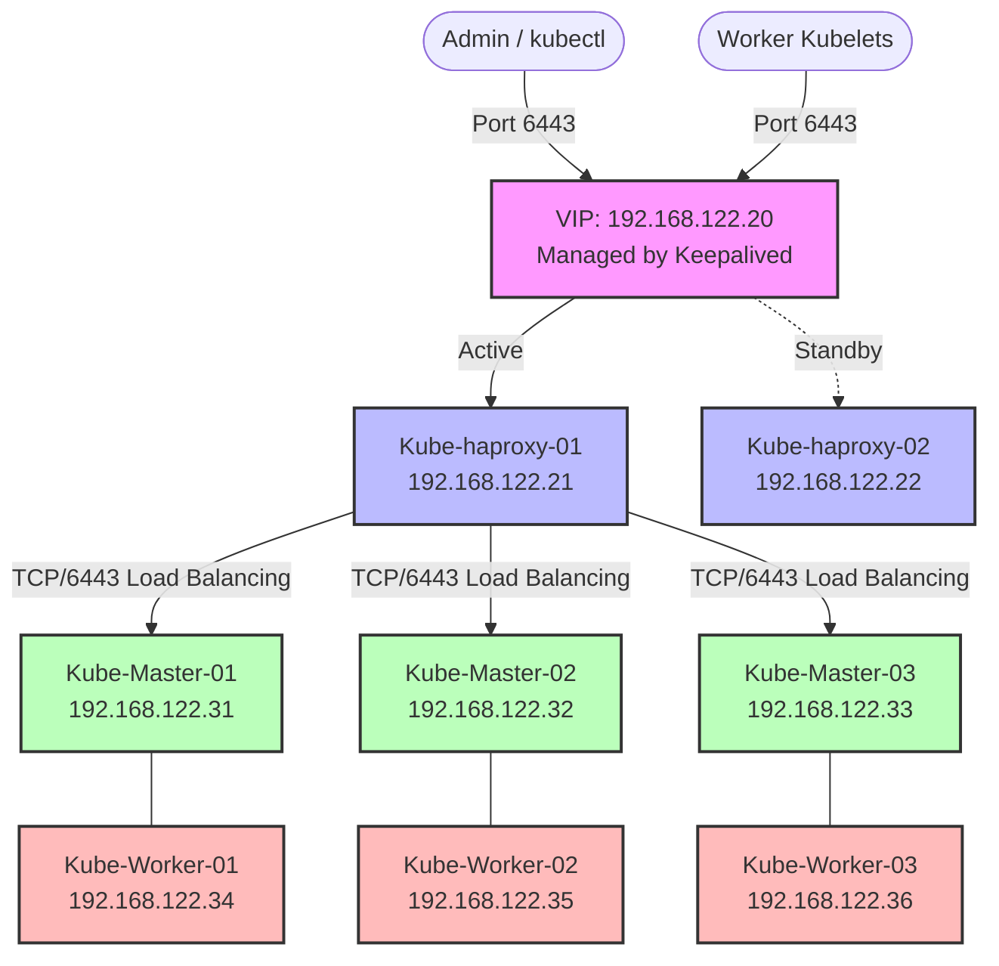

Let's put those formatting glitches behind us. Building a highly available, multi-control-plane Kubernetes cluster requires exact precision. Here is a completely rewritten, comprehensive guide from scratch, complete with architectural diagrams and deep-dive explanations for every configuration step.

# Enterprise Kubernetes 1.36 High Availability Installation Guide

This guide provisions a production-ready Kubernetes v1.36.0 cluster on Ubuntu 24.04 LTS. We utilize **Keepalived** to float a Virtual IP (VIP), **HAProxy** to load balance traffic across the control plane API servers, **containerd** as the CRI, and **Calico** (via the Tigera operator) as the CNI.

## Architecture Overview

In a High Availability (HA) Kubernetes setup, worker nodes and administrators do not communicate with a single master node. Instead, they talk to a Virtual IP (`192.168.122.20`). Keepalived ensures this VIP is always active on a healthy HAProxy node. HAProxy then routes that traffic evenly across your three backend Kubernetes API servers.



> **Important Network Override:** Calico's default pod network is `192.168.0.0/16`. Because your VMs are on the `192.168.122.0/24` subnet, leaving Calico at default will cause routing blackholes. This guide explicitly reconfigures Calico to use `10.244.0.0/16` for pod traffic.

---

## Phase 1: High Availability Front-End

HAProxy serves as a TCP reverse proxy for the Kubernetes API server (port 6443). Keepalived manages the VIP, shifting it to HAProxy-02 if HAProxy-01 goes offline.

*Execute these steps on **Kube-haproxy-01** and **Kube-haproxy-02**.*

**1. Install Core Packages:**

```bash
sudo apt-get update
sudo apt-get install -y haproxy keepalived
```

**2. Configure HAProxy (`/etc/haproxy/haproxy.cfg`):**
Open the file and append this block. It tells HAProxy to listen on port 6443 and round-robin traffic to your three future master nodes, constantly health-checking them.

```haproxy
frontend kubernetes-frontend
    bind *:6443
    mode tcp
    option tcplog
    default_backend kubernetes-backend

backend kubernetes-backend
    mode tcp
    option tcp-check
    balance roundrobin
    server kube-master-01 192.168.122.31:6443 check fall 3 rise 2
    server kube-master-02 192.168.122.32:6443 check fall 3 rise 2
    server kube-master-03 192.168.122.33:6443 check fall 3 rise 2
```

**3. Configure Keepalived (`/etc/keepalived/keepalived.conf`):**
Create the file. Notice that Keepalived runs a script every 2 seconds to check if HAProxy is running. If the script fails, Keepalived drops the VIP, allowing the backup server to claim it.

*(Replace `enp1s0` with your actual network interface name, found via `ip a`)*.

**For Kube-haproxy-01 (The Primary):**

```text
vrrp_script check_haproxy {
    script "killall -0 haproxy"
    interval 2
    weight 2
}

vrrp_instance VI_1 {
    state MASTER
    interface enp1s0
    virtual_router_id 51
    priority 101
    virtual_ipaddress {
        192.168.122.20
    }
    track_script {
        check_haproxy
    }
}
```

**For Kube-haproxy-02 (The Backup):**
Use the exact same configuration above, but change the state and lower the priority so it only takes over if the primary fails:

* Change to `state BACKUP`
* Change to `priority 100`

**4. Start the Load Balancers:**

```bash
sudo systemctl restart haproxy keepalived
sudo systemctl enable haproxy keepalived
```

*(Verify by running `ip a` on Kube-haproxy-01. You should see `192.168.122.20` assigned to the network interface.)*

---

## Phase 2: System Preparation for Kubernetes

Before installing Kubernetes, every node needs swap disabled (so Kubelet can accurately manage memory), specific kernel modules loaded for container networking, and containerd configured as the runtime.

*Execute these steps on **ALL 6 Kubernetes Nodes** (Masters 01-03, Workers 01-03).*

**1. Disable Swap Environment:**

```bash
sudo swapoff -a
sudo sed -i "/swap/s|^/|#/|g" /etc/fstab
```

**2. Load Kernel Modules & Sysctl Parameters:**
Kubernetes requires `overlay` for the container filesystem and `br_netfilter` so that iptables can see bridged traffic.

```bash
cat <<EOF | sudo tee /etc/modules-load.d/k8s.conf
overlay
br_netfilter
EOF

sudo modprobe overlay
sudo modprobe br_netfilter

cat <<EOF | sudo tee /etc/sysctl.d/k8s.conf
net.bridge.bridge-nf-call-iptables  = 1
net.bridge.bridge-nf-call-ip6tables = 1
net.ipv4.ip_forward                 = 1
EOF

sudo sysctl --system
```

**3. Install and Configure Containerd:**
We must explicitly configure containerd to use the `systemd` cgroup driver. If we don't, Kubelet and containerd will use different cgroup managers, causing nodes to become unstable under resource pressure.

```bash
sudo apt-get update
sudo apt-get install -y containerd apt-transport-https ca-certificates curl gpg

sudo mkdir -p /etc/containerd
containerd config default | sudo tee /etc/containerd/config.toml
sudo sed -i "s/SystemdCgroup = false/SystemdCgroup = true/g /etc/containerd/config.toml

sudo systemctl restart containerd
sudo systemctl enable containerd
```

**4. Install Kubeadm, Kubelet, and Kubectl:**
We lock (`hold`) these packages to prevent automatic Ubuntu updates from accidentally upgrading your cluster without warning.

```bash
sudo mkdir -p -m 755 /etc/apt/keyrings
curl -fsSL https://pkgs.k8s.io/core:/stable:/v1.36/deb/Release.key | sudo gpg --dearmor -o /etc/apt/keyrings/kubernetes-apt-keyring.gpg
echo 'deb [signed-by=/etc/apt/keyrings/kubernetes-apt-keyring.gpg] https://pkgs.k8s.io/core:/stable:/v1.36/deb/ /' | sudo tee /etc/apt/sources.list.d/kubernetes.list

sudo apt-get update
sudo apt-get install -y kubelet kubeadm kubectl
sudo apt-mark hold kubelet kubeadm kubectl
```

---

## Phase 3: Control Plane Initialization

We are now ready to bootstrap the cluster. We point the initialization to our VIP so that all future nodes route their traffic through HAProxy.

*Execute these steps **ONLY on Kube-Master-01**.*

**1. Initialize the Cluster:**

* `--upload-certs`: Automatically shares the control plane certificates so other master nodes can join easily.
* `--pod-network-cidr`: Defines our custom `10.244.0.0/16` subnet.

```bash
sudo kubeadm init \
  --control-plane-endpoint "192.168.122.20:6443" \
  --upload-certs \
  --pod-network-cidr=10.244.0.0/16 \
  --kubernetes-version=v1.36.0
```

**2. Configure local `kubectl` access:**

```bash
mkdir -p $HOME/.kube
sudo cp -i /etc/kubernetes/admin.conf $HOME/.kube/config
sudo chown $(id -u):$(id -g) $HOME/.kube/config
```

**3. Install the Calico CNI:**
We use `--server-side` apply for the Tigera Operator to guarantee the large Custom Resource Definitions (CRDs) are fully registered by the API server before we attempt to apply the custom resources file.

```bash
kubectl apply --server-side -f https://raw.githubusercontent.com/projectcalico/calico/v3.32.0/manifests/tigera-operator.yaml

curl -O https://raw.githubusercontent.com/projectcalico/calico/v3.32.0/manifests/custom-resources.yaml
sed -i 's/192.168.0.0\/16/10.244.0.0\/16/g' custom-resources.yaml

kubectl apply -f custom-resources.yaml
```

---

## Phase 4: Joining the Cluster

Once Kube-Master-01 is initialized and Calico is running, you can scale the cluster.

### Join the Remaining Masters

*Execute on **Kube-Master-02** and **Kube-Master-03**.*

If you lost the join command from Phase 3, generate a fresh one on Kube-Master-01 by running `sudo kubeadm token create --print-join-command`, and generate a fresh certificate key by running `sudo kubeadm init phase upload-certs --upload-certs`.

Run the full command on your other two master nodes:

```bash
sudo kubeadm join 192.168.122.20:6443 --token <YOUR_TOKEN> \
  --discovery-token-ca-cert-hash sha256:<YOUR_HASH> \
  --control-plane --certificate-key <YOUR_CERTIFICATE_KEY>
```

### Join the Worker Nodes

*Execute on **Kube-Worker-01**, **02**, and **03**.*

Workers do not need the certificate key or control plane flags. Run the standard join command:

```bash
sudo kubeadm join 192.168.122.20:6443 --token <YOUR_TOKEN> \
  --discovery-token-ca-cert-hash sha256:<YOUR_HASH>
```

---

## Appendix A: Emergency Cluster Reset

If you ever need to tear down a node and start over from scratch, `kubeadm reset` is not enough; it leaves orphaned networking rules and virtual interfaces behind. Run this sequence to ensure a completely clean slate:

```bash
# 1. Safely unmount Kubelet and remove basic K8s files
sudo kubeadm reset -f

# 2. Delete orphaned Calico virtual network interfaces
ip -br link | grep -o 'cali[^@]*' | sudo xargs -r -I {} ip link delete {} 2>/dev/null
sudo ip link delete vxlan.calico 2>/dev/null
sudo ip link delete cali-rx-vxlan 2>/dev/null

# 3. Flush iptables routing rules
sudo iptables -F && sudo iptables -t nat -F && sudo iptables -t mangle -F && sudo iptables -X

# 4. Purge persistent configuration and storage directories
sudo rm -rf /etc/cni/net.d /var/lib/etcd /var/lib/kubelet /var/lib/calico /etc/kubernetes $HOME/.kube

# 5. Restart containerd to clear any hung pod sandboxes
sudo systemctl restart containerd
```