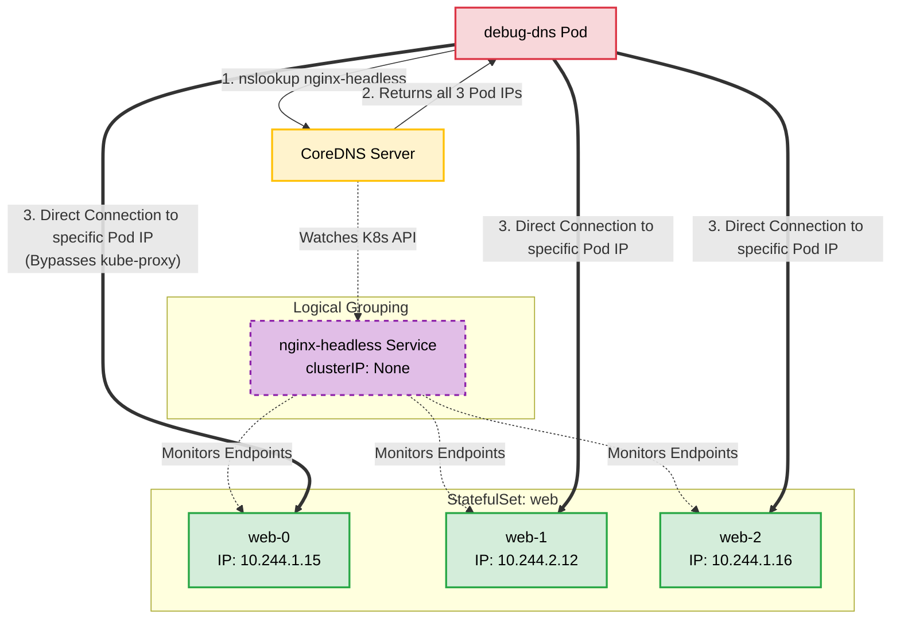

# Kubernetes Headless Services: Concept and Practical Guide

## What is a Headless Service?
A headless service is a Kubernetes Service configured with the property `clusterIP: None`. 

In a standard Kubernetes service, the cluster assigns a single virtual IP address (ClusterIP) that acts as an internal proxy, load-balancing traffic across all the backend pods. With a headless service, no single IP is allocated, and the `kube-proxy` component does not handle these requests. 

Instead, a headless service relies entirely on DNS. When a client application queries the DNS name of the service, the Kubernetes DNS server (CoreDNS) returns multiple `A` records—one for the IP address of each individual pod matching the service selector. This forces the client to handle its own load balancing or allows it to connect directly to a specific pod.

## Primary Use Cases
* **Stateful Applications (Databases & Message Brokers):** Applications like MongoDB, Cassandra, Kafka, and Redis clusters require nodes to communicate directly with specific peers (e.g., a replica syncing directly with a primary node) rather than routing through a load-balanced proxy.
* **Service Discovery:** When an application or framework needs to discover all running instances of a microservice to maintain a persistent connection pool or perform client-side load balancing (like gRPC).
* **StatefulSets:** Headless services are strictly required for Kubernetes `StatefulSets`. They allow Kubernetes to assign stable, predictable DNS hostnames (e.g., `pod-0.service.namespace.svc.cluster.local`) to individual pods.

## Practical Example: Deploying and Testing a Headless Service

In this scenario, we will deploy a 3-replica Nginx StatefulSet backed by a headless service, and then use a temporary DNS troubleshooting pod to observe how CoreDNS routes the traffic.


### 1. Create the Headless Service and StatefulSet
Save the following configuration as `headless-demo.yaml`. Notice the `clusterIP: None` declaration in the Service specification.

```yaml
apiVersion: v1
kind: Service
metadata:
  name: nginx-headless
  namespace: default
spec:
  clusterIP: None  # This explicit declaration makes it a headless service
  selector:
    app: nginx
  ports:
  - port: 80
    name: web
---
apiVersion: apps/v1
kind: StatefulSet
metadata:
  name: web
  namespace: default
spec:
  serviceName: "nginx-headless" # This must match the headless service name
  replicas: 3
  selector:
    matchLabels:
      app: nginx
  template:
    metadata:
      labels:
        app: nginx
    spec:
      containers:
      - name: nginx
        image: nginx:alpine
        ports:
        - containerPort: 80
          name: web

```

Apply the configuration to your cluster:

```bash
kubectl apply -f headless-demo.yaml

```

### 2. Verify the Resources

Wait for the pods to reach the `Running` state:

```bash
kubectl get pods -l app=nginx -o wide

```

*Note the individual IP addresses assigned to `web-0`, `web-1`, and `web-2`.*

Verify the service has no IP assigned:

```bash
kubectl get svc nginx-headless

```

*The `CLUSTER-IP` column will explicitly display `None`.*

### 3. Test DNS Resolution

To test how DNS resolves the headless service, launch an interactive, temporary pod equipped with network tools (`dnsutils`):

```bash
kubectl run -i --tty --rm debug-dns --image=infoblox/dnstools --restart=Never --command -- /bin/sh

```

Once inside the `debug-dns` shell, run an `nslookup` against the service name:

```bash
nslookup nginx-headless.default.svc.cluster.local

```

**Expected Output:**
Unlike a standard service that returns one IP, this query returns the exact IP addresses of all three Nginx pods simultaneously.

```text
Server:         10.96.0.10
Address:        10.96.0.10#53

Name:   nginx-headless.default.svc.cluster.local
Address: 10.244.1.15
Name:   nginx-headless.default.svc.cluster.local
Address: 10.244.2.12
Name:   nginx-headless.default.svc.cluster.local
Address: 10.244.1.16

```

### 4. Test Stateful Pod Hostnames

Because this headless service is bound to a `StatefulSet`, Kubernetes automatically registers individual DNS records for each specific pod.

Inside your `debug-dns` shell, query a specific pod by combining its name with the service name:

```bash
nslookup web-0.nginx-headless.default.svc.cluster.local

```

**Expected Output:**
This resolves directly to the exact IP of the `web-0` pod, demonstrating how headless services enable direct, predictable node-to-node communication.

```text
Server:         10.96.0.10
Address:        10.96.0.10#53

Name:   web-0.nginx-headless.default.svc.cluster.local
Address: 10.244.1.15

```

### 5. Cleanup

Exit the `debug-dns` shell (which will automatically delete the temporary pod), and remove the demo resources from your cluster:

```bash
exit
kubectl delete -f headless-demo.yaml

```
