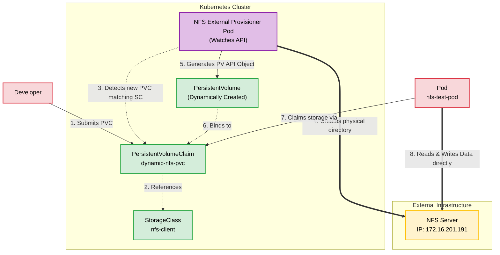

# Kubernetes Dynamic Storage Provisioning (with NFS)

## What is Dynamic Storage Provisioning?
In traditional (static) storage provisioning, a cluster administrator must manually create `PersistentVolume` (PV) objects in advance. When a developer creates a `PersistentVolumeClaim` (PVC) requesting storage, Kubernetes tries to find a pre-existing PV that matches the request. If none exists, the pod remains stuck in a `Pending` state.

**Dynamic Storage Provisioning** automates this entirely. 
Instead of creating PVs manually, the administrator configures a **StorageClass**. When a user submits a PVC referencing that StorageClass, a background "Provisioner" automatically reaches out to the underlying storage backend (like AWS EBS, Ceph, or an NFS server), creates a directory or volume on the fly, and generates the exact PV required to bind to the PVC.



### Why is this important?
* **Zero manual intervention:** Developers get storage instantly on-demand.
* **No wasted space:** Storage is allocated exactly to the size requested, rather than over-provisioning static pools.
* **Automatic cleanup:** When the PVC is deleted, the dynamic provisioner can automatically archive or delete the backend data based on the `reclaimPolicy`.

---

Run these commands directly on your Ubuntu server (`172.16.201.191`) to install and configure the NFS kernel server for Kubernetes dynamic provisioning.

1. **Install the NFS Service**
Update your package manager and install the NFS kernel server package:
```bash
sudo apt update
sudo apt install nfs-kernel-server -y
```

2. **Create the Export Directory**
Create the physical directory that will hold the dynamically provisioned Kubernetes volumes:
```bash
sudo mkdir -p /srv/nfs/kubedata
```

3. **Set Directory Permissions**
Grant wide read/write permissions so the Kubernetes provisioner and running pods can read and write data without ownership conflicts:
```bash
sudo chown nobody:nogroup /srv/nfs/kubedata
sudo chmod 777 /srv/nfs/kubedata
```

4. **Configure the Exports File**
Append the export rules to `/etc/exports`. The `no_root_squash` parameter is strictly required for the Kubernetes external provisioner to create sub-directories dynamically:
```bash
echo "/srv/nfs/kubedata 172.16.201.0/24(rw,sync,no_subtree_check,no_root_squash)" | sudo tee -a /etc/exports
```

*(Note: This restricts access to your `172.16.201.0/24` subnet. Adjust the CIDR if your Kubernetes worker nodes are on a different network).*
5. **Apply and Restart**
Export the new directory share and restart the NFS service to apply the changes:
```bash
sudo exportfs -arv
sudo systemctl restart nfs-kernel-server
sudo systemctl enable nfs-kernel-server
```

6. **Verify the Export**
Confirm that the NFS server is actively sharing the directory:
```bash
sudo showmount -e 172.16.201.191
```

## Example: Dynamic Provisioning using NFS

Vanilla Kubernetes does not have a built-in (in-tree) dynamic provisioner for NFS. To achieve this, we use the official **NFS Subdir External Provisioner**. It watches for PVCs and automatically creates uniquely named sub-directories on your existing NFS server for each claim.

### Prerequisites
For this example, we assume you have an NFS server running and accessible from your Kubernetes nodes.
* **NFS Server IP:** `172.16.201.191` *(Example using your existing server IP)*
* **NFS Export Path:** `/srv/nfs/kubedata` *(Make sure this directory exists on the NFS server and is exported with `no_root_squash`)*
* **Helm Installed:** We will use Helm to quickly deploy the provisioner's RBAC rules and deployment.

---

### Step 1: Install the NFS External Provisioner
Run these commands on your workstation (where `kubectl` and `helm` are installed) to deploy the provisioner into your cluster.

```bash
# Add the official Helm repository
helm repo add nfs-subdir-external-provisioner https://kubernetes-sigs.github.io/nfs-subdir-external-provisioner/
helm repo update

# Install the provisioner (replace IP and Path with your actual NFS details)
helm install nfs-client nfs-subdir-external-provisioner/nfs-subdir-external-provisioner \
    --set nfs.server=172.16.201.191 \
    --set nfs.path=/srv/nfs/kubedata \
    --namespace kube-system
````

**Verification:** Run `kubectl get storageclass`. You should now see a new StorageClass named `nfs-client`.

Bash

```
NAME                   PROVISIONER                                     RECLAIMPOLICY   VOLUMEBINDINGMODE   
nfs-client (default)   cluster.local/nfs-client-nfs-subdir-external-provisioner   Delete          Immediate           
```

### Step 2: Create a PersistentVolumeClaim (PVC)

Now, as a developer, you want 1GB of storage. Notice that you **do not** create a PV. You only create the claim.

Save this as `nfs-pvc.yaml`:

YAML

```
apiVersion: v1
kind: PersistentVolumeClaim
metadata:
  name: dynamic-nfs-pvc
  namespace: default
spec:
  accessModes:
    - ReadWriteMany  # NFS supports multiple pods reading/writing simultaneously
  storageClassName: nfs-client # Points to the dynamic provisioner we just installed
  resources:
    requests:
      storage: 1Gi
```

Apply it:

Bash

```
kubectl apply -f nfs-pvc.yaml
```

**Verification:** Check the status of your PVC:

Bash

```
kubectl get pvc dynamic-nfs-pvc
```

_Expected Output: The status should be `Bound`. If you run `kubectl get pv`, you will see a newly auto-generated PV that was dynamically created for this specific claim._

### Step 3: Create a Pod to Consume the PVC

Deploy a test pod that mounts the dynamic volume and writes some data to it.

Save this as `nfs-pod.yaml`:

YAML

```
apiVersion: v1
kind: Pod
metadata:
  name: nfs-test-pod
  namespace: default
spec:
  containers:
  - name: busybox
    image: busybox
    command: [ "/bin/sh", "-c", "while true; do date >> /mnt/data/time.txt; sleep 5; done" ]
    volumeMounts:
    - name: nfs-storage
      mountPath: /mnt/data
  volumes:
  - name: nfs-storage
    persistentVolumeClaim:
      claimName: dynamic-nfs-pvc
```

Apply it:

Bash

```
kubectl apply -f nfs-pod.yaml
```

**Verification:** Ensure the pod is running:

Bash

```
kubectl get pods nfs-test-pod
```

### Step 4: Verify the Data on the NFS Server

Connect directly to your physical NFS server (`172.16.201.191`) via SSH, and check the contents of the `/srv/nfs/kubedata` directory.

Bash

```
ls -l /srv/nfs/kubedata
```

**Expected Output:** You will see a dynamically generated folder. The provisioner names the folder using the format `namespace-pvcName-pvName` (e.g., `default-dynamic-nfs-pvc-pvc-1a2b3c4d...`).

Check the contents of that folder:

Bash

```
cat /srv/nfs/kubedata/default-dynamic-nfs-pvc-*/time.txt
```

_You will see the timestamps generated by the pod, proving the dynamic storage routing is functioning perfectly._

### Step 5: Cleanup and Reclaim Policy

When you delete the PVC, Kubernetes will automatically look at the StorageClass `reclaimPolicy` (which defaults to `Delete` for this provisioner).

Bash

```
kubectl delete -f nfs-pod.yaml
kubectl delete -f nfs-pvc.yaml
```

**What happens on the NFS server?** Because the policy is `Delete`, the provisioner will automatically delete the generated folder from `/srv/nfs/kubedata` or rename it to `archived-...` (depending on your Helm configuration), completely automating the storage cleanup process.