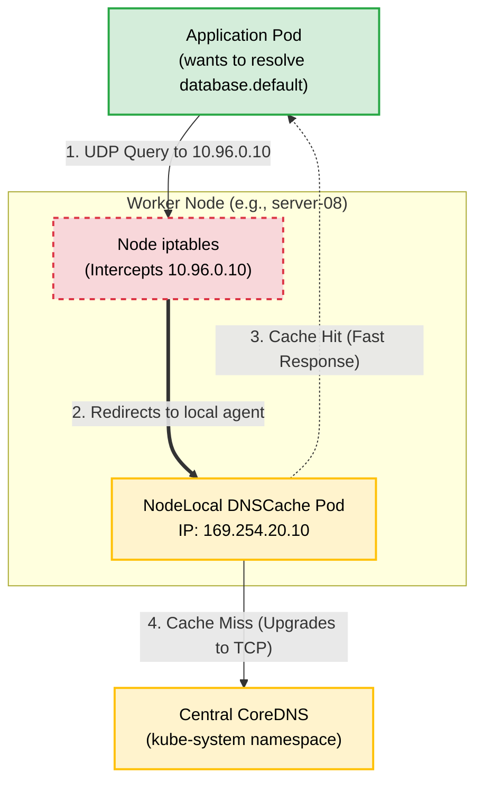

Referring to **NodeLocal DNSCache** (often deployed as the `node-local-dns` DaemonSet). This is a critical enterprise-grade add-on for high-scale Kubernetes clusters.
# Kubernetes NodeLocal DNSCache (Enterprise Local DNS)

## What is NodeLocal DNSCache?
In a standard Kubernetes cluster, all pods send their DNS queries over the network to a central CoreDNS deployment (behind the `kube-dns` Service IP). In large enterprise environments, this creates two major bottlenecks:
1. **Network Overhead & Latency:** High-frequency DNS queries (like microservices resolving database endpoints) flood the network.
2. **Conntrack Exhaustion & UDP Packet Drops:** Standard `kube-proxy` relies on `iptables` and SNAT/DNAT to route traffic to the CoreDNS pods. Under heavy load, the Linux kernel's `conntrack` table can fill up, leading to race conditions and randomly dropped UDP packets (the infamous 5-second DNS delay bug in Kubernetes).

**NodeLocal DNSCache** solves this by deploying a lightweight DNS caching agent (via a `DaemonSet`) on **every single node** in the cluster. 

When a pod makes a DNS request, it is intercepted by the caching agent running on the exact same physical node. If the cache has the answer, it returns it instantly without leaving the node. If it doesn't, the local cache forwards the request via a reliable TCP connection to the central CoreDNS servers.

## Architecture Diagram



---

## Practical Example: Deploy and Test NodeLocal DNSCache

### 1. Identify Your Central DNS IP

First, confirm the ClusterIP of your central `kube-dns` service. In most clusters (including yours, based on previous tests), this is `10.96.0.10`.

```bash
kubectl get svc kube-dns -n kube-system

```

### 2. Download and Configure the NodeLocal Manifest

The official Kubernetes repository provides a template manifest that must be customized with your cluster's details.

Download the manifest:

```bash
curl -sO https://raw.githubusercontent.com/kubernetes/kubernetes/master/cluster/addons/dns/nodelocaldns/nodelocaldns.yaml
```

Use `sed` to inject your cluster variables into the file. The standard local listen IP is `169.254.20.10`, the cluster domain is `cluster.local`, and your central DNS is `10.96.0.10`:

```bash
sed -i 's/__PILLAR__LOCAL__DNS__/169.254.20.10/g' nodelocaldns.yaml
sed -i 's/__PILLAR__DNS__DOMAIN__/cluster.local/g' nodelocaldns.yaml
sed -i 's/__PILLAR__DNS__SERVER__/10.96.0.10/g' nodelocaldns.yaml

```

### 3. Deploy the DaemonSet

Apply the configured manifest to your cluster:

```bash
kubectl apply -f nodelocaldns.yaml

```

Verify that the DaemonSet has successfully spun up a caching pod on every single node (including control planes and workers):

```bash
kubectl get daemonset node-local-dns -n kube-system

```

*Expected Output: You should see the `DESIRED` and `READY` counts match your total number of nodes (e.g., 6/6).*

---

### 4. Test the Local DNS Cache

Now, let's verify that queries are being intercepted and handled by the local cache.

Launch your DNS debugging pod:

```bash
kubectl run -i --tty --rm debug-dns --image=docker.devneeds.ir/infoblox/dnstools --restart=Never --command -- /bin/sh

```

**Test A: Query the Central DNS IP**
Run a standard query. The pod still thinks it is talking to `10.96.0.10`.

```bash
nslookup kubernetes.default.svc.cluster.local

```

*Notice that the command succeeds, but to prove the local cache is actually intercepting it, we must query the local cache IP directly.*

**Test B: Query the NodeLocal Listen IP**
Force the `nslookup` command to query the NodeLocal agent's dedicated dummy IP (`169.254.20.10`):

```bash
nslookup kubernetes.default.svc.cluster.local 169.254.20.10

```

*Expected Output:*

```text
Server:         169.254.20.10
Address:        169.254.20.10#53

Name:   kubernetes.default.svc.cluster.local
Address: 10.96.0.1

```

*If this returns the correct `10.96.0.1` address, your NodeLocal DNSCache is successfully running on the node, accepting queries, and resolving them!*

### 5. Verify Cache Metrics (Enterprise Verification)

To see exactly how many queries the local cache is saving from hitting your central network, you can curl the metrics endpoint of the local agent directly from the host node.

Exit the `debug-dns` pod, then run this command on your control plane terminal to check the cache hits on that specific node:

```bash
curl -s http://169.254.20.10:9253/metrics | grep coredns_cache_hits_total
```

*As your cluster runs, this number will increase, representing network traffic that was successfully kept entirely local to the physical node.*
