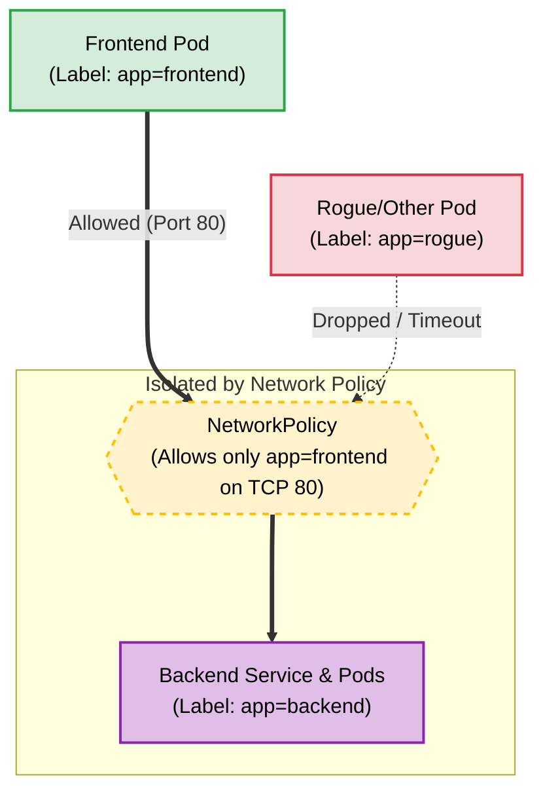

# Kubernetes Network Policies: Concept and Practical Guide

## What is a Network Policy?
By default, Kubernetes clusters have a "flat" network architecture. This means **all pods can communicate with all other pods** across any namespace without restriction. 

A **NetworkPolicy** acts as an internal firewall for your cluster. It operates at the IP and port level (OSI Layer 3 and 4) to control traffic flow. When you apply a NetworkPolicy to a specific pod (using labels), that pod becomes "isolated." Once isolated, the pod will reject all incoming (Ingress) or outgoing (Egress) traffic except for the explicit paths you allow in your policy rules.

> **CRITICAL REQUIREMENT:** Network Policies are not enforced by Kubernetes itself; they are enforced by your cluster's Container Network Interface (CNI) plugin. Your cluster must be running a CNI that supports Network Policies (such as **Calico, Cilium, or Weave**). If you are using standard Flannel, the policies will be accepted by the API but completely ignored in practice.

## Architecture Diagram



---

## Practical Example: Securing a Backend Service

In this scenario, we will deploy a backend web server and two client pods: a `frontend` pod and a `rogue` pod. We will verify that both can reach the backend by default, and then apply a Network Policy to block the `rogue` pod while allowing the `frontend` pod.

### 1. Create a Dedicated Namespace

Create a namespace to keep the demo organized:

```bash
kubectl create namespace policy-demo

```

### 2. Deploy the Backend, Frontend, and Rogue Pods

Save the following configuration as `netpol-demo.yaml`. This deploys an Nginx backend with a service, plus two idle testing pods using the DNS tools image you already have cached.

```yaml
# 1. The Backend Deployment and Service
apiVersion: apps/v1
kind: Deployment
metadata:
  name: backend
  namespace: policy-demo
spec:
  replicas: 1
  selector:
    matchLabels:
      app: backend
  template:
    metadata:
      labels:
        app: backend
    spec:
      containers:
      - name: nginx
        image: nginx:alpine
        ports:
        - containerPort: 80
---
apiVersion: v1
kind: Service
metadata:
  name: backend-svc
  namespace: policy-demo
spec:
  selector:
    app: backend
  ports:
  - port: 80
    targetPort: 80
---
# 2. The Authorized Frontend Pod
apiVersion: v1
kind: Pod
metadata:
  name: frontend
  namespace: policy-demo
  labels:
    app: frontend
spec:
  containers:
  - name: test-tools
    image: docker.devneeds.ir/infoblox/dnstools
    command: ["/bin/sh", "-c", "sleep 3600"]
---
# 3. The Unauthorized Rogue Pod
apiVersion: v1
kind: Pod
metadata:
  name: rogue
  namespace: policy-demo
  labels:
    app: rogue
spec:
  containers:
  - name: test-tools
    image: docker.devneeds.ir/infoblox/dnstools
    command: ["/bin/sh", "-c", "sleep 3600"]

```

Apply the resources:

```bash
kubectl apply -f netpol-demo.yaml

```

Wait for all pods to show as `Running`: `kubectl get pods -n policy-demo`

### 3. Test Default Unrestricted Connectivity

Before applying any policies, prove that the network is wide open.

Test from the **Frontend** (Should succeed):

```bash
kubectl exec -it frontend -n policy-demo -- curl -s --connect-timeout 3 http://backend-svc

```

Test from the **Rogue** pod (Should succeed):

```bash
kubectl exec -it rogue -n policy-demo -- curl -s --connect-timeout 3 http://backend-svc

```

*Expected Output: Both commands will return the raw HTML of the Nginx welcome page.*

### 4. Apply the Network Policy

Save this file as `backend-policy.yaml`. This policy targets pods labeled `app: backend` and dictates that they can **only** receive ingress traffic on TCP Port 80 from pods labeled `app: frontend`.

```yaml
apiVersion: networking.k8s.io/v1
kind: NetworkPolicy
metadata:
  name: secure-backend
  namespace: policy-demo
spec:
  podSelector:
    matchLabels:
      app: backend  # This isolates the backend pod
  policyTypes:
  - Ingress
  ingress:
  - from:
    - podSelector:
        matchLabels:
          app: frontend  # Only allows traffic from frontend
    ports:
    - protocol: TCP
      port: 80

```

Apply the policy:

```bash
kubectl apply -f backend-policy.yaml

```

### 5. Verify the Policy Enforcement

Run the exact same connectivity tests again.

Test from the **Frontend** (Should still succeed):

```bash
kubectl exec -it frontend -n policy-demo -- curl -s --connect-timeout 3 http://backend-svc

```

*Expected Output: The HTML Nginx welcome page.*

Test from the **Rogue** pod (Should now be blocked):

```bash
kubectl exec -it rogue -n policy-demo -- curl -s --connect-timeout 3 http://backend-svc

```

*Expected Output: The command will hang and eventually return a `curl: (28) Connection timed out` error, proving that the Network Policy successfully dropped the rogue traffic.*

### 6. Cleanup

Once you have verified the behavior, remove the test namespace:

```bash
kubectl delete namespace policy-demo

```
