# Kubernetes Advanced Networking: Replacing kube-proxy with Cilium

## What is Cilium and Can it Replace kube-proxy?
Yes, it is entirely possible and increasingly standard in enterprise environments to completely remove `kube-proxy` and replace it with **Cilium**.

Cilium is a Container Network Interface (CNI) plugin built fundamentally on **eBPF** (Extended Berkeley Packet Filter). eBPF allows sandboxed programs to run directly within the Linux kernel without changing kernel source code or loading modules. When you enable Cilium's `kubeProxyReplacement` mode, Cilium takes over all Kubernetes Service routing, load balancing, and Network Policy enforcement directly at the kernel socket layer, bypassing the traditional Linux networking stack.

## Why Replace kube-proxy? (The Reasons)

1. **Performance and Scalability (O(1) vs O(n)):** 
   Standard `kube-proxy` relies on `iptables` or `IPVS`. As your cluster grows to hundreds of services, `iptables` evaluates rules sequentially (O(n)). This causes massive CPU overhead and high latency for network routing updates. Cilium uses eBPF hash tables, providing O(1) lookups that remain near-instantaneous regardless of cluster size.
2. **Direct Server Return (DSR):**
   In standard Kubernetes, when external traffic hits a NodePort, the node proxies the traffic to the destination pod. When the pod replies, the response must travel back through the original proxy node, creating a network bottleneck. Cilium enables DSR, allowing the destination pod to send the response packet directly back to the external client.
3. **Advanced L7 Observability and Security:**
   Because eBPF hooks into the kernel at the socket level, Cilium natively understands HTTP, gRPC, and DNS. You can write Network Policies that block specific HTTP paths (e.g., `POST /api/v1/admin`) rather than just blocking IP addresses and TCP ports.
4. **Eliminating SNAT Exhaustion:**
   Bypassing `iptables` prevents the kernel's `conntrack` table from filling up during high-traffic bursts, eliminating the notorious 5-second DNS timeout bug in Kubernetes.

## Architecture Comparison

```mermaid
graph TD
    classDef standard fill:#f8d7da,stroke:#dc3545,stroke-width:2px,color:#000;
    classDef ebpf fill:#d4edda,stroke:#28a745,stroke-width:2px,color:#000;
    classDef pod fill:#e1bee7,stroke:#8e24aa,stroke-width:2px,color:#000;

    subgraph "Standard kube-proxy (iptables)"
        PodA1[Client Pod]:::pod -->|"1. Packet out"| IPT1["iptables (Node A)<br/>Traverse sequential rules"]:::standard
        IPT1 -.->|"2. NAT & Routing"| IPT2["iptables (Node B)"]:::standard
        IPT2 -->|"3. Packet in"| PodB1[Target Pod]:::pod
    end

    subgraph "Cilium kube-proxy Replacement (eBPF)"
        PodA2[Client Pod]:::pod -->|"1. Socket syscall intercepted"| EBPF1["eBPF Map (Node A)<br/>O(1) Hash Lookup"]:::ebpf
        EBPF1 ===>|"2. Direct Encapsulated Route<br/>(Bypasses iptables entirely)"| EBPF2["eBPF Hook (Node B)"]:::ebpf
        EBPF2 -->|"3. Packet in"| PodB2[Target Pod]:::pod
    end

```



---

## Practical Scenario: Migrating to Cilium Strict Mode

To test this on your cluster, you must remove the existing `kube-proxy` DaemonSet, clean up the legacy `iptables` rules, and deploy Cilium with proxy replacement enabled.

### 1. Remove the Existing kube-proxy

Run these commands from your control plane node (`server-05`) to delete the `kube-proxy` DaemonSet and prevent it from respawning:

```bash
# Delete the daemonset
kubectl delete ds kube-proxy -n kube-system

# Clean up the kube-proxy config map (optional, prevents accidental restore)
kubectl delete cm kube-proxy -n kube-system

```

### 2. Flush Legacy iptables Rules on All Nodes

You must SSH into **every node** in your cluster (`server-05` through `server-10`) and execute this command to clear out the old routing rules left behind by `kube-proxy`:

```bash
sudo iptables-save | grep -v KUBE | sudo iptables-restore

```

### 3. Deploy Cilium via Helm

Install the Cilium CLI and deploy Cilium using Helm. Because `kube-proxy` is gone, Cilium needs to know the exact IP and port of your Kubernetes API server (`172.16.201.194:6443`) to establish its initial connection.

```bash
# Add the Helm repository
helm repo add cilium [https://helm.cilium.io/](https://helm.cilium.io/)
helm repo update

# Install Cilium with kubeProxyReplacement enabled
helm install cilium cilium/cilium --version 1.15.0 \
  --namespace kube-system \
  --set kubeProxyReplacement=true \
  --set k8sServiceHost=172.16.201.194 \
  --set k8sServicePort=6443 \
  --set hubble.relay.enabled=true \
  --set hubble.ui.enabled=true

```

### 4. Verify the eBPF Takeover

Install the Cilium CLI tool on your master node to verify the cluster state:

```bash
CILIUM_CLI_VERSION=$(curl -s https://raw.githubusercontent.com/cilium/cilium-cli/main/stable.txt)
CLI_ARCH=amd64
curl -L --fail --remote-name-all https://github.com/cilium/cilium-cli/releases/download/${CILIUM_CLI_VERSION}/cilium-linux-${CLI_ARCH}.tar.gz
sudo tar xzvfC cilium-linux-${CLI_ARCH}.tar.gz /usr/local/bin

# Check the strict replacement status
cilium status
```

*Expected Output Verification:* Look for the line `KubeProxyReplacement: True`. If it says `False` or `Partial`, the strict mode failed to initialize (usually because legacy iptables rules were not flushed properly).

### 5. Run the Automated Connectivity Test

Cilium provides a comprehensive, automated testing suite that deploys multiple pods across your nodes and tests intra-node, inter-node, LoadBalancer, and Network Policy routing exclusively via eBPF.

```bash
cilium connectivity test
```

*Expected Result:* The tool will execute dozens of network scenarios. A 100% pass rate confirms that eBPF is successfully managing all Layer 3, 4, and 7 traffic in your cluster without `kube-proxy`.*
