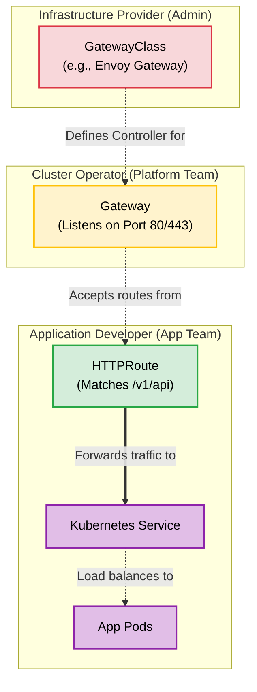

# Kubernetes Gateway API: The Modern Replacement for Ingress

## What is the Gateway API?
For years, the `Ingress` API was the standard way to route external HTTP traffic into a Kubernetes cluster. However, `Ingress` was overly simplistic—it only natively supported basic host and path matching. To handle advanced routing (like header matching, traffic splitting, or timeouts), users were forced to rely on a messy, vendor-specific web of annotations (e.g., `nginx.ingress.kubernetes.io/rewrite-target`).

The **Gateway API** is the official evolution and successor to Ingress. It is expressive, extensible, and natively supports advanced traffic routing. 

Most importantly, it introduces a **Role-Oriented Architecture** that separates network management into three distinct layers, matching how actual teams work:
1. **GatewayClass (Infrastructure Provider):** Defines *what* underlying load balancer controller is available (e.g., Envoy, Cilium, AWS ALB).
2. **Gateway (Cluster Operator):** Instantiates the load balancer and defines *where* it listens (e.g., Port 80, Port 443, TLS certificates).
3. **HTTPRoute (App Developer):** Defines *how* traffic is routed to the application services (e.g., path matching, header routing, canary deployments).

## Architecture Diagram



---

## Practical Scenario: Installing and Using Envoy Gateway

Because the Gateway API is just a specification, you need a controller to actually process the traffic. Since you recently explored Cilium, you could use Cilium's built-in Gateway API, but for this standalone tutorial, we will use **Envoy Gateway**, the CNCF's official reference implementation.

### 1. Install the Gateway API CRDs

Because the Gateway API is relatively new, its Custom Resource Definitions (CRDs) are not bundled into the core Kubernetes binary by default. You must install them first:

```bash
kubectl apply -f https://github.com/kubernetes-sigs/gateway-api/releases/download/v1.0.0/standard-install.yaml

```

### 2. Install the Envoy Gateway Controller

Install the Envoy Gateway controller, which will watch for your Gateway API resources and automatically deploy Envoy proxy instances.

```bash
helm repo add envoyproxy https://envoyproxy.github.io/ingress-envoy
helm repo update
helm install eg envoyproxy/gateway -n envoy-gateway-system --create-namespace

```

*Verification:* Wait a moment and run `kubectl get pods -n envoy-gateway-system` to ensure the controller is running.

### 3. Deploy Sample Applications

We will deploy two simple backend applications (`app-a` and `app-b`) to demonstrate path-based routing.

Save this as `apps.yaml`:

```yaml
apiVersion: apps/v1
kind: Deployment
metadata:
  name: app-a
spec:
  replicas: 1
  selector:
    matchLabels:
      app: app-a
  template:
    metadata:
      labels:
        app: app-a
    spec:
      containers:
      - name: web
        image: hashicorp/http-echo
        args: ["-text=Welcome to Application A"]
        ports:
        - containerPort: 5678
---
apiVersion: v1
kind: Service
metadata:
  name: app-a-svc
spec:
  selector:
    app: app-a
  ports:
  - port: 80
    targetPort: 5678
---
apiVersion: apps/v1
kind: Deployment
metadata:
  name: app-b
spec:
  replicas: 1
  selector:
    matchLabels:
      app: app-b
  template:
    metadata:
      labels:
        app: app-b
    spec:
      containers:
      - name: web
        image: hashicorp/http-echo
        args: ["-text=Welcome to Application B"]
        ports:
        - containerPort: 5678
---
apiVersion: v1
kind: Service
metadata:
  name: app-b-svc
spec:
  selector:
    app: app-b
  ports:
  - port: 80
    targetPort: 5678

```

Apply the apps:

```bash
kubectl apply -f apps.yaml

```

### 4. Create the Gateway (The Load Balancer)

Now we define the `Gateway`. This tells Envoy to actually spin up a proxy pod that listens on port 80.

Save this as `gateway.yaml`:

```yaml
apiVersion: gateway.networking.k8s.io/v1
kind: Gateway
metadata:
  name: demo-gateway
  namespace: default
spec:
  gatewayClassName: eg  # This tells Kubernetes to use Envoy Gateway
  listeners:
  - name: http
    protocol: HTTP
    port: 80

```

Apply the Gateway:

```bash
kubectl apply -f gateway.yaml

```

*Verification:* Run `kubectl get gateway`. Envoy Gateway will automatically provision a LoadBalancer service for this Gateway. Note the External IP or ClusterIP assigned to it.

### 5. Create the HTTPRoute (The Routing Rules)

Finally, we act as the Application Developer. We create an `HTTPRoute` that attaches to our `demo-gateway` and routes traffic based on the URL path.

Save this as `route.yaml`:

```yaml
apiVersion: gateway.networking.k8s.io/v1
kind: HTTPRoute
metadata:
  name: demo-route
  namespace: default
spec:
  parentRefs:
  - name: demo-gateway  # Attaches this route to the Gateway we just created
  rules:
  - matches:
    - path:
        type: PathPrefix
        value: /app-a
    backendRefs:
    - name: app-a-svc
      port: 80
  - matches:
    - path:
        type: PathPrefix
        value: /app-b
    backendRefs:
    - name: app-b-svc
      port: 80

```

Apply the Route:

```bash
kubectl apply -f route.yaml

```

### 6. Test the End-to-End Routing

Retrieve the IP address of the Envoy proxy that was automatically generated for your Gateway:

```bash
export GATEWAY_IP=$(kubectl get svc -n envoy-gateway-system -l gateway.envoyproxy.io/owning-gateway-name=demo-gateway -o jsonpath='{.items[0].spec.clusterIP}')

```

Now, use `curl` to test the routing rules.

**Test App A:**

```bash
curl http://$GATEWAY_IP/app-a

```

*Expected Output: `Welcome to Application A*`

**Test App B:**

```bash
curl http://$GATEWAY_IP/app-b

```

*Expected Output: `Welcome to Application B*`

**Test an Unmatched Route:**

```bash
curl http://$GATEWAY_IP/unknown

```

*Expected Output: HTTP 404 Not Found (Envoy drops the traffic because no HTTPRoute matches).*

---

# Using Legacy Ingress with a Gateway API Controller

Even after migrating to a modern Gateway API controller like Envoy Gateway or Cilium, you can still deploy standard Kubernetes `Ingress` resources. The modern controller intercepts these legacy objects and processes them using its advanced routing engine.

## Practical Example: Deploying a Legacy Ingress

Assume you still have the `app-a` and `app-b` services running from the previous Gateway API tutorial. Instead of creating a `Gateway` and an `HTTPRoute` object, you can deploy this single `Ingress` manifest.

### 1. Create the Ingress Manifest
Save the following configuration as `legacy-ingress.yaml`. Notice the `ingressClassName` field—this is how you tell the new controller to take ownership of this legacy object.

```yaml
apiVersion: networking.k8s.io/v1
kind: Ingress
metadata:
  name: demo-legacy-ingress
  namespace: default
  annotations:
    # Legacy annotations are typically still parsed and supported by the new controllers
    # to ensure backward compatibility.
    nginx.ingress.kubernetes.io/rewrite-target: /
spec:
  ingressClassName: eg  # Use 'eg' for Envoy Gateway, or 'cilium' if using Cilium
  rules:
  - host: legacy.devsecops.com
    http:
      paths:
      - path: /app-a
        pathType: Prefix
        backend:
          service:
            name: app-a-svc
            port:
              number: 80
      - path: /app-b
        pathType: Prefix
        backend:
          service:
            name: app-b-svc
            port:
              number: 80

```

### 2. Apply and Verify

Apply the manifest to your cluster:

```bash
kubectl apply -f legacy-ingress.yaml

```

Check the status of the Ingress:

```bash
kubectl get ingress demo-legacy-ingress

```

*Verification:* Under the `ADDRESS` column, Kubernetes will populate the IP of the Envoy Gateway or Cilium load balancer, proving the modern controller has successfully adopted the legacy Ingress.

### 3. How It Works Under the Hood

When you apply this file, the Gateway API controller automatically parses the `Ingress` rules and translates them internally.

Because the controller handles the translation, you get the exact same Envoy proxy or eBPF routing performance as if you had written native `Gateway` and `HTTPRoute` manifests. This allows you to swap out your underlying infrastructure immediately while updating your application YAML files gradually without breaking your existing CI/CD pipelines.

---

Here is a complete, all-in-one manifest that deploys the backend applications, the Gateway, and the HTTPRoute together so you can test a guaranteed working scenario of the native Gateway API.

Save the following configuration as `working-gateway-demo.yaml`:

```yaml
# 1. Backend Application A
apiVersion: apps/v1
kind: Deployment
metadata:
  name: app-a
  namespace: default
spec:
  replicas: 1
  selector:
    matchLabels:
      app: app-a
  template:
    metadata:
      labels:
        app: app-a
    spec:
      containers:
      - name: web
        image: hashicorp/http-echo
        args: ["-text=Working response from App A!"]
        ports:
        - containerPort: 5678
---
apiVersion: v1
kind: Service
metadata:
  name: app-a-svc
  namespace: default
spec:
  selector:
    app: app-a
  ports:
  - port: 80
    targetPort: 5678
---
# 2. Backend Application B
apiVersion: apps/v1
kind: Deployment
metadata:
  name: app-b
  namespace: default
spec:
  replicas: 1
  selector:
    matchLabels:
      app: app-b
  template:
    metadata:
      labels:
        app: app-b
    spec:
      containers:
      - name: web
        image: hashicorp/http-echo
        args: ["-text=Working response from App B!"]
        ports:
        - containerPort: 5678
---
apiVersion: v1
kind: Service
metadata:
  name: app-b-svc
  namespace: default
spec:
  selector:
    app: app-b
  ports:
  - port: 80
    targetPort: 5678
---
# 3. The Gateway (Provisions the Envoy Proxy)
apiVersion: gateway.networking.k8s.io/v1
kind: Gateway
metadata:
  name: working-gateway
  namespace: default
spec:
  gatewayClassName: eg
  listeners:
  - name: http
    protocol: HTTP
    port: 80
---
# 4. The HTTPRoute (Maps URLs to Services)
apiVersion: gateway.networking.k8s.io/v1
kind: HTTPRoute
metadata:
  name: working-route
  namespace: default
spec:
  parentRefs:
  - name: working-gateway
  rules:
  - matches:
    - path:
        type: PathPrefix
        value: /app-a
    backendRefs:
    - name: app-a-svc
      port: 80
  - matches:
    - path:
        type: PathPrefix
        value: /app-b
    backendRefs:
    - name: app-b-svc
      port: 80

```

When you apply this manifest, the Envoy Gateway controller detects the new `Gateway` resource and automatically orchestrates the infrastructure required to handle the traffic. Unlike legacy Ingress, which typically shares a single massive proxy for the entire cluster, Envoy Gateway dynamically provisions dedicated resources just for this specific Gateway.

Once these four phases complete, the Gateway IP is ready to accept `curl` requests and route them to the correct backend services.